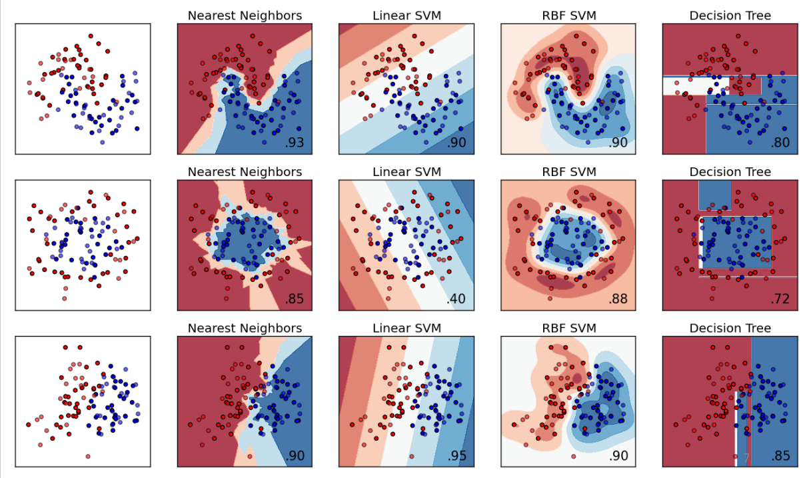

## Ch4 Nonparametric techniques

Ch3 中，我们假设 probability density function (PDF) 是已知的，然而这是非常不合理的事情，实际的数据分布经常就不会和假设的分布一致，这些做法称为 ***parametric techniques***

这一章则是会介绍不依赖于对 probability density function 做假设的 ***nonparametric techniques***

- Instead, the proper form for discriminant  function is assumed, e.g., neural network, SVM.
- Training samples are used to estimate values of parameters of the classifier.
- Sub-optimal, but simple to use.

