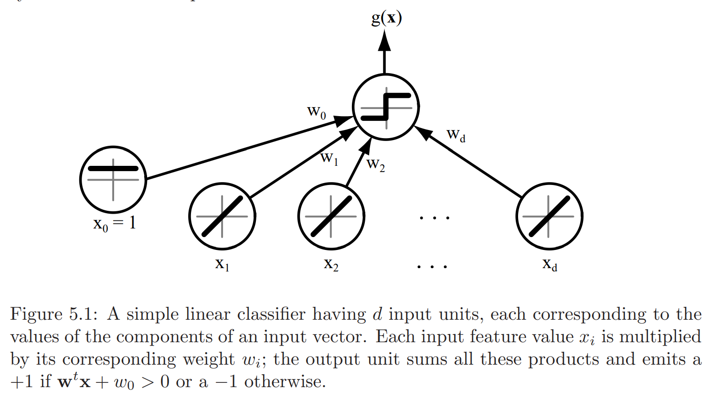
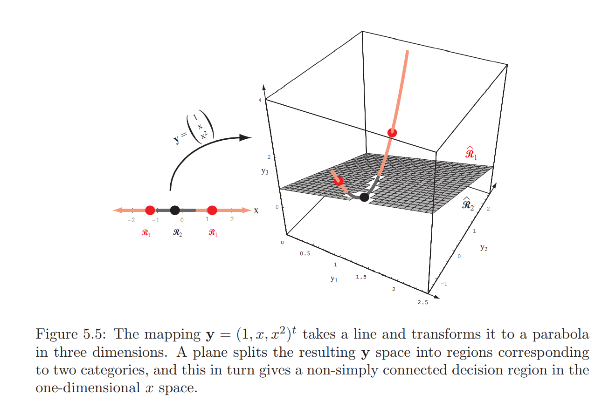
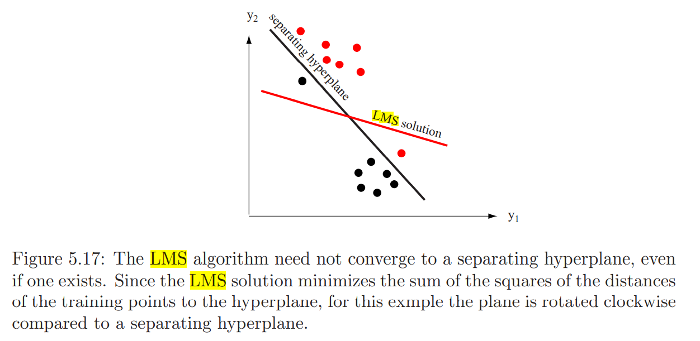
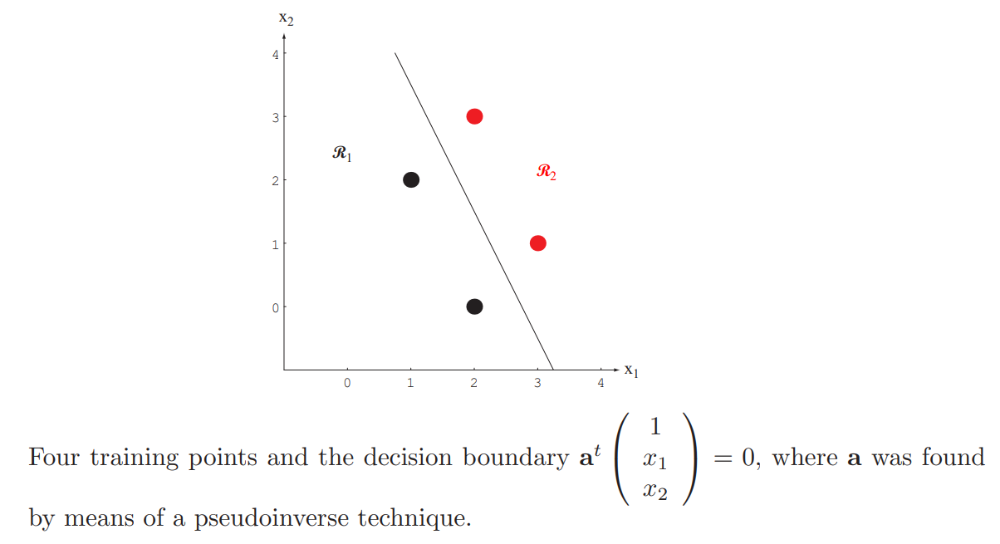
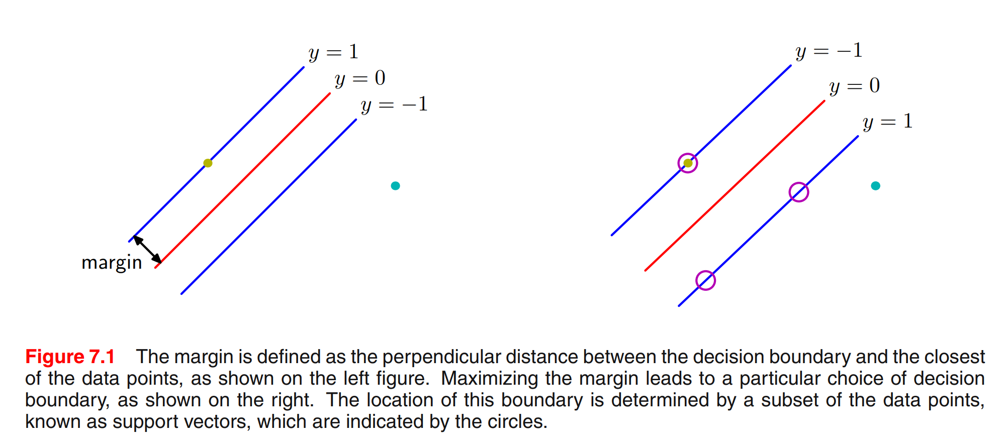
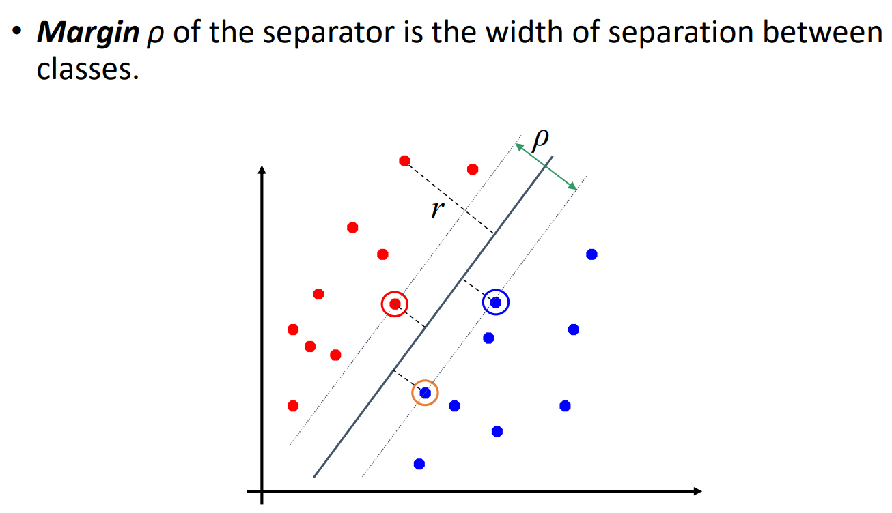
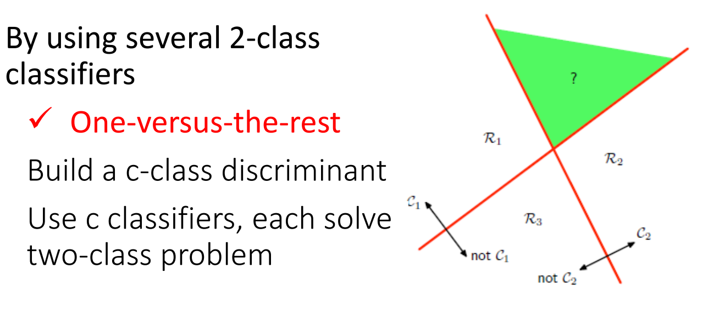
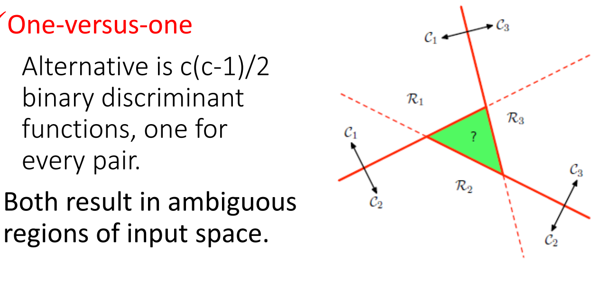

# Ch5 Linear Discriminant Functions

## 5.1 Introduction

Ch3 的时候，我们假设过已知概率密度，然后用样本来估计这个概率分布的参数

这一章，我们则是会假设我们知道 *discriminant function* 的正确形式，然后用样本来估计分类器当中的参数

## 5.2 Linear Discriminant Functions and Decision Surfaces

### 5.2.1 The Two-Category Case

discriminant function 是关于 $\textbf{x}$ 的线性组合：

$$
g(\textbf{x})=\textbf{w}^t\textbf{x}+\omega_0
$$

其中：
- $\textbf{w}$: weight vector
- $\omega_0$: bias (或者叫 threshold weight)

对应的 decision rule 如下：
> Decide $\omega_1$ if $g(\textbf{x})>0$ and $\omega_2$ if $g(\textbf{x})<0$

也就是说，可以看作是 inner product $\textbf{w}^t\textbf{x}$ 和 threshold $-\omega_0$ 比大小

一个并不怎么直观的例子：

---

显然 $g(x)=0$ 的情况定义了 decision surface，鉴于它是线性的函数，所以这个平面也是 ***hyperplane***

discriminant function 其实给了一种计算任意点 (向量) $\textbf{x}$ 到分割的超平面的方法。推导过程如下：

先把 $\textbf{x}$ 表示成：

$$
\textbf{x}=\textbf{x}_p+r\frac{\textbf{w} }{||\textbf{w}||}\tag{1}
$$

其中：
- $\textbf{x}_p$: 是点 $\textbf{x}$ 在超平面上的投影
- $r$: 我们需要求解的距离，非向量

!!! note
    上式是个向量运算

鉴于 $\textbf{x}_p$ 在超平面上，所以满足：

$$
g(\textbf{x}_p)=\textbf{w}^t\textbf{x}_p+\omega_0=0\\
\rArr \textbf{x}_p=-\frac{\omega_0}{\textbf{w}^t}\tag{2}
$$

带入到 式子(1) 中得到：

$$
\textbf{x}=-\frac{\omega_0}{\textbf{w}^t}+r\frac{\textbf{w} }{\textbf{||w||} }
$$

于是乎：

$$
\begin{align*}
g(\textbf{x})&=\textbf{w}^t\textbf{x}+\omega_0\\
&=\textbf{w}^t(-\frac{\omega_0}{\textbf{w}^t}+r\frac{\textbf{w} }{\textbf{||w||} })+\omega_0\\
&=r\frac{\textbf{w} }{||\textbf{w}||}\cdot \textbf{w}^t\\
&=r||\textbf{w}||
\end{align*}
$$

!!! note
    $\textbf{w}\cdot\textbf{w}^t=||\textbf{w}||^2$，仔细想想

所以终于可以把距离表示出来了：
$$
r=\frac{g(\textbf{x})}{||\textbf{w}||}
$$

这个式子的特殊情况就是原点到超平面的距离，可以带入得到：
$$
r=\frac{\omega_0}{||\textbf{w}||}
$$

### 5.2.2 The Multicategory Case

比较重要的一点是，多分类的情况下 decision region 也是 convex 的（假如两点落在了同一个类中，那么他们连线上的所有点也会落在这个类）

## 5.3 Generalized Linear Discriminant Functions

***generalized linear discriminant function***:
$$
g({\bf x})=\sum_{i=1}^{\tilde{d} }a_{i}y_{i}({\bf x})
$$

比方说考虑一点特殊的情况，让 quadratic discriminant function 定义成：

$$
g(x)=a_{1}+a_{2}x+a_{3}x^{2},
$$

这时候对应的 $y$ 就是：
$$
\mathbf{y}={\left(\begin{array}{l}{1}\\ {x}\\ {x^{2} }\end{array}\right)}
$$

---

假如我们把常数项看作是 $x_0=1$ 的情况下 $\omega_0\cdot x_0$ 的话，那么原本的 discriminant function 里的 feature vector $\textbf{x}$ 就相当于多了一项 1：

$$
\mathbf{y}={\left[\begin{array}{l}{1}\\ {x_{1} }\\ {\vdots}\\ {x_{d} }\end{array}\right]}={\left[\begin{array}{l}{1}\\ {\mathbf{x} }\end{array}\right]}
$$

权重向量同样也多了一项 $\omega_0$：

$$
{\bf a}=\left[\begin{array}{c}{ {w_{0} }}\\ { {w_{1} }}\\ { {\vdots} }\\ { {w_{d} }}\end{array}\right]=\left[\begin{array}{c}{ {w_{0} }}\\ { {\textbf{w} }}\end{array}\right]
$$

这俩叫做 ***augmented vector***

原本的 discriminant function 于是可以去掉常数项，然后 vector 所在的维度高了一维，且超平面此时可以穿过原点

## 5.4 The Two-Category Linearly-Separable Case

### 5.4.1 Geometry and Terminology

记得在 [5.3](#53-generalized-linear-discriminant-functions) 的时候，我们提到了将常数项合并进去的做法，所以现在：
- $\textbf{y}$: 对应原本的 $\textbf{x}$
- $\textbf{a}$: 对应原本的 $\textbf{w}$

反正现在 discriminant function 变成了：

$$
g(x)=a^ty
$$

正常来说，当 $g(x)$ 大于 0 的时候分为 $\omega_1$，而 $g(x)$ 小于 0 的时候分为 $\omega_2$

然而，为了让计算更加简单，我们采用一种 "normalization" 的方法：让隶属于 $\omega_2$ 的样本全部取反，这样我们就可以==以所有样本==为基础，计算出满足 $a^ty_i>0$ 的 weight vector $a$

!!! note
    这里还有个 margin 的概念，不知道重不重要

### 5.4.2 Gradient Descent Procedures

另一种获得结果的方法则不是把不等式强行变成等式，而是定义一个 criterion function $J(a)$，来让这个 criterion function 最小。这就把问题转换成了求一个让 scalar function 最小的情况

求解这种问题的方法包括了 ***gradient descent***，就是每次朝着梯度下降的方向移动一点：

$$
\alpha(k+1)=\alpha(k)-\eta(k){\nabla}J({\bf a}(k)),
$$

其中：
- $\eta$: learning rate

这方法反正会带来两个主要问题：
- 如何决定学习率
- 局部最优

---

下面介绍特殊情况 ***least-mean-squares*** (其实在书上的 5.8.4)

假如我们把 criterion function 定义成 sum-of-squared-error 的话：
$$
J(a)=\sum_{i=1}^{n}(a^{T}y_{i}-b_{i})^{2}\,.
$$

梯度就是：
$$
\nabla J(a)=2\sum_{i=1}^{n}(a^{T}y_{i}-b_{i})y_{i}\,.
$$

更新的规则就可以写成：
$$
a(k+1)=a(k)+\eta(k)(b_{i}-a^{T}y_{i})y_{i}.
$$

LMS 的结果不一定非要完美分类。不如说因为梯度噪声的存在，它永远到不了最优解

## 5.8 Minimum Squared Error Procedures

### 5.8.1 Minimum Squared Error and the Pseudoinverse

在 [5.4.1](#541-geometry-and-terminology) 的基础上，我们现在可以在所有的样本的基础上考虑问题了（而不只是考虑错误的样本）

之前我们想要求解 $a$ 的话，需要解不等式 $a^ty_i>0$，然而众所周知等式更加容易求解，所以我们干脆赋予一个正的常数项：
$$
a^ty_i=b_i
$$

虽然说这样子条件更加严格，但是我们简化了问题

将一系列的线性方程用局针来表达的话，可以简化表述：

$$
\left(\begin{array}{c c c c}
{ {Y_{10} }}&{ {Y_{11} }}&{ {\cdots} }&{ {Y_{1d} }}\\ 
{ {Y_{20} }}&{ {Y_{21} }}&{ {\cdots} }&{ {Y_{2d} }}\\ { {\vdots} }&{ {\vdots} }&{ {\vdots} }&{ {\vdots} }\\ { {\vdots} }&{ {\vdots} }&{ {\vdots} }&{ {\vdots} }\\
{ {Y_{n0} }}&{ {Y_{n1} }}&{ {\dots} }&{ {Y_{n d} }}\end{array}\right)
\left(\begin{array}{c}
{ {a_{0} }}\\ 
{ {a_{1} }}\\
{ {\vdots} }\\
{ {a_{d} }}\end{array}\right)
\text{=}
\left(\begin{array}{c}
{ {b_{0} }}\\ 
{ {b_{1} }}\\
{ {\vdots} }\\
{ {\vdots} }\\
{ {b_{n} }}\end{array}\right)\\
\text{or}\qquad \textbf{Ya}=\textbf{b}
$$

其中：
- $\textbf{Y}$: 第 $i$ 行是向量 $\textbf{y}_i^t$

然而一般来说等式的数量会多于未知数的数量，这时候我们就没法求出一个准确的解。但我们可以试图减小 $a^ty$ 和 $b_i$ 之间的误差，也就诞生了 ==sum-of-squared-error criterion function==：

$$
J_{s}(\mathbf{a})=\|\mathbf{Y}\mathbf{a}-\mathbf{b}\|^{2}=\sum_{i=1}^{n}(\mathbf{a}^{t}\mathbf{y}_{i}-b_{i})^{2}
$$

---

在此基础上，我们试图求出 $a$，最简单的想法就是移项：

$$
\textbf{a}=\textbf{Y}^{-1}\textbf{b}
$$

然而这有个问题，$\textbf{Y}$ 往往不是正方形的

!!! note
    只有正方形的矩阵才有可能有逆矩阵！

我们需要一些奇怪的技巧来计算

首先计算一下 sum-of-squared-error criterion function 的梯度：

$$
\nabla J_{s}=\sum_{i=1}^{n}2(\mathbf{a}^{t}\mathbf{y}_{i}-b_{i})\mathbf{y}{\mathit{i} }=2\mathbf{Y}^{t}(\mathbf{Y}\mathbf{a}-\mathbf{b})
$$

令梯度等于 0，就可以得到必要条件：

$$
\mathbf{Y}^{t}\mathbf{Y}\textbf{a}=\mathbf{Y}^{t}\mathbf{b}.
$$

这个等式有个很妙的地方，$\mathbf{Y}^{t}\mathbf{Y}$ 必定是一个 $\hat{d}$-by-$\hat{d}$ 的正方形矩阵，一般来说也会是 nonsingular 的：

$$
\begin{align*}{\mathbf{a} }&={(\mathbf{Y}^{t}\mathbf{Y})^{-1}\mathbf{Y}^{t}\mathbf{b} }\\
&={\mathbf{Y}^{\dagger}\mathbf{b}.}\end{align*}
$$

$\mathbf{Y}^{\dagger}$ 叫做 $\textbf{Y}$ 的 ***pseudoinverse***

!!! note
    即便是方形的也不一定有解，还要是 nonsingular 的才行

为了防止 nonsingular 的情况，我们可以直接将 $\mathbf{Y}^{\dagger}$ 定义成一点特殊的东西：

$$
\mathbf{Y}^{\dagger}\equiv\operatorname*{lim}_{\epsilon\to0}(\mathbf{Y}^{t}\mathbf{Y}+\epsilon\mathbf{I})^{-1}\mathbf{Y}^{t},
$$

这样可以保证是肯定能解出来 minimum-squared-error (MSE) 的解

#### 5.8.1.1 Example 1: Constructing a linear classifier by matrix pseudoinverse

假如我们有如下两类的点：
- $\omega_1$: $(1,2)^t,(2,0)^t$
- $\omega_2$: $(3,1)^t,(2,3)^t$

那么使用 augmented vector 并进行 "normalization" 之后：

$$
\mathbf{Y}=\left(\begin{array}{c c c}{ {1} }&{ {1} }&{ {2} }\\ { {1} }&{ {2} }&{ {0} }\\ { {-1} }&{ {-3} }&{ {-1} }\\ { {-1} }&{ {-2} }&{ {-3} }\end{array}\right)
$$

进行一些“简单”的计算之后，我们可以得到它的 pseudoinverse 是：

$$
\mathbf{Y}^{\dagger}\equiv\operatorname*{lim}_{\epsilon\to0}(\mathbf{Y}^{t}\mathbf{Y}+\epsilon\mathbf{I})^{-1}\mathbf{Y}^{t}=
\left({\begin{array}{l l l}
{5/4}&{13/12}&{3/4}&{7/12}\\ 
{-1/2}&{-1/6}&{-1/2}&{-1/6}\\ 
{0}&{-1/3}&0&-1/3\end{array} }\right)
$$

我们可以随便取 margin 的值，比如 $b=(1,1,1,1)^t$，于是可以算出来我们需要的解是：
$$
\textbf{a}=\textbf{Y}^{\dagger}\textbf{b}=(11/3.-4/3.-2/3)^t
$$

## 5.11 Support Vector Machines

!!! warning
    实际上这节的内容来自另一本书的 7.1

考虑之前的二分类问题：

$$
y(\mathbf{x})=\mathbf{w}^T\phi (\mathbf{x})+b
$$

其中：
- $\phi(\mathbf{x})$: fixed feature-space transformation

实际上，我们可以找到很多的结果，都可以满足二分类。那么问题来了，到底这么多结果里，哪个是最优的呢？

***Support Vector Machine (SVM)*** 通过介绍 margin 的概念来解决这个问题：

margin
: the smallest distance between the decision boundary and any of the samples

也就是如图所示：

于是乎，我们选择结果的标准也就明了了：

> the decision boundary is chosen to be the one for which ==the margin is maximized==

!!! note
    非常奇怪的是，ppt 上给的 margin 的定义有些不太一样

    

---

从任意样本点 $\mathbf{x}_n$ 到 decision surface 之间的距离是：

$$
\frac{t_ny(\mathbf{x}_n)}{||\mathbf{w}||}=\frac{t_n(\mathbf{w}^T\phi(\mathbf{x}_n)+b)}{||\mathbf{w}||}
$$

我们就是需要它最大

直接解这玩意的话会非常复杂，我们需要点技巧

假如我们对权重和偏置做一点缩放：
$$
\mathbf{w}\rightarrow\kappa \mathbf{w}\\
b\rightarrow\kappa b
$$

实际上，我们会发现这样并不影响点到 decision surface 的距离。而且，由于我们只关心满足 $t_ny(\mathbf{x}_n)>0$ 的解，于是我们来做一点奇怪的赋值：假设对于离 decision boundary 最近的点来说，满足：

$$
t_ny(\mathbf{x}_n)=t_n(\mathbf{w}^T\phi(\mathbf{x}_n)+b)=1
$$

于是乎，所有的数据点就会转而满足：

$$
t_ny(\mathbf{x}_n)=t_n(\mathbf{w}^T\phi(\mathbf{x}_n)+b)\ge 1
$$

将 $=1$ 代入到距离的表达式里，就会发现表达式已经被削成了非常简单的样子：

$$
\frac{1}{||\mathbf{w}||}
$$

还是不够简单，最大化 $||\mathbf{w}||^{-1}$ 其实可以看作是最小化 $||\mathbf{w}||^2$。于是问题最后被简化成了：

$$
\argmin_{w,b}\frac{1}{2}||\mathbf{w}||^2
$$

这种问题称为 ***quadratic programming problem***

!!! note
    至于为啥最后不是简化成最小化 $||\mathbf{w}||$，我猜是方便优化导数？

---

为了解上面这个 constrained optimization problem，我们需要点有关 [Duality](https://en.wikipedia.org/wiki/Duality_(optimization)) 和 [Lagrange multiplier](https://en.wikipedia.org/wiki/Lagrange_multiplier) 的数学知识：
> In order to find the maximum or minimum of a function $f(x)$ subjected to the equality constraint $g(x)=0$, form the ***Lagrangian function***:
> $$\mathcal{L}(x,\lambda)=f(x)+\lambda\cdot g(x)$$
> and find the stationary points of $\mathcal{L}$ considered as a function of $x$ and $\lambda$. This means that all partial derivatives should be zero:
> $$\frac{\partial\mathcal{L} }{\partial x}=0\quad \text{and}\quad \frac{\partial\mathcal{L} }{\partial \lambda}=0$$

总之，就是把原本的一个目标函数和一个条件等式，转变成只有一个目标函数（把条件乘了 Lagrangian multiplier 后放了进去）

现在可以来看看怎么整了。引入 ***Lagrange multipliers*** $a_n\ge 0$，定义 ***Lagrangian function*** 为：

$$
L({\bf w},b,{\bf a})=\frac{1}{2}{\bf ||w||^{2} }-\sum_{n=1}^{N}a_{n}\left\{t_{n}({\bf w^{T} }\phi({\bf x}_{n})+b)-1\right\}
$$

其中：
- $\textbf{a}=(a_1,...,a_N)^T$

此时的目标就变成了让上式最大化

!!! note
    假如原本是最小化问题，经过这种变换会变成最大化问题

然后让上式对 $\textbf{w}$ 和 $b$ 求导分别等于0：

$$
\begin{align*}
\mathbf{w}&=\sum_{n=1}^Na_nt_n\phi(\mathbf{x}_n)\\
0&=\sum_{n=1}^Na_nt_n
\end{align*}
$$

将两个等式代回到第一个式子，得到 ***dual representation***

$$
\widetilde{L}({\bf a})=\sum_{n=1}^{N}a_{n}-\frac{1}{2}\sum_{n=1}^{N}\sum_{m=1}^{N}a_{n}a_{m}t_{n}t_{m}k({\bf x}_{n},{\bf x}_{m})
$$

其中 ***kernel function*** 为：
- $k(\mathbf{x},\mathbf{x}')=\phi(\mathbf{x})^T\phi(\mathbf{x}')$

且 $\mathbf{a}$ 有如下限制：
$$
\begin{align*}
a_n&\ge 0,\quad n=1,...,N\\
\sum_{n=1}^Na_nt_n&=0
\end{align*}
$$

---

Sequential Minimal Optimization (SMO) 算法用于解决 dual problem，解的形式为：

$$
\mathbf{w}=\sum_{n=1}^Na_nt_n\phi(\mathbf{x}_n),\quad b=\frac{1}{N_{\mathcal{M} }}\sum_{n\in\mathcal{M} }\left(t_{n}-\sum_{m\in\mathcal{S} }a_{m}t_{m}k({\bf x}_{n},{\bf x}_{m})\right)
$$

### 5.11.1 Overlapping class distributions

之前讨论的问题里，两类点必定是完全线性可分的。实际上肯定没有这么简单，所以这里介绍如何允许点处在错误的位置，也叫做 ***soft margin***

我们可以让“错误点的惩罚”正比于“到线的距离”。于是我们引入 ***slack variables*** $\xi_n\ge 0$，定义为：
$$
\xi_n=
\begin{cases}
    0&\text{on or inside the correct margin boundary}\\
    |t_n-y(\mathbf{x}_n)|&\text{others}
\end{cases}
$$

所以，处在 margin 里但还在正确的一侧的为0~1，恰好处在 decision boundary 上的点正好对应的值为 1，而大于 1 的点全部是错误分类的

于是，我们最小化的目标可以多加一项：

$$
\frac{1}{2}||\mathbf{w}||^2+C\sum_{n=1}^N\xi_n
$$

- $C$:

    controls the trade-off between the slack variable penalty and the margin

    还有控制 overfitting 的间接作用

鉴于 ppt 上没有推导，这里就不写过程了，直接上结论，dual Lagrangian 和 separable 的情况并没有区别：

$$
\widetilde{L}({\bf a})=\sum_{n=1}^{N}a_{n}-\frac{1}{2}\sum_{n=1}^{N}\sum_{m=1}^{N}a_{n}a_{m}t_{n}t_{m}k({\bf x}_{n},{\bf x}_{m})
$$

不过条件有些变化：
$$
0\le a_n\le C\\
\sum_{n=1}^Na_nt_n=0
$$

解不出意外的没有区别：

$$
\mathbf{w}=\sum_{n=1}^Na_nt_n\phi(\mathbf{x}_n),\quad b=\frac{1}{N_{\mathcal{M} }}\sum_{n\in\mathcal{M} }\left(t_{n}-\sum_{m\in\mathcal{S} }a_{m}t_{m}k({\bf x}_{n},{\bf x}_{m})\right)
$$

### 5.11.3 Kernel Methods

!!! note
    这节对应于另一本书的 Ch6

我们前面已经见过 kernel function 了，这玩意的主要作用是简化不必要的细节（鉴于每次都要算 inner product 所以干脆把乘积的结果算出来）

常见的 kernel function：

- **Linear kernel**

    $$K(\mathbf{x}_i,\mathbf{x}_j)=\mathbf{x}_i^T\mathbf{x}_j$$
- **Polynomial kernel**

    $$K(\mathbf{x}_i,\mathbf{x}_j)=(1+\mathbf{x}_i^T\mathbf{x}_j)^p$$
- **Gaussian (Radial-Basis Function, RBF ) kernel**

    $$K(\mathbf{x}_i,\mathbf{x}_j)=\exp(-\frac{||\mathbf{x}_i-\mathbf{x}_j||^2}{2\sigma^2})$$

---

关于如何鉴定一个函数是不是 kernel function：

Mercer's theorem[^1]
: Every [semi-positive definite](https://en.wikipedia.org/wiki/Positive-definite_kernel) symmetric function is a kernel

[^1]:[Mercer's theorem - Wikipedia](https://en.wikipedia.org/wiki/Mercer%27s_theorem)

还有一些别的推断方法：

- Given a proper kernel $K$, then $aK$, $a>0$, is a proper kernel
- Given proper kernels $K'$ and $K''$, then $K'K''$ is a proper kernel
- For any real valued function over the input space, $K(x_1,x_2)=f(x_1)f(x_2)$ is a proper kernel

### 5.11.4 Nonlinear SVM

假如有些数据在当前的维度下非常难以分开的话，可以考虑映射到更加高维度的空间，一般都是存在其他的线性可分的空间的

## 5.12 Multicategory Generalization

假如是多个类的话应该咋办呢？当然是多用几个二分类就完事

### 5.12.3 Generalizations for MSE Procedures

