# Ch6 Multilayer Neural Network

!!! warning
    前面的部分来自另一本书 "*Pattern-Recognition-and-Machine-Learning*"

## 4.1.7 The perceptron algorithm

P213

其中一种 linear discriminant function

对应于一个二分类模型，其中输入向量 $x$ 先被一个非线性转化给转换成特征向量 $\phi(x)$，于是模型可以表示为：
$$
y(\mathbf{x})=f(\mathbf{w}^T\phi(\mathbf{x}))
$$

其中 nonlinear activation function $f$ 实际上是个 step function：

$$
f(a)=
\begin{cases}
    +1,&a\ge0\\
    -1,&a<0
\end{cases}
$$

计算结果对应的类别分别是：

- $y=+1$ for $\mathcal{C}_1$
- $y=-1$ for $\mathcal{C}_2$

---

实际上我们的目标是计算出一个合适的 $\mathbf{w}$，然而现在的这种写法并不方便计算，基于梯度的方法压根用不了，因为这激活函数压根就没有梯度

介绍一种新的 error function 叫做 ***perceptron criterion***

既然我们希望在 $f$ 输入为正数时，输出为正数，且分类为1类；而输入为负数时，输出为负数，且分类为2类，那干脆把输入和输出相乘，不就都变成正数了？于是我们希望所有的 pattern 都满足：

$$
\mathbf{w}^T\phi(\mathbf{x}_n)t_n>0
$$

对应的 perceptron criterion 对于分类错误的输入 $\mathbf{x}_n$ 都会给予大小为 $-\mathbf{w}^T\phi(\mathbf{x}_n)t_n$ 的惩罚

$$
E_{\mathrm{P} }\!\left(\mathbf{w}\right)\equiv\,-\,\sum_{n\in\mathcal{M} }\mathbf{w}^{\mathrm{T} }\phi_{n}t_{n}
$$

- $t_n$: target coding, 其实就是上面模型的最终输出结果 $y$
- $\mathcal{M}$: the set of all misclassified patterns

反正我们现在可以对这个新的 error function 使用梯度下降的方法了，递推关系如下：

$$
{\bf w}^{(\tau+1)}\equiv{\bf w}^{(\tau)}-\eta\nabla E_{\mathrm{P} }({\bf w})\equiv{\bf w}^{(\tau)}+\eta\phi_{n}t_{n}
$$

- $\eta$: learning rate parameter
- $\tau$: an integer that indexes the steps of the algorithm

反正这算法的流程就是：

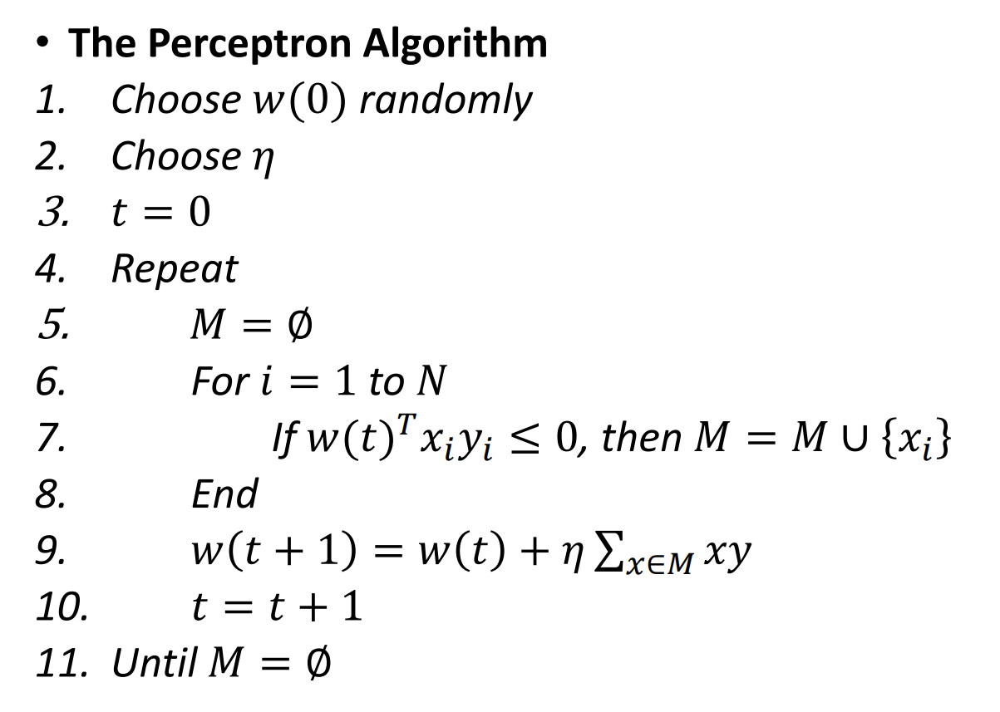

ppt "4_PRC_neural" P27 还讲了个变种的算法和对应的例子，也不知道考不考，按理来说对着算法写就完事了

## 6.2 Feedforward operation and classification

### 6.2.2 Expressive power of multilayer networks

- More than one hidden layer
- Sigmoid is used as activation function
- A general function approximator not limited to linear problems

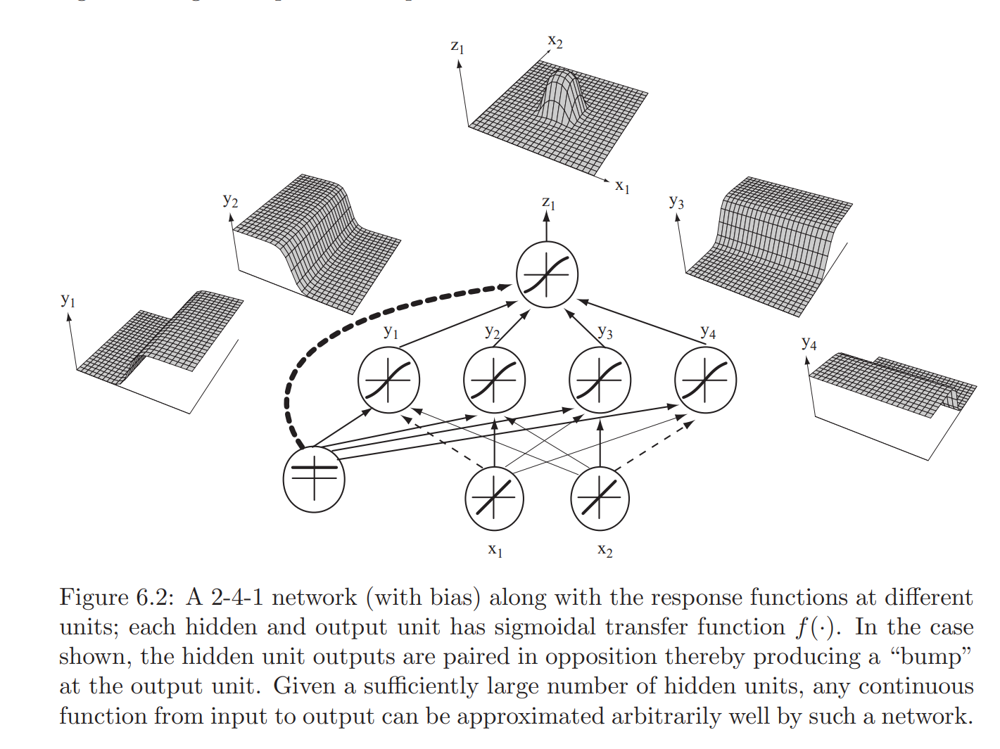

## 6.3 Backpropagation algorithm

- 好处: simple and general method
- 坏处: slow and trapped at local minima

反正找个让 error function 降低的方向改变：

$$
w(k+1)=w(k)-\eta\frac{\partial J}{\partial w}
$$

最常见的误差函数是 mean square error：

$$
J=(\text{target}-\text{output})^2/2
$$

反正你懂如何链式法则求偏导的

---

ppt 还正儿八经推导了三层的情况下求偏导是个啥结果：

隐藏层到输出层：

$$
\frac{\partial J}{\partial w_{k j} }=-y_{j}f^{\prime}(n e t_{k})(t a r g e t_{k}-o u t p u t_{k})
$$

输入层到隐藏层：

$$
\frac{\partial J}{\partial w_{j i} }=-x_{i}f^{\prime}(n e t_{j})\left[\sum_{k=1}^{c}(t a r g e t_{k}-o u t p u t_{k})f^{\prime}(n e t_{k})\,w_{k j}\right]
$$

可以看到第二条式子的第三部分有点不同，因为需要考虑从隐藏到输出的那些个权重

!!! note
    $f$ 表示激活函数

### 6.3.2 Training protocols

不用考虑到底选哪个 pattern 来训练，全都 pattern 都训练一遍

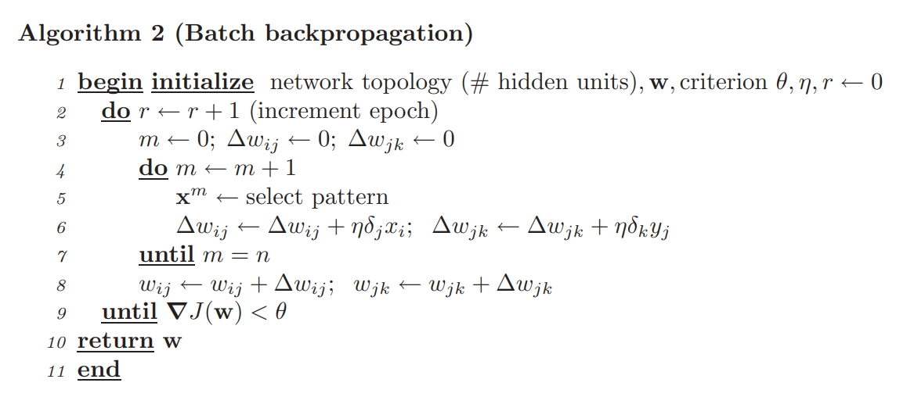

## 6.8 Practical techniques for improving backpropagation

### 6.8.3 Scaling input

因为不同特征的数量级差别非常大，所以需要用 normalization 统一一下

### 6.8.4 Target values

目标值假如真的用实际值的话，计算起来会非常麻烦，所以一般会用 one-of-c representation (one-hot 就是一种)

$$
\omega_{1}=(1,-1,-1,-1)\,\quad\mathrm{o}\mathrm{r}\quad(1,0,0,0)\\
\omega_{2}=(-1,1,-1,-1)\,\quad\mathrm{o}\mathrm{r}\quad(0,1,0,0)\\
\omega_{3}=(-1,-1,1,-1)\,\quad\mathrm{o}\mathrm{r}\quad(0,0,1,0)\\
\omega_{4}=(-1,-1,-1,1)\,\quad\mathrm{o}\mathrm{r}\quad(0,0,0,1)
$$

### 6.8.7 Number of hidden unit

反正最坏的情况下，需要至少保证权重的数量不多于训练的数据数量

一般来说会让训练的数据数量的1/10为权重的数量

网络的复杂度也可以多试试，先从复杂的试起，然后逐渐降低复杂度

### 6.8.8 Initializing weights

从简单的分布当中随机初始化

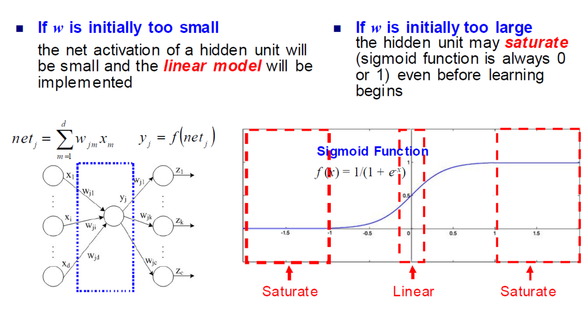

### 6.8.13 On-line, stochastic or batch training?

各有优缺点：
- Batch learning is typically slower than stochastic learning.
- Stochastic training is preferred large redundant training sets

### 6.8.14 Stopped training

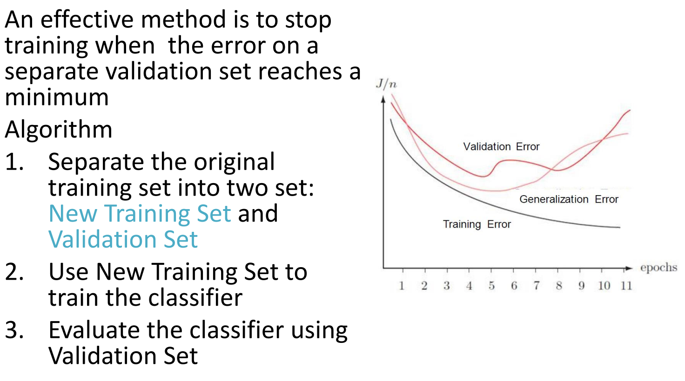

### 6.8.15 How many hidden layers?

太多层的话，反向传播的效率会降低，而且会有更多极大值、更复杂

一般会选 3 层的神经网络

## 6.10 Additional networks and training methods

直接反向传播好像会很慢，于是需要点技巧

### 6.10.1 Radial basis function networks (RBF)

这部分不知道从哪搞来的，没按照书上讲

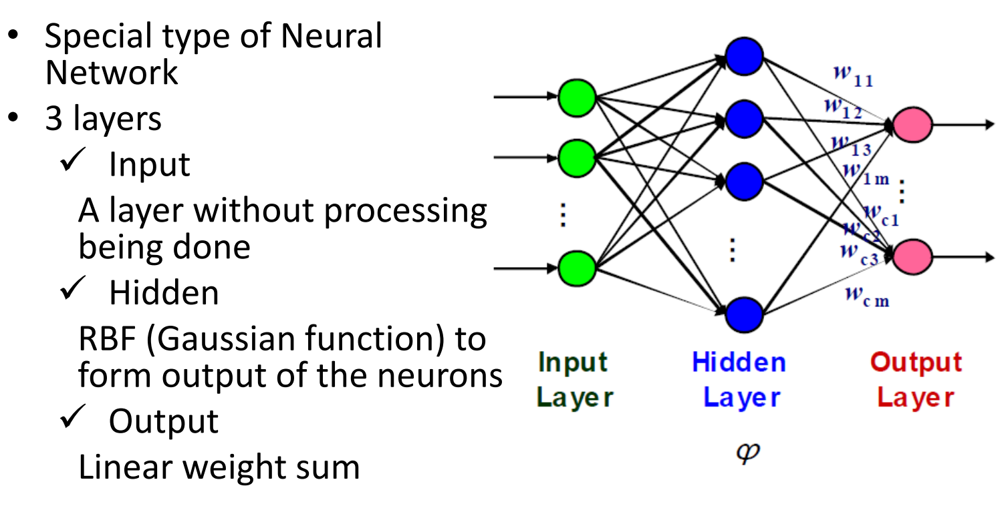

其中的 RBF 经常使用高斯函数：

$$
\phi_{j}(x)= e x p\left(-\frac{1}{2v^{2} }\sum_{i=1}^{n}\left(x_{i}-u_{j}\right)^{2}\right)
$$

- $\mu$: 中心值
- $v$: 宽度（左右两边一起）

假如 $\phi$ 的结果大的话，代表输入的 $x$ 和当前的神经元拥有类似的样子

隐藏层的输出如上所示，所以我们可以据此得到该网络的最终输出：

$$
{z}_{k}({\bf x}){=}\sum_{j=0}^{n_{H} }w_{k j}\phi_{j}({\bf x}).
$$

---

关于这网络到底干了啥：隐藏层做了一次非线性的变换，于是可以把非线性的分类问题变回线性分类问题（？）

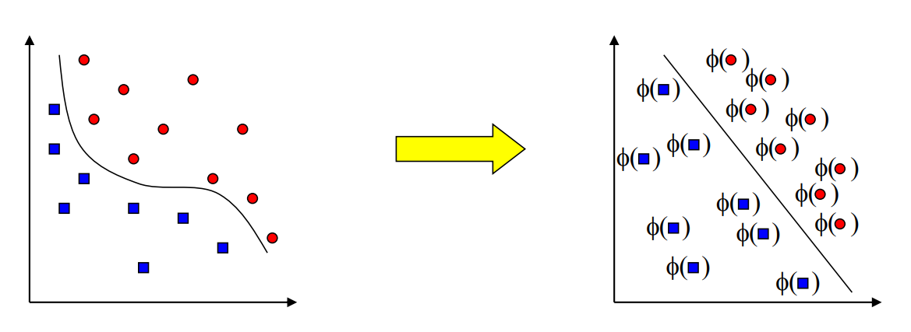

---

至于 RBF 涉及到的三个参数 $u,v,w$ 到底要如何确定大小，主要用了聚类相关的技巧

- center $u$: K-means
- width $v$: using samples belonging to the same cluster: Mean/Variance of the samples
- weight $w$: 前两个确定之后，可以用 [pseudoinverse](ch5-linear-discriminant-functions.md#581-minimum-squared-error-and-the-pseudoinverse) 来算

    $$y=\phi w\\\rArr w=\phi^{-1}y$$

对他们使用梯度下降的话就会是：
$$
w_{i}(n+1)=w_{i}(n)-\eta_{1}\frac{\partial E(n)}{\partial w_{i}(n)}
$$

其他俩参数类似

---

ppt "5_PRC_neural" P11 开始讲了个 拿上面这玩意解决 XOR 问题的例子

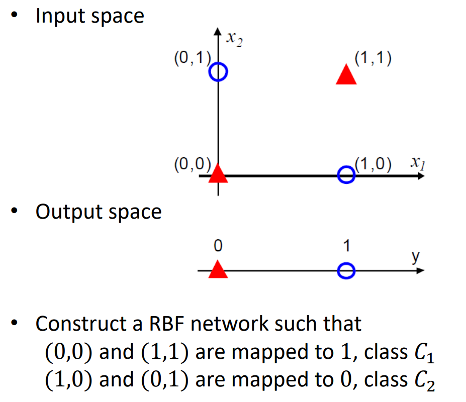

隐藏层：

$$
\phi_{1}(x\,)=e x p\left(-{\frac{||x-u_{1}||^{2} }{2v_{1}^{2} }}\right)\!,\,u_{1}=[1,1]^{T},\,v_{1}={\frac{1}{\sqrt{2} }}\\
\phi_{2}(x)=e x p\left(-{\frac{||x-u_{2}||^{2} }{2v_{2}^{2} }}\right)\!,\,u_{2}=[0,0]^{T},\,v_{2}={\frac{1}{\sqrt{2} }}
$$

可以看到 $v$ 就是每个组内，两个点距离 cluster 中心的距离的平均值 (到 (0.5, 0.5) 的距离)

算出来的 $\phi$ 值和对应的图如下：

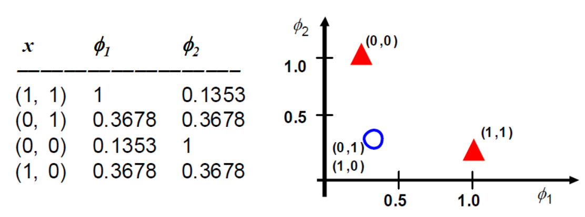

可以看到确实是转化为了可以线性解决的问题

至于权重：

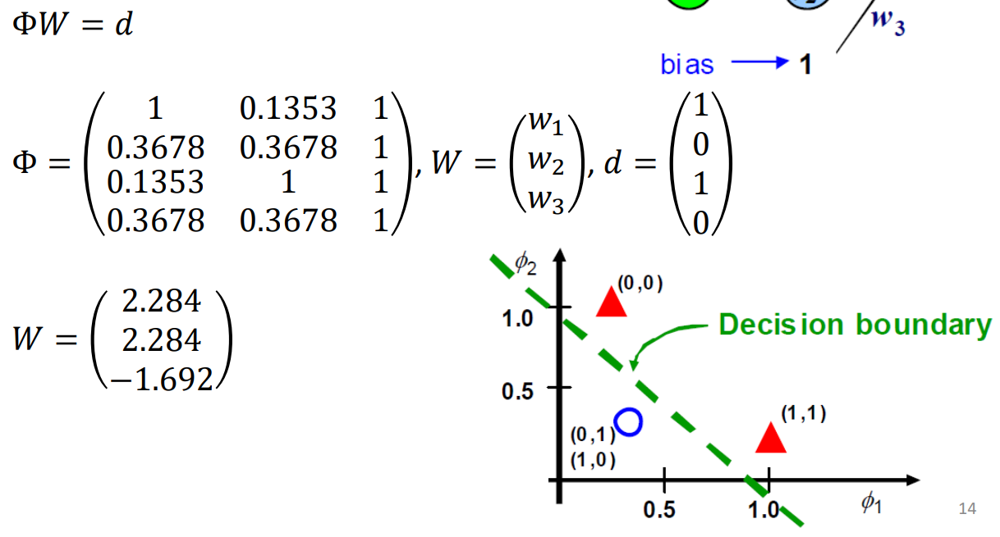

---

来总结下 RBF 的优缺点：

优点：
- RBF network trains faster than MLP
- The hidden layer is easier to interpret than MLP

缺点：
- During the testing, the calculation speed of a neuron in RBF is slower than MLP

## 6.11 Regularization and complexity adjustment

实际上我们可以同时得到很多不同的解，究竟哪个才是最优解？

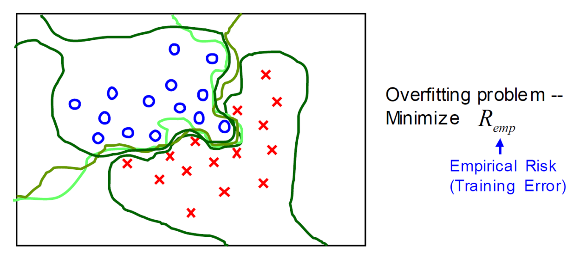

regularization 就是解决问题的其中一种方法

- Add **regularization term 𝜓** in objective function to measure the ==“smoothness”== of the decision plane
- **Regularization parameter(𝜆)** to control the importance of training accuracy and regularization term
- May sacrifice training accuracy for the simplicity of a classifier if necessary

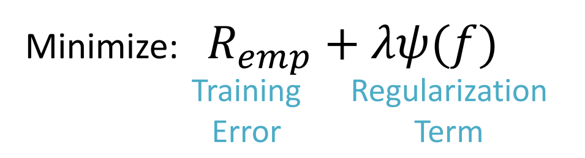

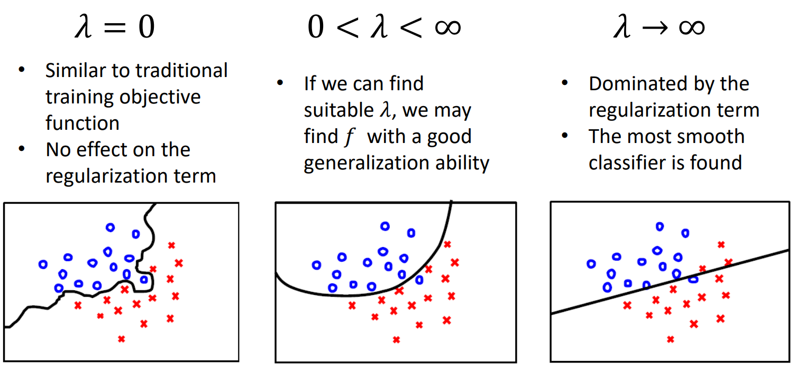

似乎一种常见的取值是：

$$
\psi(f)=||w||_2^2
$$

