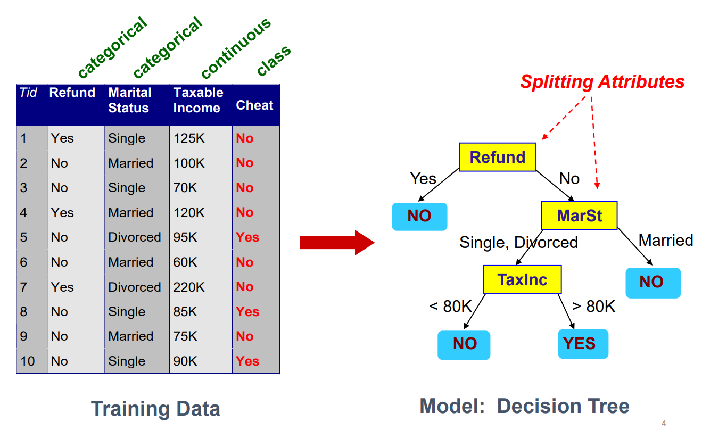
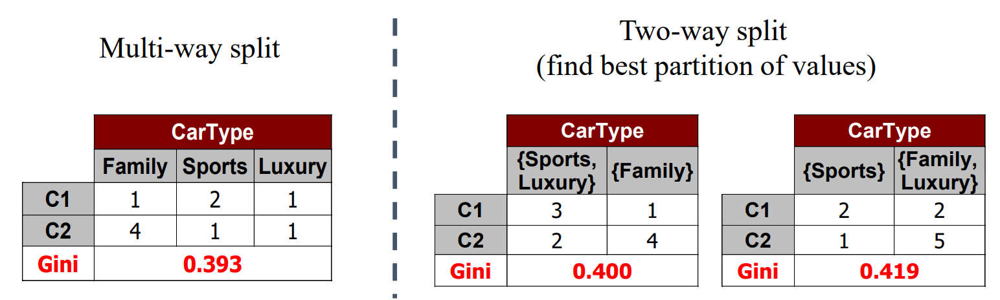
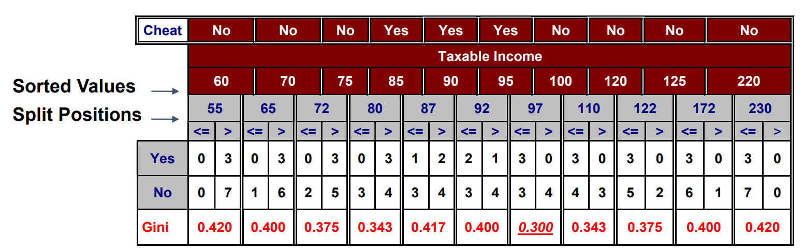

# Ch8 Non-metric Methods

!!! warning 
    这章没有按照书上的顺序来记录

其实都是讲 decision tree 有关的

## 8.1 Introduction

之前的模型考虑的都是作用于拥有确切值的一些个 feature vector 上的。然而有时候数据并非是数字表示的，这些是 *nominal data* （标称数据）没法直接计算

e.g., 描述一个水果为 {red, shiny, sweet, small}

为了能够使用这些 nominal data 来进行 classification，就有了 decision tree

## 8.2 Decision trees

!!! note
    同一组数据可能可以建出来完全不同的树

---

那么问题来了，怎么建树呢？

这里用了 ***Hunt's Algorithm***[^1]:

[^1]:[8.1 Decision Tree in Hunt’s Algorithm | Do A Data Science Project in 10 Days..](https://bookdown.org/gmli64/do_a_data_science_project_in_10_days/decision-tree-in-hunts-algorithm.html)

大体上的步骤是通过一个个的 attribute 来将数据集逐渐分割成 子数据集。严谨表述如下：

先定义三个玩意：
- dataset $D$
- ***test condition***:

    包括 attributes $Att_{list}$ 和 testing criterion

    e.g., `age>=25` 是个 *test condition*, 其中 `age` 是 attribute 而 `>=25` 是 test criterion
- ***Attribute selection method***

    refers to a procedure to determine the best splitting

算法的步骤如下：

假设节点 $t$ 对应的输入数据集此时为 $D_t$:
- If $D_t$ contains records that belongs to the same class $y_t$:

    then $t$ is a leaf node labelled as $y_t$
- If $D_t$ is not an empty set but $Att_{list}$ is empty:

    then $t$ is a leaf node labelled by the label of the majority records in the dataset
- If $D_t$ contains records that belong to more than one class and $Att_{list}$ is not empty:

    use *Attribute selection method* to choose next best attribute from the $Att_{list}$ and remove it from the list.

不断重复上面的步骤

## 8.3 Test Condition

算法的流程中并么有提到如何选择 test condition

Depends on attribute types
- Nominal
- Ordinal
- Continuous

    需要手动划分为几个区间

Depends on number of ways to split
- Binary split

    假如有超过两个值的话，就必须要找到最优的二分方法
- Multi-way split

    有多少值就分多少类

## 8.4 Measures of Node Impurity

### 8.4.1 GINI

GINI index for a given node t:

$$
\text{GINI}(t)=1-\sum_{j}[\,p(\,j\,|\,t\,)]^{2}
$$

其中：
- $p(j|t)$: relative frequency of class $j$ at node $t$

考虑这个函数啥时候会取到最值：
- 最大值

    $1-1/n_c$

    当所有 record 平均分布在各个类的时候
- 最小值

    0

    当所有 record 全都属于一个类

---

When a node $p$ is split into $k$ partitions (children), the quality of split is computed as:

$$
\text{GINI}_{split}=\sum_{i=1}^{k}\frac{n_i}{n}\text{GINI}(i)
$$

其中：
- $n_i$: number of records at child $i$
- $n$: number of records at node $p$

可以参考 ppt "7_PRC_dtree" P30 看看具体是怎么计算的

比较复杂的情况下，可以用 ***count matrix*** 来辅助计算：

假如属性是连续的，还需要纠结下如何分割属性的值域，这还需要多次尝试来计算：

### 8.4.2 Entropy

at given node $t$:

$$
\text{Entropy}(t)=-\sum_j p(j|t)\log_2 p(j|t)
$$

- $p(j|t)$: relative frequency of class $j$ at node $t$

来考虑下极值：
- 最大值

    $\log n_c$

    当所有 record 平均分布在各个类的时候
- 最小值

    0

    所有数据属于一个类

### 8.4.3 GAIN

Information GAIN:

$$
\text{GAIN}_{split}=\text{Entropy}(p)-(\sum_{i=1}^k\frac{n_i}{n}\text{Entropy}(i))
$$

我们希望尽可能减小信息熵，所以会选择 GAIN 值最大的情况

缺点：倾向将数据划分为很多的部分，每一个都比较小但是纯净

### 8.4.4 Classification Error

$$
\text{Error}(t)=1-\max_i P(i|t)
$$

极值：
- 最大值

    $1-1/n_c$

    当所有 record 平均分布在各个类的时候
- 最小值

    0

    所有的数据属于一个类

## 8.5 When to Stop Splitting

主要是防止过拟合

### 8.5.1 Pre-Pruning

也叫 early stopping

一些常见的停止条件：

- Stop if number of instances is less than some user-specified threshold
- Stop if class distribution of instances are independent of the available features (e.g., using $\chi^2$ test)
- Stop if expanding the current node does not improve impurity measures (e.g., Gini or information gain).

### 8.5.2 Post-Pruning

- Grow decision tree to its entirety
- Trim the nodes of the decision tree in a bottom-up fashion
- If generalization error improves after trimming, replace sub-tree by a leaf node.
- Class label of leaf node is determined from majority class of instances in the sub-tree.

长完之后再截掉

