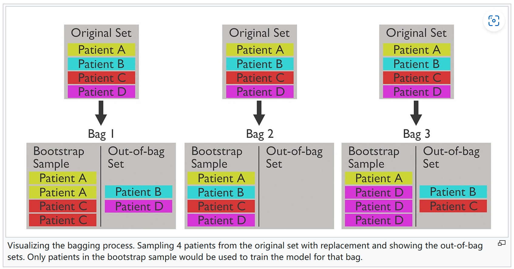
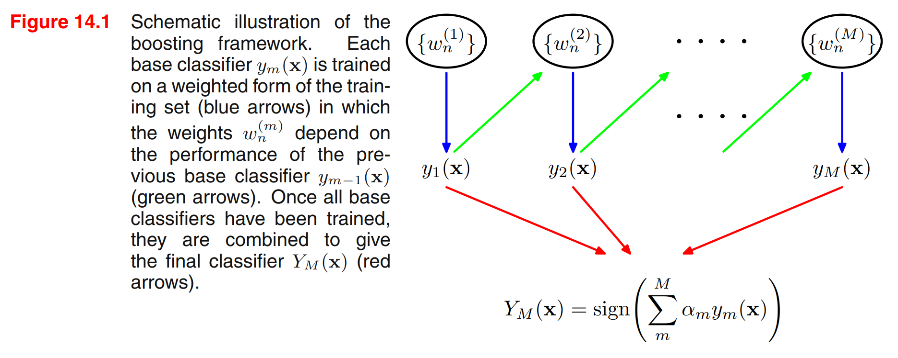

# Ch9 Algorithm-independent machine learning

!!! note
    书上的内容和 ppt 差不少

实际上 ppt 讲的主题是 **ensemble learning**（集成学习）

可能一个简单的学习算法没法得到很好的结果，但是当我们同时使用多个的时候，可以得到好得多的效果

## 9.5 Resampling for classifier design

### 9.5.1 Bagging

Bootstrap data set
: drawing $n'<n$ samples from $\mathcal{D}$ with replacement（同一个样本可以被反复抽取）

就是每次从原数据集里抽出一部分来，用来训练

我们对于每一个 Bootstrap data set 都训练一个 component classifier，那么最后怎么把这么多的 classifier 都合起来呢？

Bootstrap aggregation
: the final classification decision is based on the vote of each component classifier (分类问题中)

ppt 上讲了，在回归问题中定义成平均值：

$$
\hat{f}_{avg}(x)=\frac{1}{B}\sum_{b=1}^{B}\hat{f}^b(x)
$$

反正综合多个 classifier 之后，结果可以更加稳定

---

现在来考虑下如何计算 prediction error

反正是用不了 [cross-validation](https://en.wikipedia.org/wiki/Cross-validation_(statistics)) 的

out-of-bag dataset (OOB)
: 对于一次的 bootstrap 采样过程来说，那些没有被选中的样本构成了==这个 component classifier== 的 *out-of-bag dataset*

out-of-bag error[^1]
: 把每个 out-of-bag dataset 喂给自己对应的那个 classifier，得到每个 classifier 的误差，然后计算整体的 mean square error

[^1]:[Out-of-bag error - Wikipedia](https://en.wikipedia.org/wiki/Out-of-bag_error)

---

Bagging 的好处：
- Reduces overfitting (variance).
- Normally uses one type of classifier.
- Decision trees are popular.
- Easy to parallelize

---

坏处：

降低了可解释性

ppt 这里莫名插入了个别的概念：

variable importance[^2]
: Variable importance refers to how much a given model "uses" that variable to make accurate predictions. The more a model relies on a variable to make predictions, the more important it is for the model

[^2]:[machine learning - What is variable importance? - Cross Validated](https://stats.stackexchange.com/questions/332960/what-is-variable-importance#:~:text=(My)%20definition%3A%20Variable%20importance,models%2C%20each%20using%20different%20metrics.)

### 9.5.? Random forests

是个改进版本的 bagging

> they use a modified tree learning algorithm that selects, at each candidate split in the learning process, ==a random subset of the features==

分割的时候==只取一部分的 feature (predictor)==

至于为什么要这么做：

> if one or a few features are very strong predictors for the response variable (target output), these features will be selected in many of the B trees, causing them to become correlated

反正让各个树之间存在关联是不好的事情

算法流程如下：

> For b = 1 to B: 
> - Draw a bootstrap sample $D$ of size $N$ from the training data. 
> - Grow a random-forest tree to the bootstrapped data, by recursively repeating the following steps for each terminal node of the tree, until the minimum node size $n_{min}$ is reached. 
> 
>     - Select $m$ variables at random from the $p$ variables. 
>     - Pick the best variable/split-point among the $m$.
>     - Split the node into two daughter nodes. 
> 
> Output the ensemble of trees

至于算法流程里提到的 $m$ 要怎么取值：
- classification

    $m=\sqrt{p}$

    the minimum node size is 1
- regression

    $m=\frac{1}{3}p$

    the minimum node size is 5

random forest 不会对于 classifier 的数量而言出现过拟合

### 9.5.2 Boosting

#### 9.5.2.1 AdaBoost

**Ada**ptive **Boost**ing

整体的想法是：通过多个 weak classifier 的组合来得到一个 strong classifier

算法流程：
> - Initialize the data weighting coefficients $\{w_n\}$ by setting $w_n^{(1)}=1/N$ for $n=1,...,N$
> - For $m=1,...,M$:
>   - Fit a classifier $y_m(\mathbf{x})$ to the training data by minimizing the weighted error function
>       $$J_m=\sum_{n=1}^Nw_n^{(m)}I(y_m(\mathbf{x}_n)\neq t_n)$$
>       where $I(y_m(\mathbf{x}_n)\neq t_n)$ is the indicator function and equals 1 when $y_m(\mathbf{x}_n)\neq t_n$ and 0 otherwise
>   - Evaluate the quantities:
>       $$\epsilon_m=\frac{\sum_{n=1}^Nw_n^{(m)}I(y_m(\mathbf{x}_n)\neq t_n)}{\sum_{n=1}^{N}w_{n}^{(m)} }$$
>       and then use these to evaluate:
>       $$\alpha_{m}=\ln\left\{\frac{1-\epsilon_{m} }{\epsilon_{m} }\right\}$$
>   - Update the data weighing coefficients:
>       $$w_{n}^{(m+1)}\mathop=\,w_{n}^{(m)}\exp\{\alpha_{m}I(y_{m}({\bf x}_{n}){\neq}{\cal t}_{n})\}$$
> - Make predictions using the final model, which is given by:
>   $$Y_{M}({\bf x})={\text{sign} }\left(\sum_{m=1}^{M}\alpha_{m}y_{m}({\bf x})\right)\,.$$

其中的理解：
> the weighting coefficients $w_n^{(m)}$ are increased for data points that are misclassified and decreased for data points that are correctly classified. 
>
> Successive classifiers are therefore forced to place greater emphasis on points that have been misclassified by previous classifiers

分类错误的点会被赋予更大的权重，从而被重点关注（称为 ***reweighing***）

$y(m)$ 就是所谓的 weak classifier 了

ppt "8_PRC_ensemble" P30~33 讲了些奇奇怪怪的东西，好像其实就是用了不同的标记符号，不过 ppt 上的 $\alpha_m$ 多了一个 $\frac{1}{2}$ 的系数

---

优点：

- It has no parameters to tune (except for the number of rounds).
- It is fast, simple and easy to program.
- Instead of trying to design a learning algorithm that is accurate over the entire space, we can focus on finding base learning algorithms that only need to be better than random.

缺点：

- The actual performance of boosting depends on the data and the base learner. 
- Boosting seems to be especially susceptible to noise.
- When the number of outliners is very large, the emphasis placed on the hard examples can hurt the performance.

