# 2. IPv6

这章很多内容参考了[微软](https://learn.microsoft.com/en-us/previous-versions/windows/it-pro/windows-server-2003/cc759208(v=ws.10)?redirectedfrom=MSDN)的文档

## 2.1 Expressing IPv6 addresses

复习一下

每个 v6 地址是 128 位，16 位一组，一共 8 组：

```
21DA:00D3:0000:2F3B:02AA:00FF:FE28:9C5A
```

每组前缀的零可以简化，不过最少留一个：

```
21DA:D3:0:2F3B:2AA:FF:FE28:9C5A
```

### 2.1.1 Compressing zeros

有些类型的地址包含好几组连续的0，这时候可以再度简化

比如 `FE80:0:0:0:2AA:FF:FE9A:4CA2` 可以简化成：

```
FE80::2AA:FF:FE9A:4CA2
```

!!! warning
    压缩 0 的操作每个地址只能做一次！因为假如做多次的话，地址就没法复原了

### 2.1.2 IPv6 prefixes

在 IPv4 中，我们可以用例如 `255.255.255.0` 来表示子网掩码。然而 IPv6 中==不存在==这种写法，只能够通过==前缀长度==来表达。如：

```
21DA:D3:0:2F3B::/64
```

## 2.2 Unicast IPv6 addresses

IPv6 地址可以分为：

- Unicast Address (单播)
- Multicast Address (组播)
- Anycast Address (任播)

!!! warning
    没有了广播地址

---

unicast address
: A unicast address identifies a ==single interface== within the scope of the type of unicast address

包含以下不同的种类：

- **本地链路地址**
- 环回地址
- 未指定地址
- 唯一本地地址
- 嵌入式Ipv4地址
- **可聚合全局单播地址**

### 2.2.1 本地链路地址 (LLA)

```
FE80::/64
1111 1110 10
```

link-local addresses
: are used by nodes when communicating with neighboring nodes ==on the same link==

e.g.

> on a single link IPv6 network with no router, link-local addresses are used to communicate between hosts on the link

假设网络拓扑是 switch 之上还有 router 将不同的 switch 连到一起的话，那么 link 指的就是每个 switch 各自的那个子网

和 IPv4 中的 `169.254.0.0/16` 是一个作用（好像都不知道是干啥用的

---

那这个地址到底拿来干什么事情呢？

> are used ==between on-link neighbors== and for ==Neighbor Discovery== processes

!!! note
    不管其它单播地址是否真的存在，本地链路地址是一定存在的！

---

关于本地链路地址生成的其中一种方式，参考[微软](https://learn.microsoft.com/en-us/previous-versions/windows/it-pro/windows-server-2003/cc738446(v=ws.10))

前缀已经是 `FE80::/64` 了，而剩下的 64 位则被称为 **interface identifier**，而这 64 位是通过 48 位的 mac 地址推导得到的

推导原则如下：

- The hexadecimal digits `FF-FE` are inserted between the third and fourth bytes of the MAC address.

- The Universal/Local bit (==the second low-order bit of the first byte of the MAC address==) is complemented. If it is a 1, it is set to 0; and if it is a 0, it is set to 1.

好奇怪的规则

e.g., 对于 mac 地址 `00-60-08-52-F9-D8`：

- The hexadecimal digits `FF-FE` are inserted between `08` (the third byte) and `52` (the fourth byte) of the MAC address, forming the 64-bit address of `00-60-08-FF-FE-52-F9-D8`

- The Universal/Local bit, the second low-order bit of `00` (the first byte) of the MAC address, is complemented. The second low-order bit of `00` is `0` which, when complemented, becomes `1`. The result is that for the first byte, `00` becomes `02`.

!!! note
    关于会在这个地址里看到 `%10` 之类的后缀，那是系统给该网卡赋予的一个本机的标识符

### 2.2.2 环回地址

```
::1
```

loopback address
: is used to identify a loopback interface, enabling a node to send packets to itself

说人话：等于 IPv4 里的 `127.0.0.1`，localhost

### 2.2.3 未指定地址

```
::
```

unspecified address
: is used only to indicate the absence of an address

说人话：等于 IPv4 里的 `0.0.0.0`

那干啥用呢？

> The unspecified address is typically used as a ==source address== for packets that are attempting to verify the uniqueness of a tentative address

!!! note
    The unspecified address is never assigned to an interface or used as a ==destination address==

### 2.2.4 唯一本地地址

和局域网内的[私有地址](https://en.wikipedia.org/wiki/Private_network)很像，但是又不太一样

范围是从 `FC00::/7` 到 `FDFF::/7`

最开始规范是使用 site-local address 的`FEC0::/10`，不过因为规范不明确所以逐渐弃用

### 2.2.5 可聚合全球单播地址 (GUA)

```
001
```

aggregatable global unicast addresses
: are equivalent to public IPv4 addresses

理论上是一个全球唯一的地址

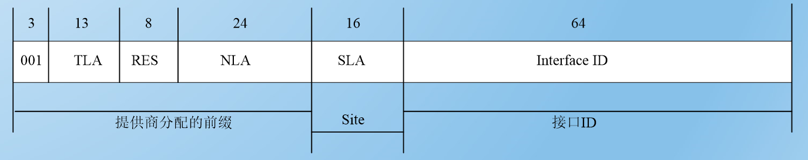

### 2.2.6 其它

- IPv6兼容地址：0:0:0:0:0:0:w.x.y.z或::w.x.y.z

    > is used by dual-stack nodes that are communicating with IPv6 over an IPv4 infrastructure
- IPv4映射地址：0:0:0:0:0:FFFF:w.x.y.z或::FFFF:w.x.y.z

    > is used to represent an IPv4-only node to an IPv6 node. It is used only for internal representation
- 6to4地址

    > is used for communicating between two nodes running both IPv4 and IPv6 over the Internet

## 2.3 Multicast IPv6 addresses

组播地址

```
FF
1111 1111
```

> packets addressed to a multicast address are delivered to all interfaces that are identified by the address

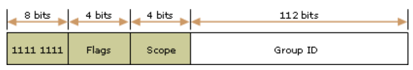

其中：

- Flags

    虽然大小有 4 位，但是实际只有一个 flag 被定义了，就是 **Transient flag**

    使用 Flags 的 low-order bit：

    - 0: the multicast address is permanently-assigned
    - 1: the multicast address is transient

- Scope

    大概是表示组播的范围。包括了如下不同的种类：

    |Scope field value|Scope|
    |---|---|
    |1|Node-local|
    |2|Link-local|
    |5|Site-local|
    |8|Organization-local|
    |E|Global|

    比方说 `FF02` 开头的就是 link-local 的 scope

在上述的基础上，还有个别特殊的多播地址：

- `FF01::1`

    node-local scope all-nodes address
- `FF02::1`

    link-local scope all-nodes address

    对应 IPv4 的 `224.0.0.1`
- `FF02::2`

    link-local scope all-routers address

    对应 IPv4 的 `224.0.0.2`

### 2.3.1 Solicited-node address

/səˈlɪsɪt/ 索求

大概是为了解决 IPv4 时代通过 ARP 来发现链路上的节点时，会打扰链路上的每一个节点的问题

```
FF02::1:FF00:0/104
```

你可能疑惑这最后的 24 位到底来自于哪里，实际上来自 link-local address 的最后 24 位

e.g., 

- link-local address: `FE80::2AA:FF:FE28:9C5A`
- solicited-node address: `FF02::1:FF28:9C5A`

可以看到 `28:9C5A` 是相同的

## 2.4 Anycast IPv6 address

IPv6 新增的广播方式

Anycast
: packets addressed to an anycast address are delivered to a single interface (the ==nearest interface== that is identified by the address)

所谓的 closest 指的是 routing distance 最短

和 multicast 相比：

- one-to-many: 目标接口是多个
- one-to-one-of-many: 目标接口是多个接口中的一个，距离最近的那个

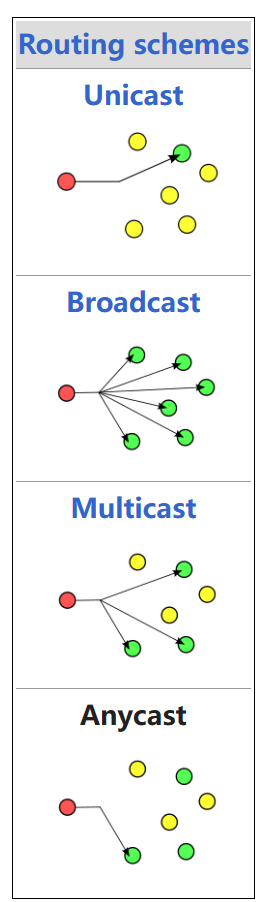

仅能做目标地址，且仅能分配给路由器


## 2.5 IPv6 地址的分配

实际上也是三种

### 2.5.1 手动配置

没人真的这么做吧？？？

### 2.5.2 SLAAC (无状态)

**S**tate**L**ess **A**ddress **A**uto**C**onfiguration

[SLAAC](https://www.ii.pwr.edu.pl/~kano/course/module7/#7.2.1.1)
: SLAAC is a method in which a device can obtain an IPv6 global unicast address ==without the services of a DHCPv6 server==

SLAAC 的核心是 ICMPv6，利用 RS 和 RA 两种信息来完成：

- Router Solicitation (RS)

    :  the client sends an RS message to the router. The RS message is sent to the IPv6 all-routers multicast address `FF02::2`

    节点启动时最多只能发送 3 个 RS

- Router Advertisement (RA)

    : sent by routers to provide addressing information, including the **prefix** and **prefix length** of the local segment.

    > 一般来说前缀就是==路由器==的前缀，64 位
    > 
    > 还需要 64 位的 Interface ID (IID)，一般可以使用的生成方法有：
    > - EUI-64 - Using the EUI-64 process, PC1 will create an IID using its 48-bit MAC address.
    > - Randomly generated - The 64-bit IID can be a random number generated by the client operating system.

    送到 `FF02::1` 

    虽然 RA 是作为 RS 的回复，但是 RA 其实是会周期性发送的（比如 200s）


需要注意的是，因为这是个**无状态**的服务，所以并不存在一个 server 来维护网络地址的信息。意味着相比 DHCP 来说，并没有人知道哪个地址在用哪个地址空闲，意味着我们需要 **D**uplicate **A**ddress **D**etection

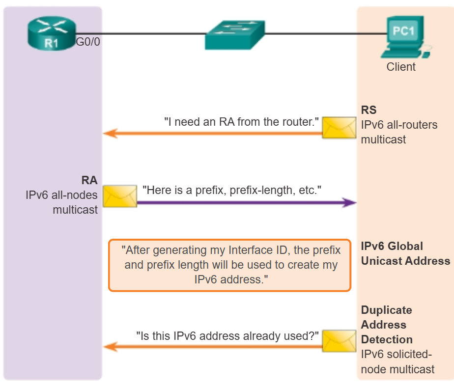

#### 2.5.2.1 Duplicate Address Detection (DAD)

- 节点组播发送 **Neighbor Solicitation** (NS)
- 如果收到 **Neighbor Advertisement** (NA)，就证明地址重复
- 如果尝试若干次发送请求，都没有收到邻居通告，即可启用该地址

在经过 DAD 验证之前的地址称为 tentative address，只有验证通过之后才是正式地址

NS 的接收者可能会做出两种不同的行为：

- 若 target 域中的地址对自己而言是 tentative 的，那么会**主动放弃**使用这个地址
- 若 target 域中的地址是自己正在使用的地址，那么会发送 NA 信息，**使得 NS 的发送方放弃**这个地址


#### 2.5.2.2 M flag & O flag

RA 发送的信息里其实包含了两个 flag：

- M flag: Managed Address Configuration 
- O flag: Other Stateful Configuration

来表明 client 应该使用 SLAAC, DHCPv6 还是两者相结合：

- **SLAAC only**

    - M=0
    - O=0

- **Stateless DHCPv6**

    - M=0
    - O=1

    意思是 client 使用 router 分配的地址，但是其它相关的信息都使用 DHCPv6 分配的信息

- **Stateful DHCPv6**

    - M=1
    - O不存在

    只使用 DHCPv6

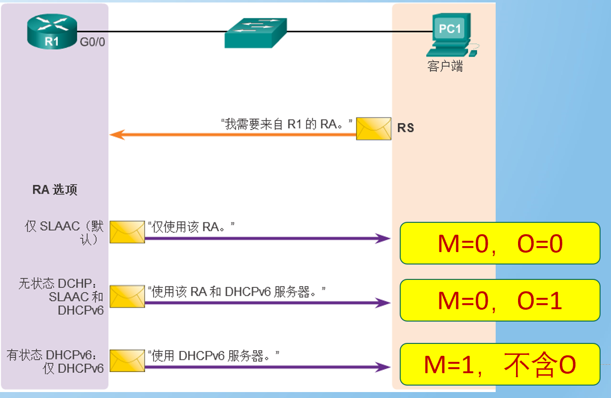

其实还有一个特殊的 flag:

- A flag: 是否允许 client 自己用 SLAAC 生成地址

#### 2.5.2.3 地址的生存期

很诡异，真想看见 ppt 第三讲 p10~11

#### 2.5.2.4 前缀重新编址

允许网络从以前的前缀平稳地过渡到新的前缀，提供对用户透明的网络重新编址能力

- 在前缀重新编址时，路由器会继续通告当前前缀，只是优先时间和有效时间被减小到接近0，同时，路由器开始通告新的前缀，这样，链路中至少有两个前缀共存
- 节点收到这样的RA，会发现当前前缀的生命周期较短，停止使用；同时开始用新的前缀配置接口，并进行DAD，通过后，获得新的地址使用。

在转换期间，节点有两个单播地址使用:

- 旧的地址：基于旧的前缀，用以维持以前已经建立的连接；
- 新的地址：基于新的前缀，用来建立新的连接

当旧的前缀的有效时间递减为0时，旧的前缀完全废止，此时，RA中只包含新的前缀

### 2.5.3 DHCPv6

**D**ynamic **H**ost **C**onfiguration **P**rotocol for IPv6

这里特指**有状态**的 DHCPv6 (有 server)

#### 2.5.3.1 特点

- 用 UDP 来交换报文，端口分别是：

    - client: `546`
    - server: `547`

- 用本地链路地址或者其它机制获得的地址来发送和接收 DHCPv6 报文
- 取消了 DHCPv4 中的 Discover 和 Offer 消息

#### 2.5.3.2 正常工作流程

一个四步的流程

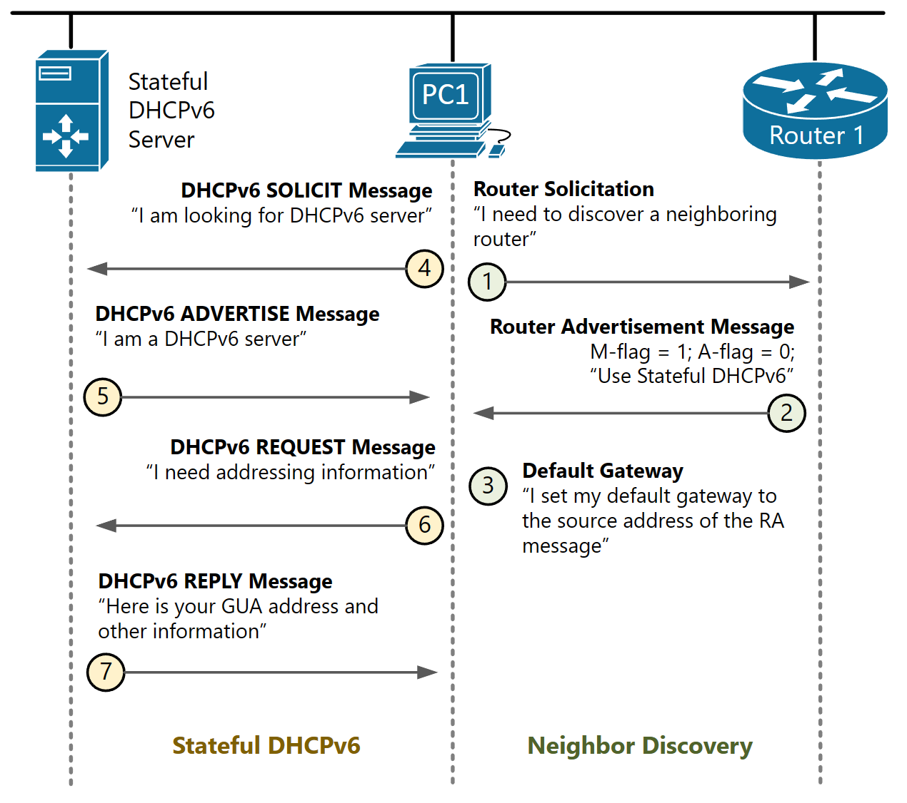

client 在 stateful DHCPv6 中发送的信息都是指向组播地址 `FF02::1:2`

#### 2.5.3.3 快速地址配置流程

上面的正常步骤要 4 步，还是有点麻烦，于是有了快速版本，只用 2 步

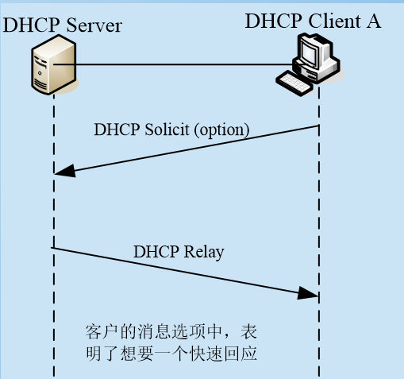

- 当客户端启用了快速选项（Solicit消息中携带RapidCommit选项，期望服务器快速回应）
- 或者是 client 只需要DNS server、NTP server等信息（无状态DHCP）
- 租期续约：renew-relay

#### 2.5.3.4 重配置机制

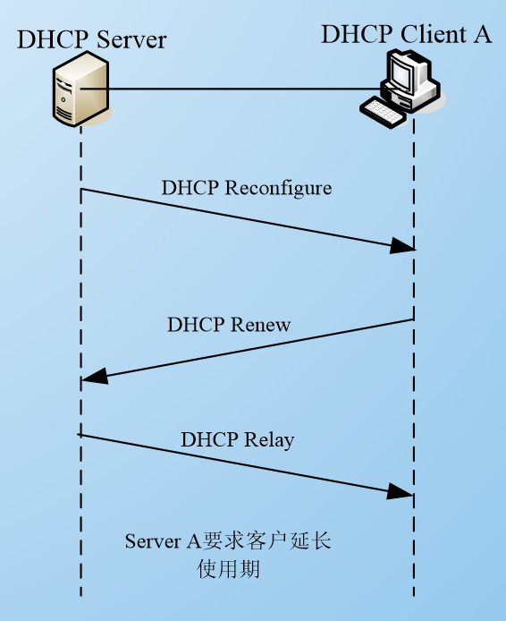

由服务器发起，也需要 DAD

#### 2.5.3.5 异常情况

当客户端发生断电等异常情况的时候，就会启动这个流程

- client 发送 Confirm 来确认地址是不是还是可用的
- 两种情况

    - 若收到回复：可用
    - 无回复：重新申请

#### 2.5.3.6 报文

长这样

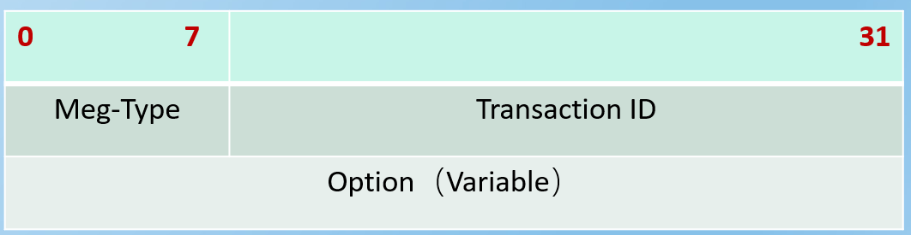

#### 2.5.3.7 对比

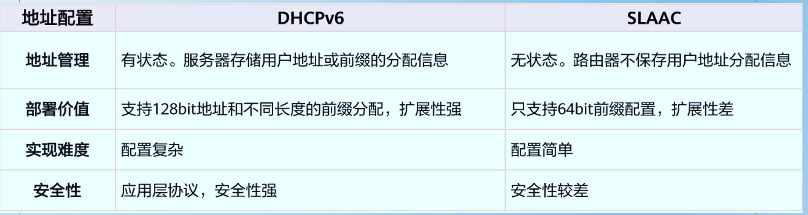

## 2.6 IPv6 包的格式

[以前学过](../../y3-fall/computer-networks/ch5-the-network-layer.md#63-ip-version-6)

众所周知，数据包 (packet) 由三个部分组成：

- 基本头
- 扩展头
- 有效载荷

三者之间的关联：

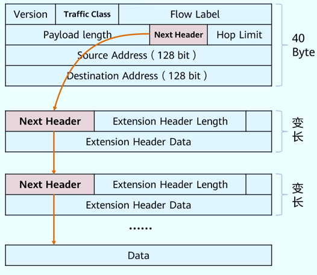

### 2.6.1 基本头

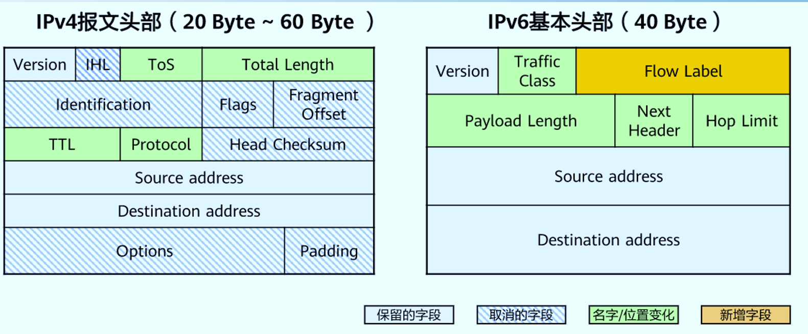

虽然 IPv6 这边的 field 数量变少了，但是总的长度其实并没有减少

### 2.6.2 扩展头

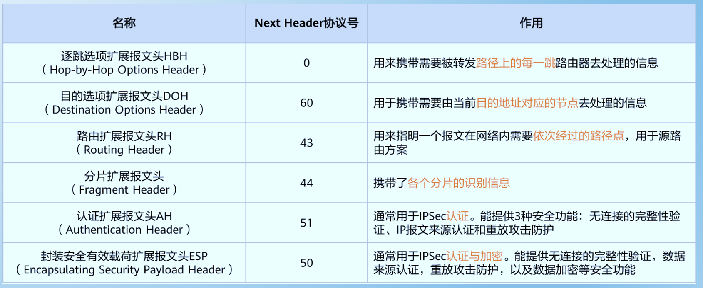

#### 2.6.2.1 Hop-by-Hop (HBH)

存放着沿途的==所有路由器==都必须检查的信息，比方可以是：

- **Jumbo payload**

    巨型报，可以塞下超过 64KB 的负荷

    > 此时基本头部中的净荷长度为 0

#### 2.6.2.2 Routing Header (RH)

用于指定路由时需要经过的中间节点的地址（不一定非要连续）

还记得扩展头是长这样的：

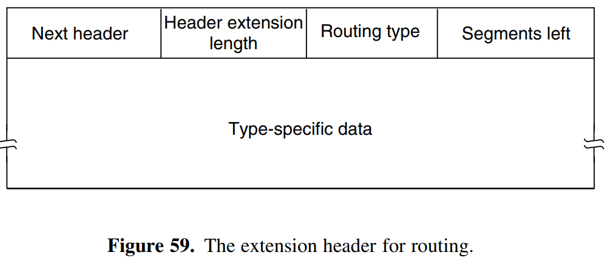

一般 routing type 是 0

e.g.,

目标地址是 $D$，中间地址是 $\langle R_1,R_2,...,R_n \rangle$，那么 $R_1$ 就会被设为初始的 destination address，而 extension header 里面会包含 $\langle R_2,R_3,...,R_n,D\rangle$ 这些地址。

$R_1$ 收到这个 packet 之后，就会将原本的 destination $R_1$ 和当前的下一个目标地址 $R_2$ 换个位置，并将 Segments Left 字段减一，以此类推

至于怎么知道当前已经到了目标地址的第几个，则是根据 **Segments left** 字段作为 pointer 来指明

### 2.6.3 扩展头的应用场景

#### 2.6.3.1 SRH 用于 SRv6

感觉也是一种指定路由路径的手段

见 ppt 3 P59~61

#### 2.6.3.2 HBH 用于网络切片

见 ppt 3 P62~63

#### 2.6.3.3 DOH 用于 BIERv6

见 ppt 3 P64

## 2.7 ICMPv6

原本就有的能力：

- ping
- tracert

    目的器一般发送端口不可达报文

增加的能力：

- 邻居发现
- 无状态地址配置
- PMTU 发现

    发送方被要求在发送前需要知道整个传输路径的最小 MTU

    由于最大传输单元的瓶颈在路由器，所以就是不断试探各个路由器的最大承载量是多少，短板原则   

### 2.7.1 报文

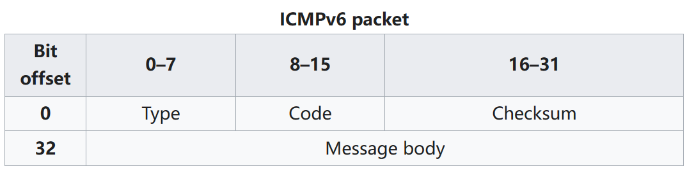

其中 Type 可以是以下两种之一：

- **差错报文**：通告IPv6分组传输中出现的错误

    0~127，意味着二进制的最高位是0

    包括报文的类型

    - 目标不可达
    - 数据包超长
    - 超时
    - 参数问题
- **信息报文**：提供诊断和附加的主机功能

    128~255，意味着二进制的最高位是1

    - MLD(组播侦听发现)
    - NDP (ARP,redirect…)
    - 回声请求（128）和应答（129）

## 2.8 Neighbor Discover Protocol (NDP)

假如源机和目的机在同一链路，则称为 **on-link** 的数据路由，由 NDP 协议完成

建立在 ICMPv6 的基础上，定义了其中的 5 种 packet 类型，前两种我们之前已经在 SLAAC 里见到了：

- [RS](#252-slaac-无状态) (133)
- [RA](#252-slaac-无状态) (134)
- **Neighbor Solicitation** (NS, 135)
- **Neighbor Advertisement** (NA, 136)
- **Redirect** (137)

解析的流程变为：

- 首先查找**邻居缓存表**（ipv6 neighbor cache），没有则进行地址解析 （类似于ARP表）
- 源主机发送**组播NS**报文，该报文的目的地址为目标IPv6地址所对应的被请求节点组播地址（Solicited-node），在其中也包含了自己的链路层地址；
- 目标主机收到NS报文后，就会了解到发送主机的**IPv6地址和相应链路层地址**；
- 目标主机向源主机**单播**发一个邻接点公告报文（**NA**），该报文中包含自己的链路层地址。（单播）

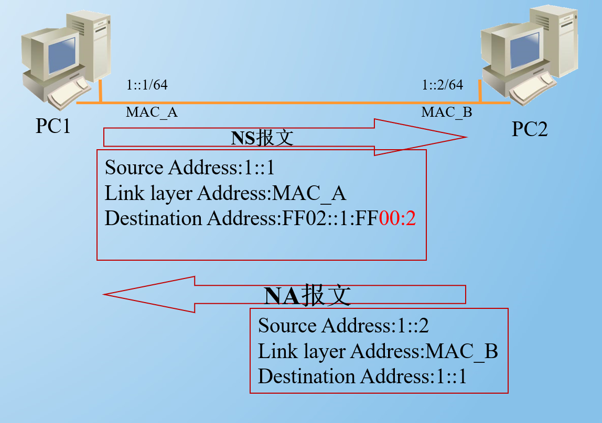

### 2.8.1 Neighbor Cache

存储最近通信过的邻居信息，包含：

- 单播 IPv6 地址
- MAC 地址
- 标记
- 下次 NUD (Neighbor Unreachability Detection) 的时间

这些记录可能的状态：

- **INCOMPLETE**

    添加的新纪录，还未有MAC地址，可尝试多次组播NS
- **REACHABLE**：收到NA确认了
- **STALE**：已经过了reachable time时效
- **DELAY**：等待上层协议的确认，默认5s
- **PROBE**

    delay时效过，可发3次（间隔1s）NS

## 2.9 Off-link 路由

前面 [2.8](#28-neighbor-discover-protocol-ndp) 节介绍了源和目的在同一链路下的情况，而这节要介绍的则是不在的情况

核心的问题有两个：

- 主机发给哪个路由器？（主机-路由器）
- 路由器发给哪个路由器？（路由器-路由器）

### 2.9.1 主机-路由

IPv6 有一个特有的数据结构：**DestinationCache**（目的缓存表）

生成机制：

- 初始时为空；
- 某个地址在该表中查不到时，改查路由表，做on-link判断：

    - 是on-link的（同一链路里），将==目的地址本身==加入DC表的nexthop域；
    - 是off-link的（不同链路里），将==路由表中的下一跳==加入DC的nexthop域。

还挺合理

---

那假如跳错了路由器咋办？这时候需要**重定向**机制

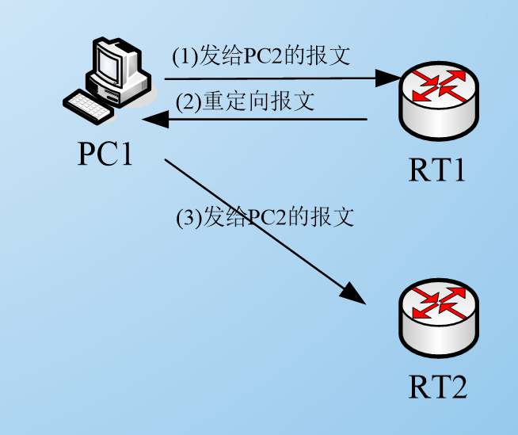

RT1发现报文的出口和入口相同，或者源地址跟报文下一跳同属一个网段，则发出重定向报文

省的下一跳跳错方向

### 2.9.2 路由器-路由器

核心还是路由表相关的问题，可以在[以前的笔记中](../../y3-fall/computer-networks/ch5-the-network-layer.md#2-routing-algorithms)看到关于路由算法的事情

还是几种：

- 直连路由
- 静态路由
- 动态路由

毕竟前两种肯定没区别，我们关注动态路由协议的变化

- 内部网关协议

    - 距离矢量（DV）路由选择协议: **RIPng**（vs. rip）
    - 链路状态（LS）路由选择协议: **OSPFv3** （vs. OSPFv2（RFC2328））
- 边界网关协议

    - **BGP4+**（或MBGP：Multiprotocol）

#### 2.9.2.1 RIPng

主要改变的地方：
- 组播代替广播：主机不再受骚扰
- 下一跳信息由单独的R Table Entry表示（RTE）
- 安全考虑：不单独设置验证，由IPv6本身保证
- 只用于IP网络：不再支持其他网络协议

#### 2.9.2.2 OSPFv3

主要改变的地方
- 地址信息从LSA中移除；（LSU载荷中包含地址信息）
- RouterID仍然采用32位，但不再跟地址有关
- 重新定义了LSA（如增加了link-LSA、Intra-Area-Prefix-LAS等，即LSDB的内容发生了变化）
- 不再支持认证

## 2.10 过度技术

为了同时兼容 IPv4 和 IPv6

- **双栈**

    网络设备上运行IPv6/IPv4双协议栈

    没错，双栈代理也是
- **隧道**

    IPv6网络上承载IPv4分组，或相反
- **翻译/转换**

    地址、分组、端口的转换

    就是 **NAT64** 这种


## 题目


---

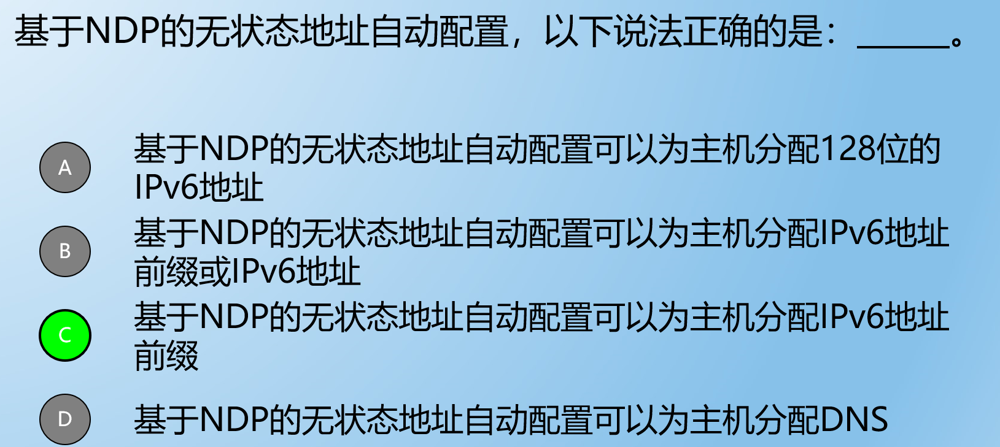

---

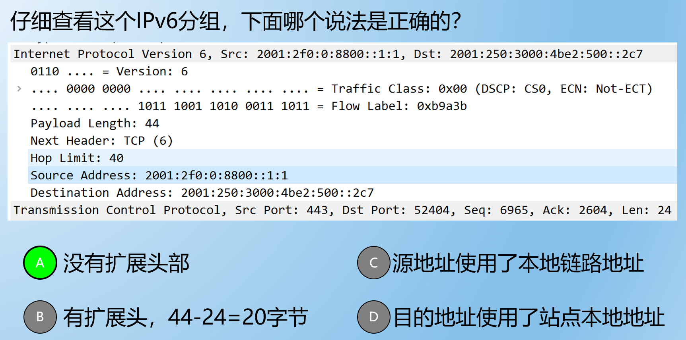

next header 直接就是 TCP（负荷）了


