# 3. 高级路由

想看主路由表的话：

- Windows: `route print`
- Linux: `netstat -r`

## 3.1 设置路由

为了生成路由表，可以有三种形式

- **直连路由**（自学习）
- **静态路由**（管理员配置）
- **动态路由**（协议运行，自动生成和维护）

### 3.1.1 静态路由

语法：`ip route prefix mask {address|interface} [distance]`

可以看到既可以指定地址、也可以指定接口。指定接口的时候可以更高效，指定地址的话需要二次查找，才能确定接口

!!! question

    ppt 上有个重要的管理距离：0, 1, 110, 120，不知道指的是什么

使用场景：

- 拓扑长期不变，无须学习，可以节约路由器的学习维护开销
- 存根网络（stub），可配置默认路由

    减小学习维护开销
    缩减路由表的规模
- 避免错误地丢弃分组
- **浮动静态路由**

    是一种特殊的静态路由，通过配置一个比主路由的管理距离更大的静态路由，保证网络中主路由失效的情况下，提供备份路由

### 3.1.2 动态路由

还是和之前了解的那样：

- 内部网关协议

    - 路由信息协议（RIP）（典型DV协议）
    - 开放最短路径优先（OSPF）（典型的LS协议）
    - 内部网关路由协议（IGRP）
    - 增强内部网关路由协议（E IGRP ）
- 外部网关协议

    - 边界网关协议（BGP）

#### 3.1.2.1 RIP

最基本的 RIPv1 参见之前的[笔记](../../y3-fall/computer-networks/ch5-the-network-layer.md#24-distance-vector-routing)

RIPv2 相比 RIPv1，增加了两个字段：

- **Subnet Mask**
- **Next Hop**

---

Distance Vector 类的协议存在之前笔记中提过的收敛之类的问题，那么怎么解决？

提高收敛速度的方法：

- **水平分割**（Split Horizon）

    原则很简单：
    
    > Never send routing information back in the direction ==from which it was received==
- 毒性逆转（Poison Reverse）
- **抑制定时器**（Hold-Down Timers）

    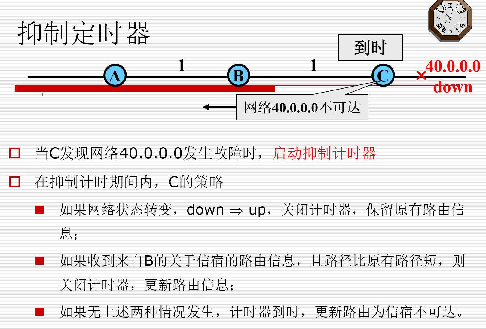
- 触发更新（Triggered Updates）

##### 3.1.2.1.1 RIPng

处于应用层的协议，前面玩意的 IPv6 增强版，主要的区别是：

- Support of IPv6 networking.
- While RIPv2 supports RIPv1 updates authentication, RIPng does not. IPv6 routers were, at the time, supposed to use IPsec for authentication.
- RIPv2 encodes the next-hop into each route entry, RIPng requires specific encoding of the next hop for a set of route entries.

除此之外：

- 端口从 `520` 改成了 `521`
- 组播地址为 `ff02:9`
- 源地址使用 `fe80::/10`

---

报文的结构：

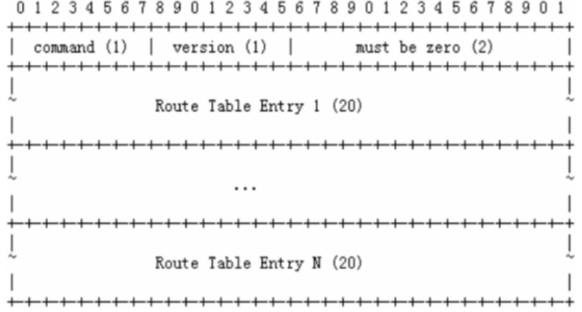

- Command：报文类型

    - 0x01：request报文
    - 0X02：response报文
- Version：RIPng的版本号，现在是0x01
- Route Table Entry (RTE)

    路由表项，长度为20个字节

    有两种：

    - 下一跳RTE：位于一组前缀之前
    - 前缀RTE--》下一跳RTE

---

报文整体上也是分成两类：

- Request报文：当路由器启动或更新时，发该类报文 （组播）

    - 通用request报文：路由器启动时发送，只有一项RTE，且前缀和前缀长度都为0，量度为16，表示请求全部
    - 指定request报文：用于网络诊断

- Response报文

    - 对Request的回应：通常包含全部的路由信息
    - 主动发送
        - 周期性发送 （组播）
        - 触发更新

    通常，路由会对收到的Response报文进行有效性检查，如端口号，地址，通过了才会使用该信息来更新路由表

## 3.2 OSPF

考试的时候就考v3和v2的区别而已

其实以前就学过v2的内容，详见[link state routing](../../y3-fall/computer-networks/ch5-the-network-layer.md#25-link-state-routing)相关的内容，另参见[wiki](https://en.wikipedia.org/wiki/Open_Shortest_Path_First#OSPF_areas)

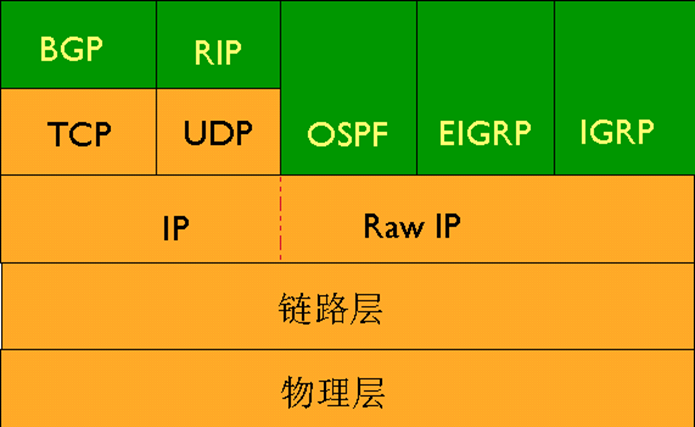

不知道这图想表达什么


也是个奇怪的概念

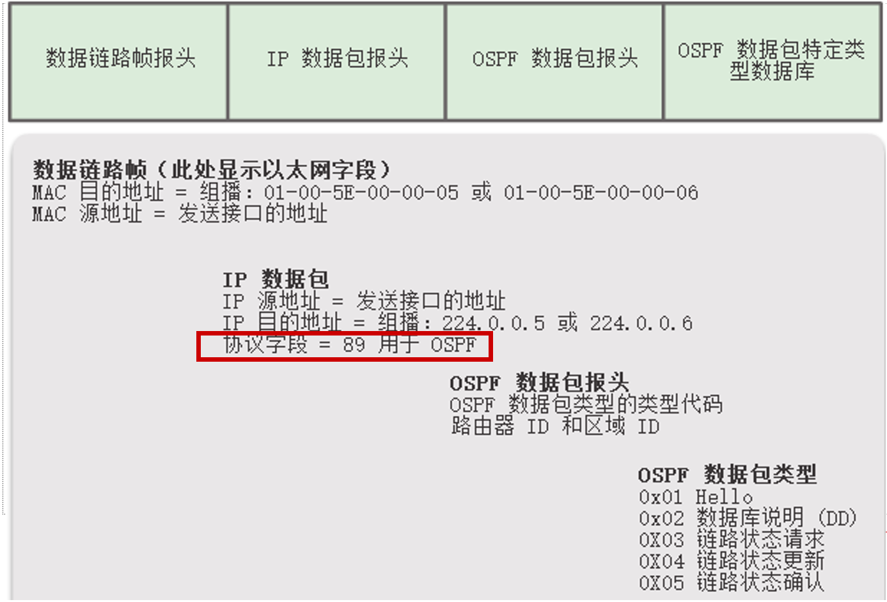

这是包大概的构成，可以看到 OSPF 对应 89 字段协议

至于包到底都有哪些类型：

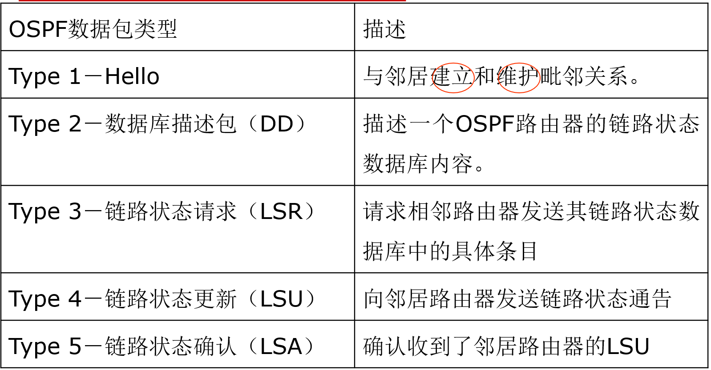

我觉得报文的具体细节应该不考

报文的结构则是这样：

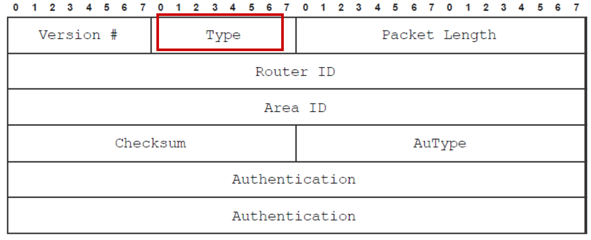

### 3.2.1 OSPF 运行过程

前面介绍的是 link state protocol 的运行过程，而 OSPF 的会略有不同

- 建立路由器毗邻关系
- 选举DR和BDR
- 发现路由
- 选择最佳路由
- 维护路由信息

#### 3.2.1.1 建立毗邻关系

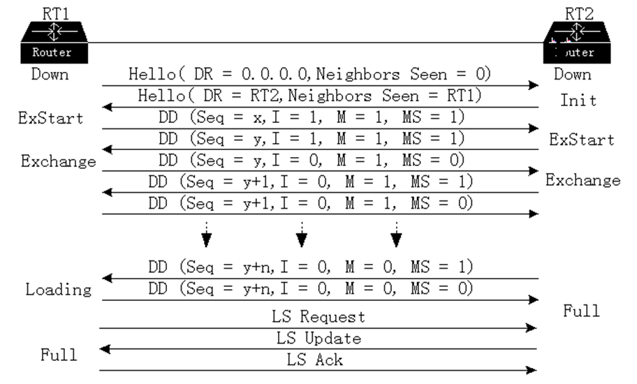

看看就得了

OSPF 的状态也可以在上图中看到：

- Down
- Init（初始）
- Two-way（双向）
- ExStart（准启动）
- Exchange（交换）
- Loading（加载）
- Full adjacency（全毗邻） 

#### 3.2.1.2 选举 DR 和 BDR

Designated Router
:  is the router interface elected among all routers on a particular multiaccess network segment, generally assumed to be broadcast multiaccess

Backup Designated Router
: is a router that becomes the designated router if the current designated router has a problem or fails

你可能会觉得为什么需要 DR，因为这样的话邻接关系就可以大幅度简化，大家都尽量和 DR 通信就可以维护状态了，同步的次数减少到了 $O(n)$

#### 3.2.1.3 发现路由

- 在exstart状态下交换DD报文
- 比较自己的数据库与收到的摘要是否相同
- 不相同，则请求完整LSA信息

#### 3.2.1.4 选择最佳路由

- SPF (Shortest Path First)
- 负载均衡

#### 3.2.1.5 维护路由信息

- 触发更新，LSU
- Hello分组发送的时间间隔：缺省10秒
- Hello分组的失效间隔：缺省40秒
- 即使没有拓扑变化，LSA在条目过期（缺省30分钟）后，发送LSU，通告链路存活

### 3.2.2 优势

- 每一条LSA都标记了生成者（用生成该LSA的路由器的RouterID标记），其他路由器只负责传输，这样不会在传输的过程中发生对该信息的改变和错误理解。
- 路由计算的算法是SPF，计算的结果是一棵树，路由是树上的叶子节点，从根节点到叶子节点是单向不可回复的路径。
- 区域之间通过规定骨干区域避免

### 3.2.3 Router types

- Internal router (IR)

    : An internal router has all its interfaces belonging to the same area.
- Area border router (ABR)

    : An area border router is a router that connects one or more areas to the main backbone network. It is considered a member of all areas it is connected to. An ABR keeps multiple instances of the link-state database in memory, one for each area to which that router is connected.
- Backbone router (BR)

    : A backbone router has an interface to the backbone area. Backbone routers may also be area routers, but do not have to be.
- Autonomous system boundary router (ASBR)

    : An autonomous system boundary router is a router that is connected by using ==more than one routing protocol== and that exchanges routing information with routers autonomous systems. ASBRs typically also ==run an exterior routing protocol (e.g., BGP)==, or use static routes, or both. 

### 3.2.4 OSPF Areas

关于为什么要划分多个区域：

- LSDB非常庞大，占用大量存储空间
- 计算最小生成树耗时增加，CPU负担很重
- 网络拓扑结构经常发生变化，网络经常处于“动荡”之中

有如下类型：

- Backbone

    接收外部路由信息
- Stub

    不接收外部路由信息
- 其它不用管

### 3.2.5 OSPFv3

变化：

- 基于链路运行

    在OSPFv2中，协议的运行是基于**子网**的，邻居之间形成邻接关系的条件之一就是两端的IP地址属于同一网段而且掩码相同。

    而在OSPFv3中，协议基于**链路**运行，与具体的IPv6地址、前缀分离开来，即使同一链路上的不同节点具有不同的IPv6地址时，协议也可以正常运行。

- 取消了编址语义

    在OSPFv2中，协议分组和LSA中的许多字段都是来自于网络上的某个IP地址，或掩码，或某个IP子网号。严重依赖IPv4。

    在OSPFv3中，取消了上述编址性语义，而只保留协议运行必须的核心内容。ID依然保留32位，但只是一个编号，不再包含地址信息。

- 链路本地地址的使用


    在OSPFv2中，每一个运行OSPF的接口都必须有一个全局的IPv4地址，协议的运行和路由的计算都依赖于它。

    在IPv6中，每个接口都会分配本地链路地址（link-local address），OSPFv3使用了这个本地链路地址作为协议分组发送的源地址（虚连接除外），而且使用它作为路由的下一跳。

    可以节省大量的全局地址，同时可以说协议的运行独立于IPv6，可以方便的扩展用于多种协议的路由。

- 使用专门的LSA来发布路由前缀信息

    新增加了Intra-Area-Prefix-LSA，用于传递区域内路由前缀；新增加了Link-LSA，用于传递链路范围内的IPv6前缀。

于是有了如下优点：

- 结构更加清晰

    - 取消了协议报文的验证字段
    - 明确的LSA泛滥范围
        - 本地链路范围（Link-local scope）
        - 区域范围（Area scope）
        - AS范围（AS scope）
        - 在LS_Type中增加了专门的字段，方便传播控制

    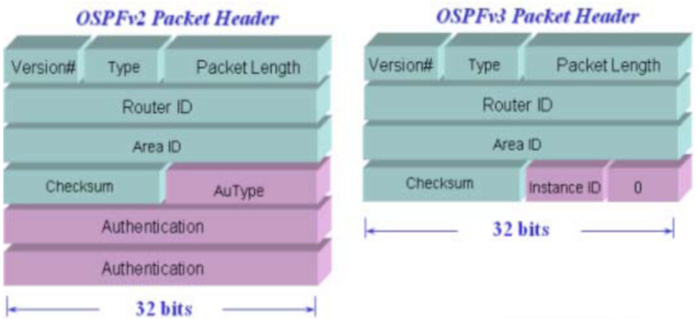

- 更好的可扩展性和适应性

    - 在OSPFv2中，不同的实例必须运行在不同的链路上。
    - 在OSPFv3中，明确的提供了对多实例的支持，在协议报文中增加了“instance ID”字段，同时在报文接收时对该字段进行判断，只有实例号匹配的报文才会处理，否则丢弃。这样，即使是同一链路也可以运行多个OSPF实例了，而且互相独立运行不会影响。


## 3.3 BGP

[wiki](https://en.wikipedia.org/wiki/Border_Gateway_Protocol)

[以前的笔记](../../y3-fall/computer-networks/ch5-the-network-layer.md#67-bgp-the-exterior-gateway-routing-protocol)

Border Gateway Protocol (BGP)
: is a standardized exterior gateway protocol designed to exchange routing and reachability information among ***autonomous systems (AS)*** on the Internet

> BGP is classified as a **path-vector routing protocol**, and it makes routing decisions based on ==paths, network policies, or rule-sets configured by a network administrator==.

增强版的 DV，会记录整个路径的信息，而不只是路径的 cost，==不会导致环路==

---

每个 AS 其实都有自己对应的编号，叫 ***ASN***。ASN 会像 IP 地址一样用完，所以曾经扩充过

### 3.3.1 Operation

BGP peer/neighbor
: 运行BGP的设备之间的称谓

BGP speaker
: 运行BGP的设备

Interior BGP (iBGP)
: two peers in the same AS

Exterior BGP (eBGP)
: runs between different AS

BGP neighbors 之间通过 ==TCP 在端口 179== 建立连接

所以 BGP 到底是怎么工作的？

- 通过TCP建立BGP连接时，发送OPEN报文
- 连接建立后，如果有路由器需要发送路由或路由发生变化时，发送UPDATE报文
- 稳定后，周期发送KEEPALIVE报文，维持连接有效性
- 当本地BGP运行中发生错误时，发送NOTIFICATION报文通告BGP对端

下一小节介绍报文


### 3.3.2 Packet format

#### 3.3.2.1 Message header format

<table class="wikitable" style="text-align:center; border:none; background:none;">
<caption>BGP version 4 message header format<sup id="cite_ref-" class="reference"></sup>
</caption>
<tbody><tr>
<th style="width:4%;">bit offset
</th>
<th colspan="16" style="width:50%;">0–15
</th>
<th colspan="8" style="width:25%;">16–23
</th>
<th colspan="8" style="width:25%;">24–31
</th></tr>
<tr>
<th>0
</th>
<td rowspan="4" colspan="32">Marker (always: ff ff ff ff ff ff ff ff ff ff ff ff ff ff ff ff)
</td></tr>
<tr>
<th>32
</th></tr>
<tr>
<th>64
</th></tr>
<tr>
<th>96
</th></tr>
<tr>
<th>128
</th>
<td colspan="16">Length
</td>
<td colspan="8">Type
</td>
<td colspan="8" style="border: none; background:none;">
</td></tr></tbody></table>

- **Marker**: Included for compatibility, must be set to all ones.
- **Length**: Total length of the message in octets, including the header.
- **Type**: Type of BGP message. The following values are defined:

    - Open (1)
    - Update (2)
    - Notification (3)
    - KeepAlive (4)
    - Route-Refresh (5)

下面就一个个看看这 5 种报文：

#### 3.3.2.2 Open Packet

- **Version (8bit)**

    Version of BGP used.
- **My AS (16bit)**

    Senders autonomous system number.
- **Hold Time (16bit)**

    Timeout timer, used to calculate KeepAlive messages. Default 90 seconds.
- **BGP Identifier (32bit)**

    IP-address of sender.

- **Optional Parameters Length (8 bit)**

    total length of the Optional parameters field.

#### 3.3.2.3 Update Packet

只发送变化的情况

e.g.,

```
Type: UPDATE Message (2)
Withdrawn Routes Length: 0
Total Path Attribute Length: 25
Path attributes
 ORIGIN: IGP
 AS_PATH: 64500
 NEXT_HOP: 192.0.2.254
 MULTI_EXIT_DISC: 0
Network Layer Reachability Information (NLRI)
 192.0.2.0/27
 192.0.2.32/27
 192.0.2.64/27
```

#### 3.3.2.4 Notification

有异常情况

e.g.,

```
Type: NOTIFICATION Message (3)
Major error Code: OPEN Message Error (2)
Minor error Code (Open Message): Bad Peer AS (2)
Bad Peer AS: 65200
```

#### 3.3.2.5 KeepAlive

保持活跃，不过只有报文头部

```
Type: KEEPALIVE Message (4)
```

#### 3.3.2.6 Route-Refresh

路由信息有变化，请求重发 update 报文

```
Type: ROUTE-REFRESH Message (5)
Address family identifier (AFI): IPv4 (1)
Subtype: Normal route refresh request [RFC2918] with/without ORF [RFC5291] (0)
Subsequent address family identifier (SAFI): Unicast (1)
```

### 3.3.3 BGP路由的注入途径及通告原则

- 动态路由注入
- 半动态路由注入
- 静态路由注入

BGP 路由的使用原则

- 多条路径时，BGP 路由器只选最优的给自己使用
- BGP 路由器只把自己使用的路由通告给相邻体
- BGP 路由器从EBGP获得的路由会向它的所有BGP相邻体通告（包括EBGP和IBGP）
- BGP路由器从IBGP获得的路由不会向它的IBGP相邻体通告（避免内部产生环路）
- BGP 路由器从IBGP获得的路由是否通告给它的EBGP相邻体要依IGP和BGP同步的情况而定
- 连接一建立， BGP路由器将把自己所有的BGP路由通告给新相邻体（极大的考验和挑战！）

ppt p41 提到了 BGP 黑洞，解释见[知乎](https://zhuanlan.zhihu.com/p/109012492)（外网居然反而搜不到。。。）

### 3.3.4 路径属性

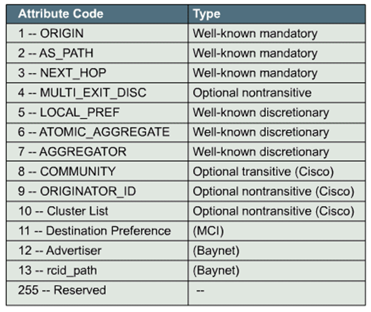

一些和路径选择有关的属性

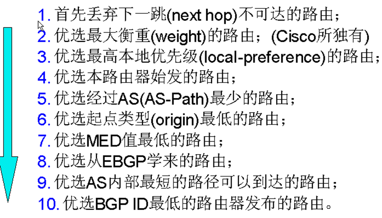

反正选最短的就对了

### 3.3.5 大型网络可能遇到的问题

- 从IBGP收到的路由不会通告给其它IBGP 相邻体（避免loop），所以，AS内部的IBGP必须全连接
- 路由表庞大：超过80万条

    - BGP聚合
- IBGP相邻体过多，逻辑全链接不现实

    - BGP联盟
    - BGP反射
- 复杂网络中的路由变化频繁

    - BGP衰减

- BGP 安全：如果恶意/不小心通告比合法通告还要具体,或者声称提供更短的路径,那么流量就可能被定向到攻击者那里去。


## 题目

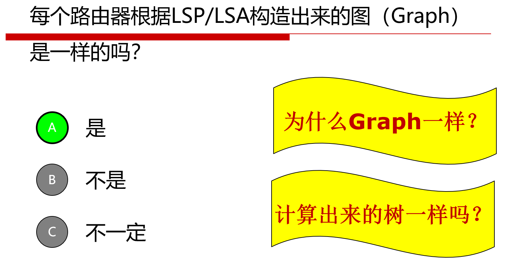

---

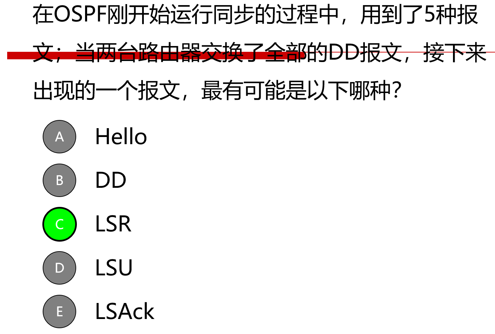

---

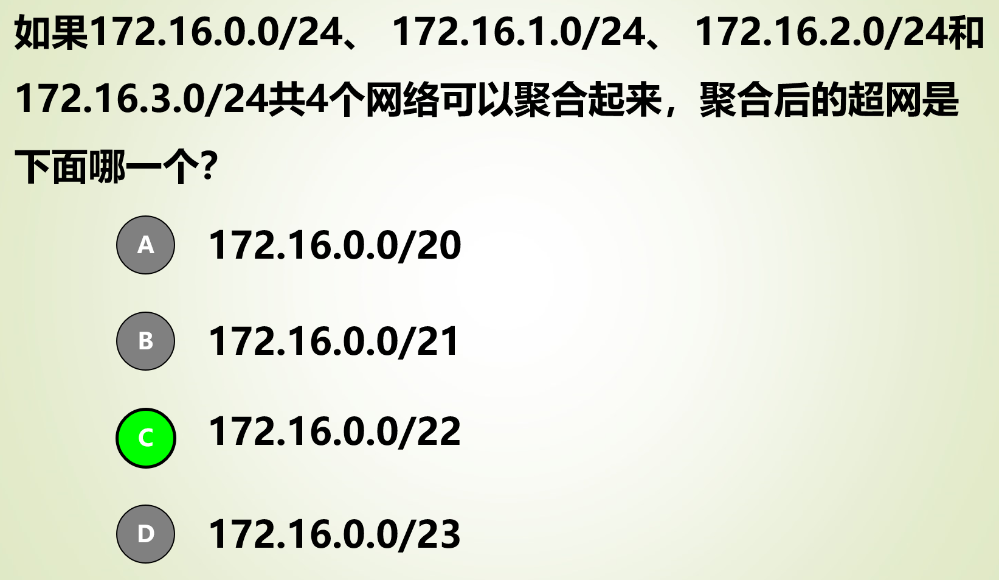

`00`, `01`, `10`, `11`，一起占了两位二进制
