# 5. QoS

总之就是不同类型的流量提供不同的服务质量

QoS 的衡量参数：

- 有效性（可靠性）
- 带宽/吞吐量 (bandwidth)

    - 有效带宽：

        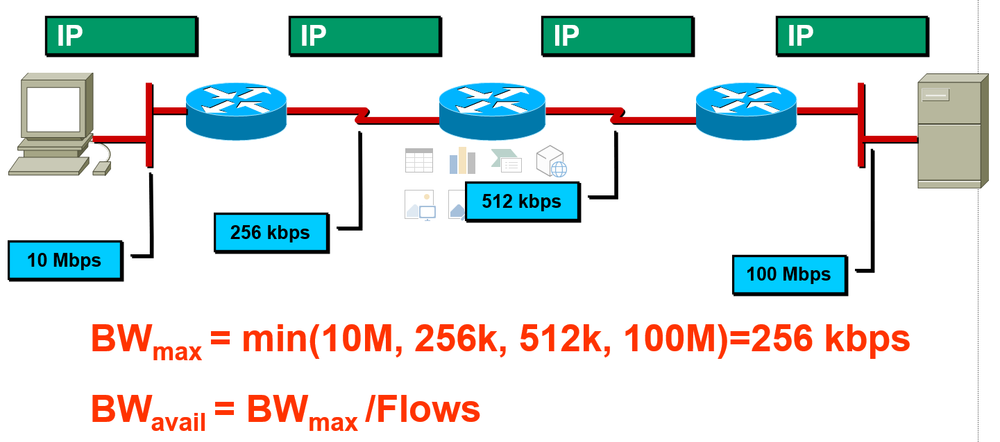
- 延时 (delay)

    - 端到端延迟：

        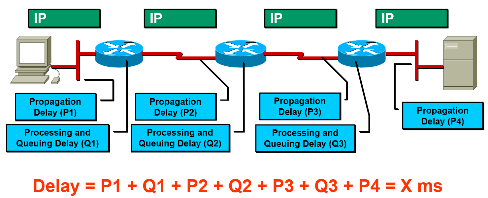
- 抖动 (jitter)

    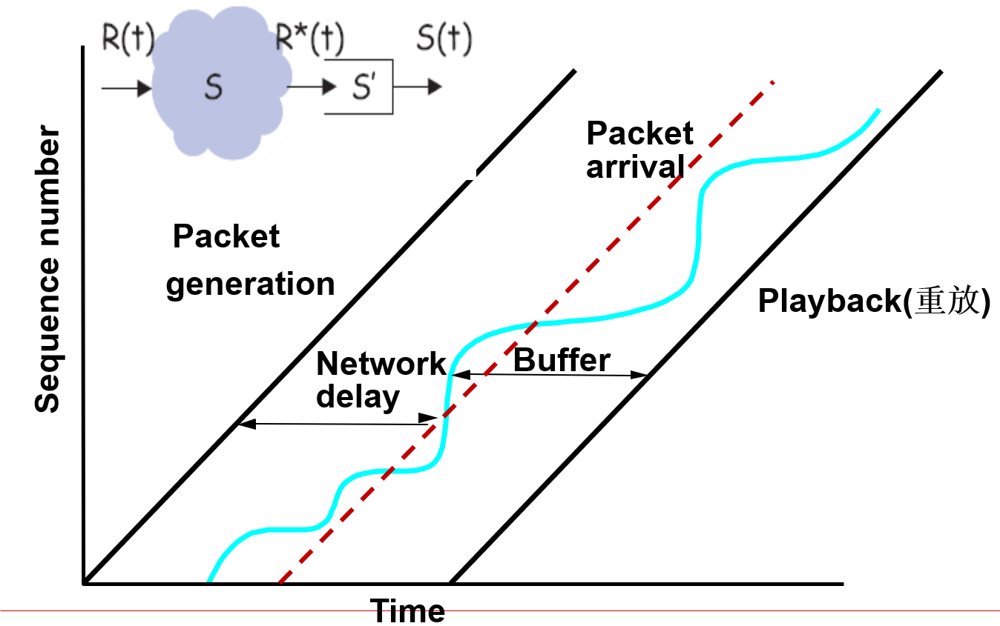
- 丢包率 (loss rate)

虽然 QoS 的方法有很多类，我们这里关注的是和 IP 有关的 QoS

有几种不同的 QoS 模型

## 5.1 综合服务模型

具体的协议为**资源预留协议** ReSource ReserVation Protocol (RSVP)

工作流程为：

- 发送者发送 PATH message (每 30 秒)
- 沿途路由器记录路径信息 （设置路径状态）
- 接收者回发 RESV message (每 30 秒)

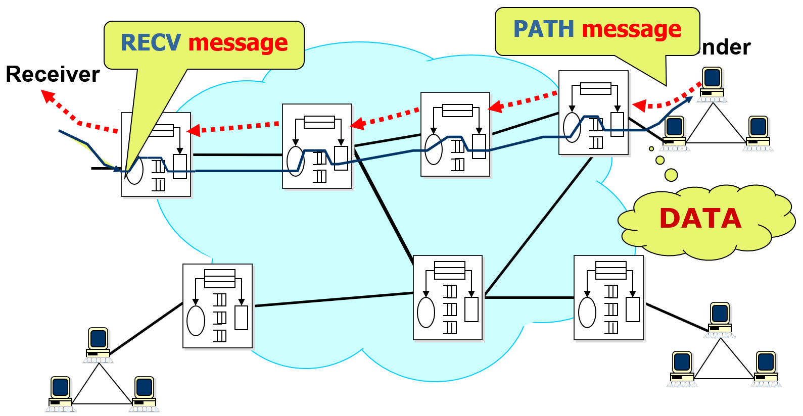

---

综合服务缺点如下：

- 所有的路由器都必须为每个流维护状态信息
- 完全的分布性导致极大的复杂性！
- 在低速连接上造成高负载的低效工作模式
- 扩展性和鲁棒性

## 5.2 区分服务模型

也叫差分服务模型（[Differentiated Services](https://en.wikipedia.org/wiki/Differentiated_services)）

综合服务因为各种缺点失败了，区分服务模型则试图通过定义**服务类**，来克服缺点。具体来说，会使用 6-bit 的 **differentiated services code point** (DSCP) 来进行不同类别的划分，被放在 IPv4 的 TOS 字段（该字段 8-bit，所以有 2-bit 没用）

<table class="wikitable">
<tbody><tr>
<th>7</th>
<th>6</th>
<th>5</th>
<th>4</th>
<th>3</th>
<th>2</th>
<th>1</th>
<th>0
</th></tr>
<tr>
<td colspan="3">Precedence
</td>
<td colspan="3">Type of Service
</td>
<td colspan="2">Unused (0)
</td></tr></tbody></table>

总的来说有四个大类（下面的 `a` 都表示任意值）：

- **Class Selector**

    ```
    aaa 000
    ```

    > which maintain backward compatibility with the IP precedence field
- **Expedited Forwarding** (EF): RFC2598 (加速转发)

    ```
    101 110
    ```
- **Assured Forwarding** (AF): RFC2597 (确保转发)

    ```
    aaa bb0
    ```
    `a`代表IP优先级，只用到 1~4，`b`代表丢弃级别，具体如下表

    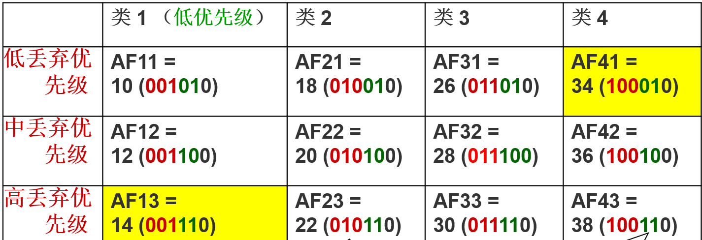

- **Default** (Best Effort，BE)

    ```
    000 000 
    ```

> **CoS** 是 class of service

---

差分服务的优点：

- 无需逐条信令（signalling）
- 无需单个流或单个用户状态
- 只有聚合的类别状态（ classification state）
- 只有在边界路由器上分类/调节较复杂
- 简单的分组处理（ 核心路由器）
- 转发行为较单纯（PHB）

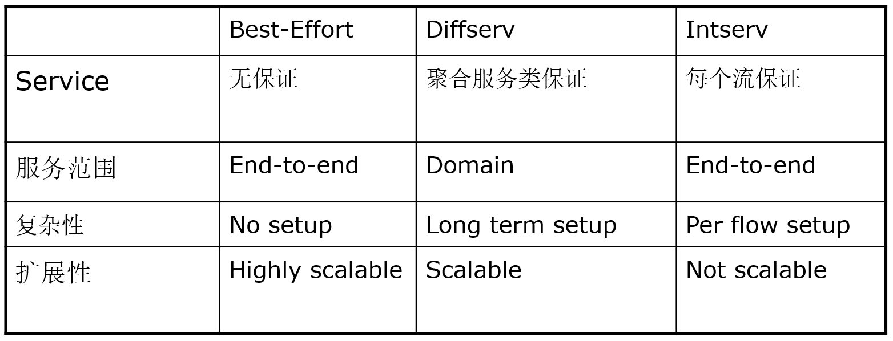

## 5.3 MPLS 模型

多协议标签交换 [Multiprotocol Label Switching](https://en.wikipedia.org/wiki/Multiprotocol_Label_Switching)

大概思路是，地址负责标识目的地，而包上打的**标签**则是用于选择中间的道路

因为 IP 分组头部没有这个字段，所以就放在分组头部之前；一般认为是工作在 ISO 网络模型的 2.5 层

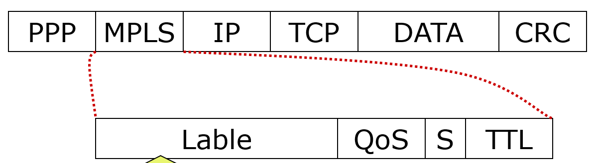

具体的工作流程：

- 在MPLS网络入口的边沿路由器上打上标签
- 沿途路由器检查标签，根据标签值查找转发表，转发（替换新的标签）
- 在MPLS网络出口的边沿路由器上拆除标签，以后按照通常意义的三层路由转发

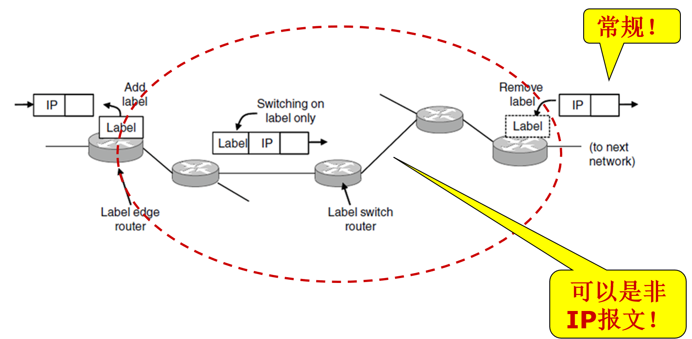

---

MPLS 和普通标签交换的区别：

- 聚合水平：FEC（转发等价类）
- 支持多种网络协议
- 是否需要连接建立：标签转发表由MPLS路由器建立

## 5.4 QoS 相关的重要技术

- 拥塞管理和控制
    - 队列技术
    - 拥塞避免
        - 随机早期检测RED
    - 流量监管（Commit Access Rate）
    - 流量整形（漏桶、令牌桶）
    - 物理接口总速率限制
- 其他QoS技术
    - 链路效率机制
    - 链路层QoS（ATM、FR等）

### 5.4.1 队列技术

感觉和以前学过的进程管理一模一样

- **First in First Out** (FIFO)

    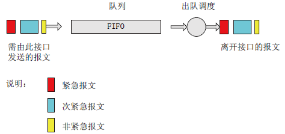
- **Priority Queuing** (PQ)

    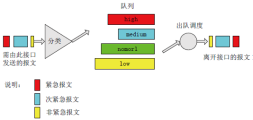
- **Custom Queuing** (CQ)

    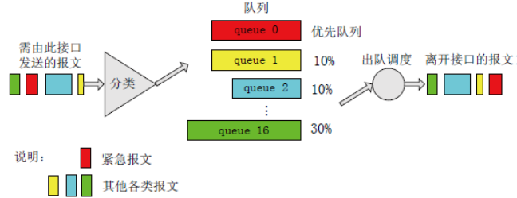

    0 号队列会优先处理，而其它则是遵循 [round-robin](../../y3-fall/operating-systems/ch2-processes-and-threads.md#243-scheduling-in-interactive-systems) 的策略

- **Weighted Fair Queuing** (WFQ)

    先把相同的源IP、目的IP、源端口、目的端口、协议号、ToS值归为一个流（五元组），在此基础上根据设好的权重来给每个流分配带宽

- **Class Based Weighted Fair Queuing** (CBWFQ)

    顾名思义，就是在 WFQ 的基础上增加了用户自定义的 class。

    class 根据一些标准来进行划分（e.g., 协议、输入端口）

    每个 class 可以设置包括最低可以保证的带宽、权重等等属性

---

说了对每个 queue 可以做的流量管控算法，但是队列要按什么标准划分呢？

其中一种是 **Access Control List** (ACL)：基础的信息包括源 IP 地址，扩展情况下还包括目的 IP、端口号、范围、时间等

### 5.4.2 拥塞避免技术

Weighted Random Early Detection (WRED)
: 人话：权重低的就设个较低阈值，随机丢包


## 题目

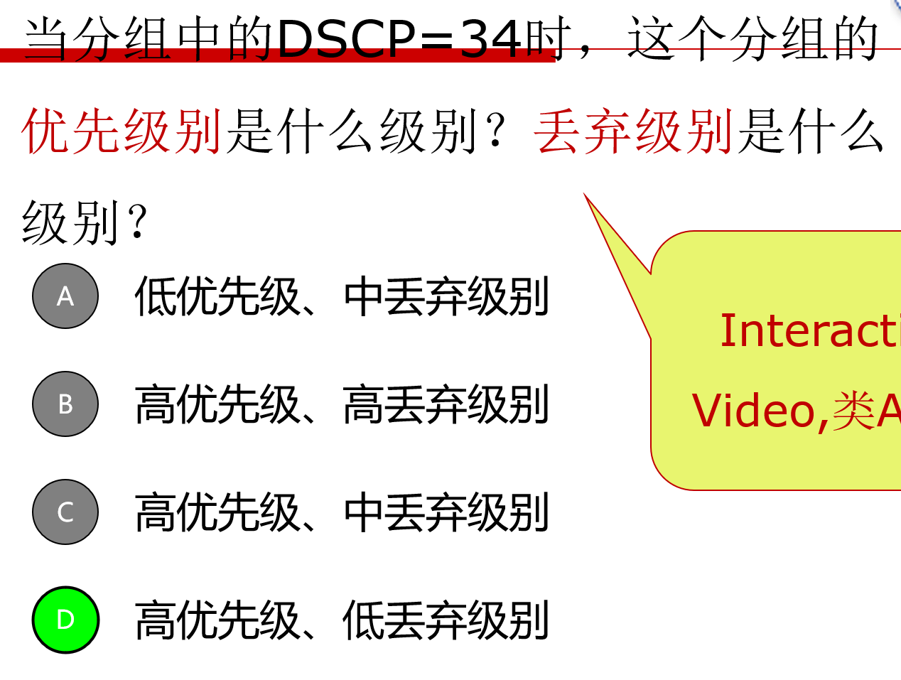

`100010` 意味着优先级是 `100` 即高优先；`010` 是低丢弃（没错，丢弃的最低级别不是 `001`）

