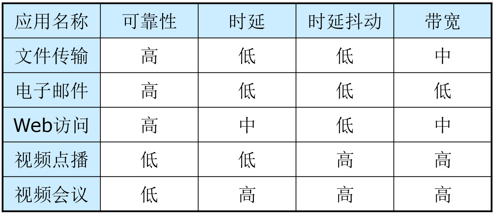

# 综述题

## QoS基本概念、应用及研究现状？

概念：

> QoS是指一个网络能够利用各种底层技术向**选定的网络业务**提供更好的服务的能力。

应用：

研究现状：

- IP QoS: Issues, Protocols and Standards
- IP QoS: VoIP，IPTV，VC
- Web QoS
- QoS路由（QoS Routing）
- 分组调度技术（Packet scheduling techniques）
- 无线网络QoS
- 流量工程（Traffic Engineering ）
    - 是一套工具和方法，无论是在网络设备和传输线路正常还是失效的情况下，它都能从给定的基础设施中提取最佳的服务。

感觉乱七八糟的

## QoS基本服务模型及其对比？

<table class="table table--bordered table--compressed table--wrap table--nostripes" style="width: 800px;"><thead><tr><th style="width: 250px;"><strong>型号</strong>       </th><th style="width: 550px;"><strong>描述</strong>       </th></tr></thead><tbody><tr><td>尽力而为模型</td><td><ul><li> 它并不是真正的 QoS 部署， 也无需明确配置。</li><li>在不需要实施 QoS 时使用的就是它。</li></ul></td></tr><tr><td>集成服务 (IntServ)</td><td><ul><li> IntServ 为 IP 数据包提供了非常高的 QoS 传输保证。</li><li> 它为应用定义了一个信令过程，以信令的方式告诉 网络它们在一段时间内需要特殊的 QoS， 应该为它们预留带宽。</li><li> 但 IntServ 模型严重限制了网络的可扩展性。</li></ul></td></tr><tr><td>差分服务 (DiffServ)</td><td><ul><li> DiffServ 在 QoS 的实施中提供了高可扩展性和灵活性。</li><li> 网络设备会对流量进行分类识别， 并为不同的流量类别提供不同 级别的 QoS 服务。</li></ul></td></tr></tbody></table>

## IPv6与QoS？

Quality of Service (QoS) in an IPv6 network is a set of techniques and mechanisms designed to ensure that network traffic meets specific service level objectives, such as latency, bandwidth, and reliability. QoS becomes particularly important in IPv6 networks where diverse applications, including voice and video, coexist and compete for network resources. Here's a detailed explanation of QoS in an IPv6 network:

### 1. **Traffic Classification:**
   - **Definition:** Traffic classification involves categorizing different types of traffic based on various parameters like source/destination address, port numbers, protocol, and Differentiated Services Code Point (DSCP) values in the IPv6 header.
   - **Implementation:** Administrators use policies and rules to classify traffic into different classes or queues.

### 2. **Marking and Tagging:**
   - **Definition:** Once traffic is classified, it needs to be marked or tagged to indicate its priority or treatment.
   - **Implementation:** IPv6 uses the ==Traffic Class field and Flow Label== field in the IPv6 header for marking packets. The DSCP field in the IPv6 header is also used to convey QoS information.

### 3. **Queue Management:**
   - **Definition:** Queues are used to temporarily hold packets before they are transmitted. Queue management involves determining the order in which packets are dequeued and transmitted.
   - **Implementation:** Differentiated queuing, Weighted Fair Queuing (WFQ), and Class-Based Queuing (CBQ) are common queue management techniques in IPv6 networks.

### 4. **Traffic Policing and Shaping:**
   - **Definition:** Traffic policing involves monitoring and controlling the rate of traffic entering a network. Traffic shaping smoothes out bursts of traffic.
   - **Implementation:** Token Bucket and Leaky Bucket algorithms are often used for traffic policing, while traffic shaping is typically done at the network edge.

### 5. **Congestion Avoidance:**
   - **Definition:** Congestion avoidance mechanisms help prevent network congestion by slowing down traffic when congestion is detected.
   - **Implementation:** Random Early Detection (RED) and Explicit Congestion Notification (ECN) are examples of congestion avoidance mechanisms.

### 6. **Resource Reservation:**
   - **Definition:** Resource reservation ensures that sufficient network resources are allocated to meet the QoS requirements of specific applications.
   - **Implementation:** Resource Reservation Protocol (RSVP) can be used to reserve resources along the network path.

### 7. **IPv6 Flow Label:**
   - **Definition:** IPv6 introduces the Flow Label field in the IPv6 header, designed to help identify and provide special handling for packets belonging to the same flow.
   - **Implementation:** While not widely deployed, the Flow Label field has the potential for improving QoS by facilitating faster packet processing for specific flows.

### 8. **Integration with Existing QoS Mechanisms:**
   - **Definition:** IPv6 networks often coexist with IPv4 networks, and it's essential to integrate QoS mechanisms seamlessly.
   - **Implementation:** Dual Stack networks need to apply QoS policies consistently across both IPv4 and IPv6 traffic.

### 9. **Monitoring and Management:**
   - **Definition:** Continuous monitoring and management are crucial for maintaining and optimizing QoS in the network.
   - **Implementation:** Network administrators use tools like Simple Network Management Protocol (SNMP) and flow analysis tools to monitor and manage QoS parameters.

In summary, implementing QoS in an IPv6 network involves a combination of traffic classification, marking and tagging, queue management, traffic policing and shaping, congestion avoidance, resource reservation, and integration with existing QoS mechanisms. Monitoring and management are critical components to ensure that the QoS policies are effective and adaptive to the dynamic nature of network traffic.

## 流量工程，MPLS实现QoS

### 流量工程

Traffic Engineering (TE) is a set of techniques and strategies used to optimize the performance and utilization of network resources, with a focus on Quality of Service (QoS). It involves the intelligent control and management of traffic flows within a network to ensure efficient and reliable data transmission. The primary goals of Traffic Engineering are to enhance network performance, minimize congestion, and meet specific QoS requirements. Here's a detailed introduction to Traffic Engineering in terms of QoS:

#### 1. **Overview of Traffic Engineering:**
   - **Definition:** ==Traffic Engineering is the process of analyzing, modeling, and controlling the flow of data through a network to achieve optimal performance and resource utilization==.
   - **Objectives:** The main objectives include improving network efficiency, reducing congestion, enhancing QoS, and ensuring a better overall user experience.

#### 2. **Importance of Traffic Engineering for QoS:**
   - **Resource Optimization:** TE helps distribute network resources efficiently to prevent congestion and ensure that available bandwidth is used optimally.
   - **QoS Assurance:** By strategically managing traffic, TE helps meet QoS requirements for applications like voice, video, and real-time data transmission.

#### 3. **Key Components of Traffic Engineering for QoS:**
   - **Traffic Measurement and Analysis:** Collecting data on traffic patterns, usage, and performance metrics to understand network behavior.
   - **Traffic Modeling:** Creating mathematical models to simulate and predict how network resources will be used under different conditions.
   - **Routing Optimization:** Dynamically adjusting routing paths to balance traffic loads, avoid congested links, and optimize end-to-end delay.
   - **Policy-Based Management:** Implementing policies to prioritize specific types of traffic based on QoS requirements.

#### 4. **Techniques and Mechanisms in Traffic Engineering:**
   - **Traffic Classification:** Identifying and categorizing different types of traffic based on application, service, or user to apply specific QoS policies.
   - **Traffic Shaping:** Controlling the rate of traffic flow to prevent bursts and ensure a more predictable transmission pattern.
   - **Path Selection and Load Balancing:** Choosing optimal paths for data transmission based on real-time network conditions to distribute traffic evenly.
   - **Link State Monitoring:** Constantly monitoring the state of network links to detect congestion or failures and trigger appropriate adjustments.

#### 5. **QoS Parameters in Traffic Engineering:**
   - **Latency:** Minimizing delay in data transmission, especially for real-time applications like VoIP and video conferencing.
   - **Bandwidth:** Ensuring sufficient bandwidth for different types of traffic, with priority given to critical applications.
   - **Reliability:** Reducing packet loss and ensuring reliable delivery of data.
   - **Jitter Control:** Minimizing variations in packet arrival times to maintain smooth and consistent data flow.

#### 6. **Challenges in Traffic Engineering for QoS:**
   - **Dynamic Network Conditions:** Networks are dynamic, and conditions change constantly. TE systems must adapt to these changes in real-time.
   - **Scalability:** As networks grow in size and complexity, scalability becomes a challenge in implementing effective Traffic Engineering solutions.
   - **Integration with QoS Policies:** Ensuring seamless integration with existing QoS policies and mechanisms across the network.

#### 7. **Tools and Protocols:**
   - **Network Management Protocols:** SNMP (Simple Network Management Protocol) and NetFlow are commonly used for monitoring and managing network traffic.
   - **Routing Protocols:** Protocols like OSPF (Open Shortest Path First) and IS-IS (Intermediate System to Intermediate System) may be extended or modified to support Traffic Engineering.

#### 8. **Future Trends:**
   - ==**SDN (Software-Defined Networking):**== SDN allows for centralized control of network resources, making it easier to implement dynamic Traffic Engineering strategies.
   - ==**AI and Machine Learning:**== Applying artificial intelligence and machine learning algorithms to predict and adapt to changing network conditions.

In conclusion, Traffic Engineering plays a crucial role in optimizing network performance, especially in the context of QoS. By intelligently managing traffic flows, balancing loads, and adapting to dynamic network conditions, Traffic Engineering helps ensure a reliable and efficient network that meets the QoS requirements of various applications and services.

### MPLS

Multiprotocol Label Switching (MPLS) is a widely adopted and standardized protocol in networking that enhances packet forwarding efficiency, scalability, and traffic engineering capabilities. It provides a flexible and efficient way to route and prioritize network traffic, making it highly relevant in the context of Quality of Service (QoS). Here's a detailed introduction to MPLS in terms of QoS:

#### 1. **Overview of MPLS:**
   - **Definition:** MPLS is a protocol that uses ==labels== to efficiently direct data packets along predetermined paths through a network. It operates at the ==OSI model's layer 2.5==, bridging the gap between traditional layer 2 (Data Link Layer) and layer 3 (Network Layer) protocols.
   - **Label Switching:** MPLS ==replaces traditional IP routing with label switching==, where each packet is assigned a label. Routers use these labels to make forwarding decisions.

#### 2. **Key Components of MPLS for QoS:**
   - **Label Switched Paths (LSPs):** These are predefined paths through the network along which labeled packets are forwarded. LSPs can be established based on QoS requirements.
   - **Label Distribution Protocol (LDP):** LDP is used to distribute labels across MPLS-enabled routers, ensuring consistency in label assignment.
   - **Traffic Engineering (TE):** MPLS allows for the optimization of network resources and traffic flows through the dynamic establishment of LSPs.

#### 3. **Traffic Engineering with MPLS for QoS:**
   - **Path Optimization:** MPLS enables the creation of explicit paths for traffic, allowing network administrators to optimize paths based on QoS requirements.
   - **Resource Reservation:** MPLS supports the reservation of network resources along specific paths, ensuring that sufficient bandwidth and other resources are available for critical applications.
   - **Class of Service (CoS):** MPLS provides a framework for assigning different classes of service to packets, allowing for prioritization and differentiation based on QoS policies.

#### 4. **MPLS Label Stack and QoS:**
   - **Label Stack:** MPLS allows multiple labels to be stacked on top of each other. This enables the encoding of various information, including QoS-related parameters.
   - **Experimental (EXP) Bits:** Within the MPLS header, the EXP bits are used to mark packets with different levels of priority or class of service. This allows for the implementation of differentiated services.

#### 5. **QoS Mechanisms in MPLS:**
   - **IntServ and DiffServ Integration:** MPLS can integrate with IntServ (Integrated Services) and DiffServ (Differentiated Services) models, allowing for fine-grained QoS control.
   - **Explicit and Implicit QoS Control:** MPLS supports both explicit QoS control, where administrators define specific requirements, and implicit control, where default behaviors are used based on preset policies.

#### 6. **MPLS and Traffic Classes:**
   - **Traffic Classifiers:** MPLS routers can classify packets into different classes based on various criteria such as IP precedence, DSCP values, or specific applications.
   - **Per-Hop Behavior (PHB):** MPLS allows the specification of PHB for each traffic class, defining the expected forwarding behavior for packets belonging to that class.

#### 7. **Benefits of MPLS for QoS:**
   - **Efficient Traffic Handling:** MPLS improves the efficiency of routing and forwarding, reducing packet processing times and improving overall network performance.
   - **Scalability:** MPLS scales well, making it suitable for large and complex networks where QoS is crucial.
   - **Network Flexibility:** MPLS provides flexibility in designing and implementing QoS policies, making it easier to adapt to changing network requirements.

#### 8. **Challenges and Considerations:**
   - **Implementation Complexity:** Deploying MPLS may require careful planning and coordination, and it may be complex in large-scale networks.
   - **Interoperability:** Ensuring compatibility between different vendors' MPLS implementations can be a challenge.

In conclusion, MPLS plays a significant role in enhancing QoS in networks by providing a flexible and efficient framework for traffic engineering. Its ability to support explicit paths, label stacking, and various QoS mechanisms makes MPLS a valuable technology for optimizing network performance and ensuring the reliable and timely delivery of critical applications.
