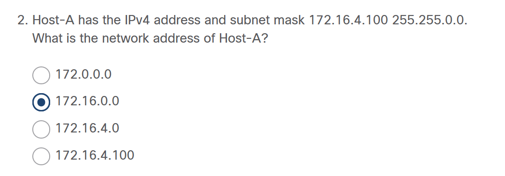
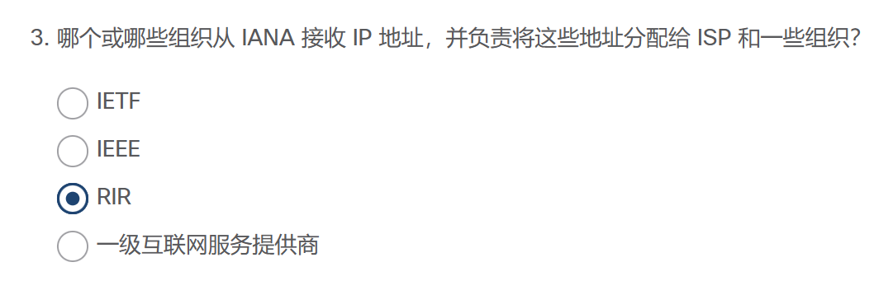
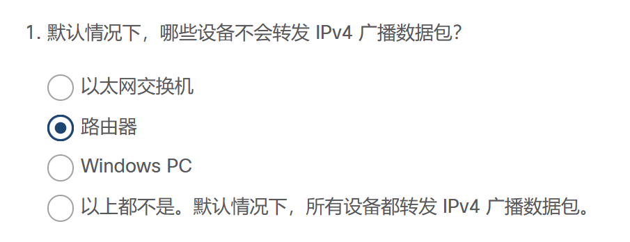
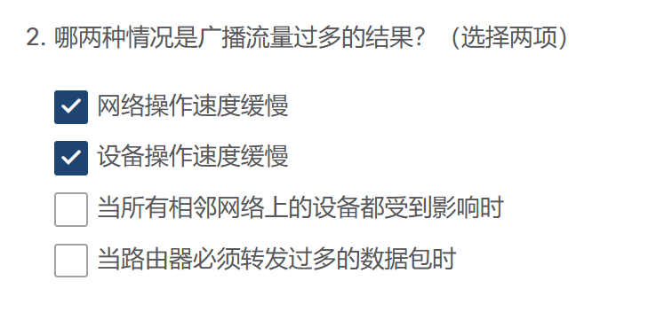
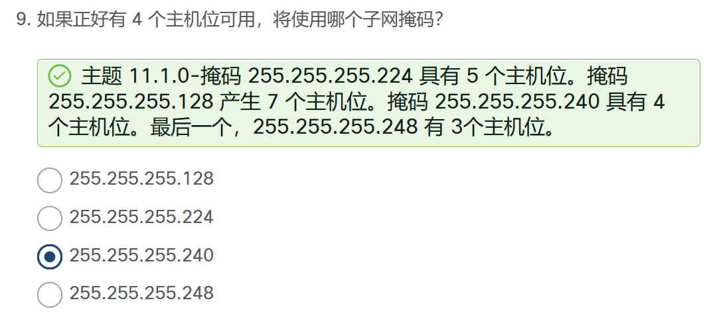

# 11. IPv4 编址

## 11.1 IPv4 地址结构

### 11.1.8 测试

"network address" 指的是**网络地址**！也就是说，代表了整个网络的网段的地址。这个地址也是不可分配的

## 11.3 IPv4 地址的分类

### 11.3.1 公有和私有 IPv4 地址

<table class="table table--bordered table--compressed table--wrap table--nostripes" style="width: 400px;"><thead><tr><th><strong>网络地址和前缀</strong>       </th><th><strong>RFC 1918 私有地址范围</strong>       </th></tr></thead><tbody><tr><td> 10.0.0.0/8</td><td> 10.0.0.0 - 10.255.255.255</td></tr><tr><td> 172.16.0.0/12</td><td> 172.16.0.0 - 172.31.255.255</td></tr><tr><td> 192.168.0.0/16</td><td> 192.168.0.0 - 192.168.255.255</td></tr></tbody></table>

zerotier 应该就是用了第一个网段

第二个网段这个范围也太奇葩了。。。真的很难记

### 11.3.5 传统有类编址

- **A 类 (0.0.0.0/8 - 127.0.0.0/8)** -用于支持拥有 1600 万以上主机地址的规模非常大的网络。A类的第一个八位组使用固定的 /8 前缀表示网络地址，其他的三个八位组表示主机地址(每个网络支持1600 万以上主机地址)。
- **B 类 (128.0.0.0 /16 – 191.255.0.0 /16)** - 用于支持拥有大约 65,000 个主机地址的大中型网络。B类的两个高位八位组使用固定的 /16 前缀表示网络地址，其他的两个八位组表示主机地址(每个网络支持65,000个以上主机地址)。
- **C 类 (192.0.0.0 /24 – 223.255.255.0 /24)** - 用于支持最多拥有 254 台主机的小型网络。C类的前三个八位组使用固定的 /24 前缀表示网络地址，其余的八位组表示主机地址（每个网络中只有254个主机地址）。

和我记忆中不太一样

### 11.3.8 小测

RIR 是地区的分配商，这谁记得住？？？

## 11.4 网络分段

### 11.4.4 小测

路由器不会转发广播

路由器并不会理会广播，所以和 D 没关系

## 11.10 测试

"主机位"指的是主机部分使用的二进制位数。。。IPv4 地址由网络部分和主机部分组成

