# 12. IPv6 编址

## 12.1 IPv4 的问题

### 小测

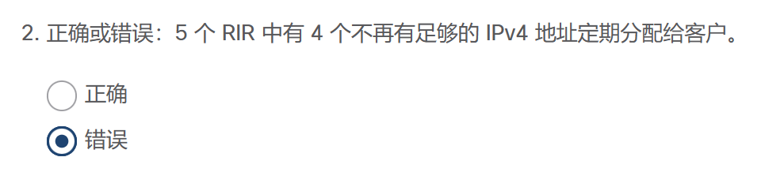

实际上是 4 个都已经用完了，油饼？

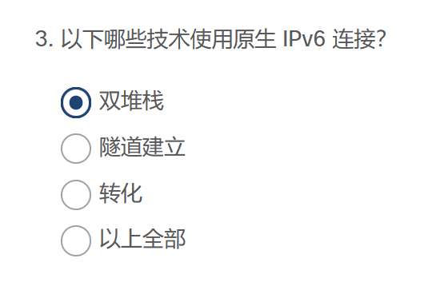

总之两边能够通过 IPv6 直接建立连接才叫“原生”，真无聊的概念题。。。

## 12.3 IPv6 地址类型

### 小测

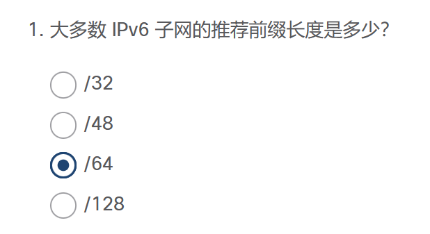

它指的是 IPv6 地址的前缀一般是多长。。。别被子网两个字迷惑了以为是填子网 ID 长度

剩下的 64 位是接口长度

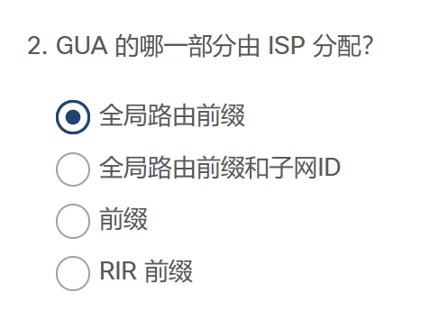

子网 ID 当然不由你管

## 12.4 GUA 和 LLA 静态配置

### 小测

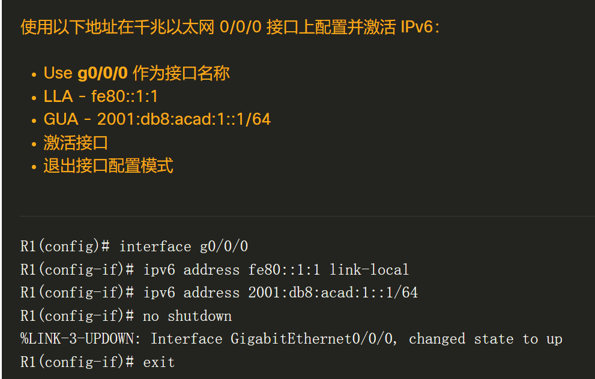

这奇葩的语法，真是没一点共同性。。。

## 12.5 IPv6 GUA 的动态编址

这里讲得比 ppt 清晰得多。。。

### 12.5.1 RS and RA

ICMPv6 RA 包含：

- **网络前缀和前缀长度** – 这会告知设备其所属的网络。
- **默认网关** – IPv6 LLA，RA 消息的源 IPv6 地址。
- **DNS 地址和域名** – 这些是DNS 服务器的地址和域名。

RA 消息有三种类型：

- **方法 1: SLAAC** -“我拥有您需要的一切，包括前缀、前缀长度和默认网关地址。”
- **方法 2: SLAAC 和 无状态DHCPv6服务器** -“这是我的信息，但您需要从 无状态DHCPv6 服务器获得其他信息，例如 DNS 地址。”
- **方法 3: 有状态的 DHCPv6（无SLAAC）** -“我可以给您默认网关的地址。您需要向有状态的 DHCPv6 服务器询问您的所有其他信息。”

### 12.5.2 SLAAC

不需要 DHCPv6 服务器的接入

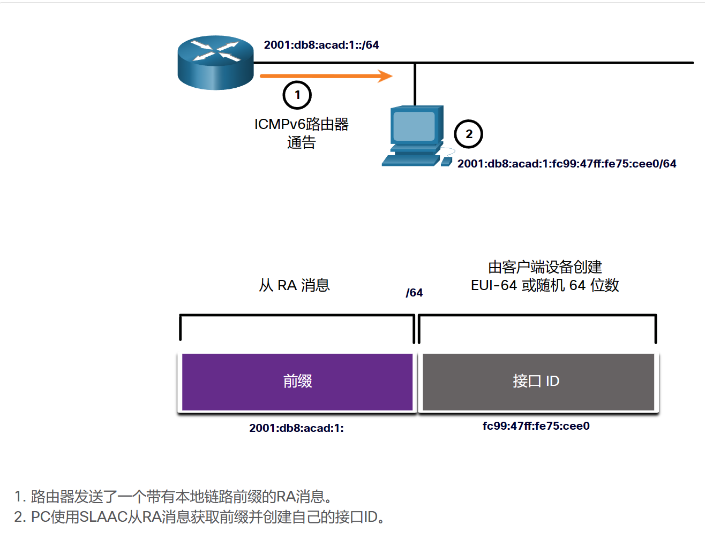

### 12.5.3 SLAAC 和无状态 DHCPv6

使用无状态 DHCPv6 服务器分配 DNS 服务器地址和域名。**它不分配 GUA**。

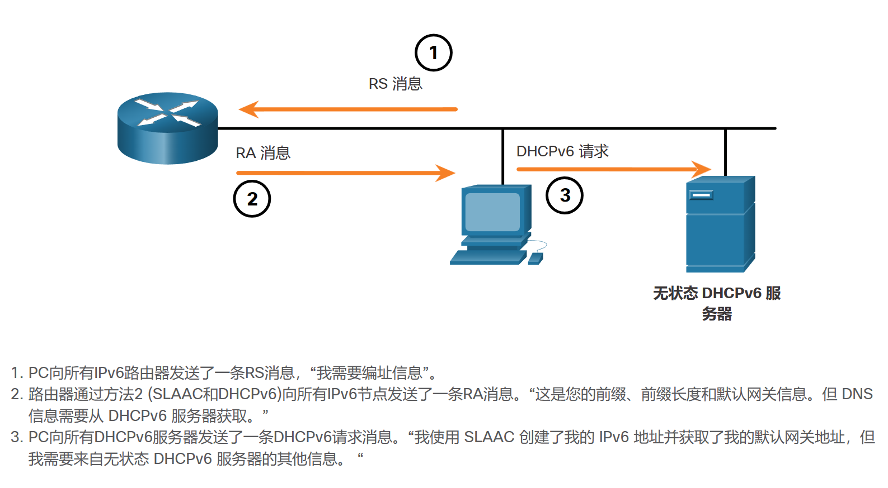

### 12.5.4 有状态的 DHCPv6

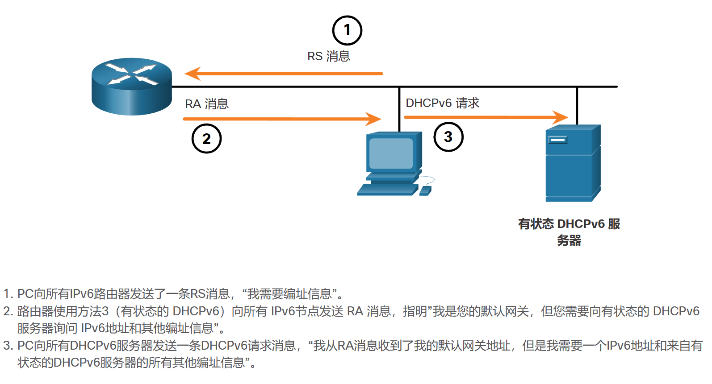

### 12.5.6 EUI-64 流程

就是如何使用 48 位的 MAC 地址，生成 64 位的接口 ID

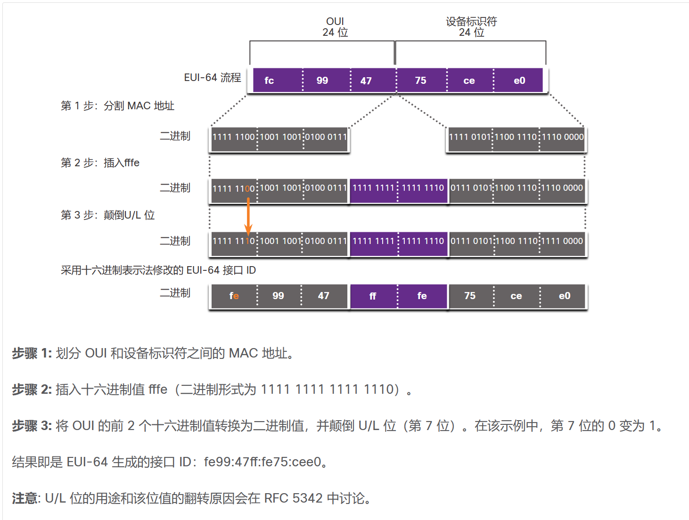

### 小测

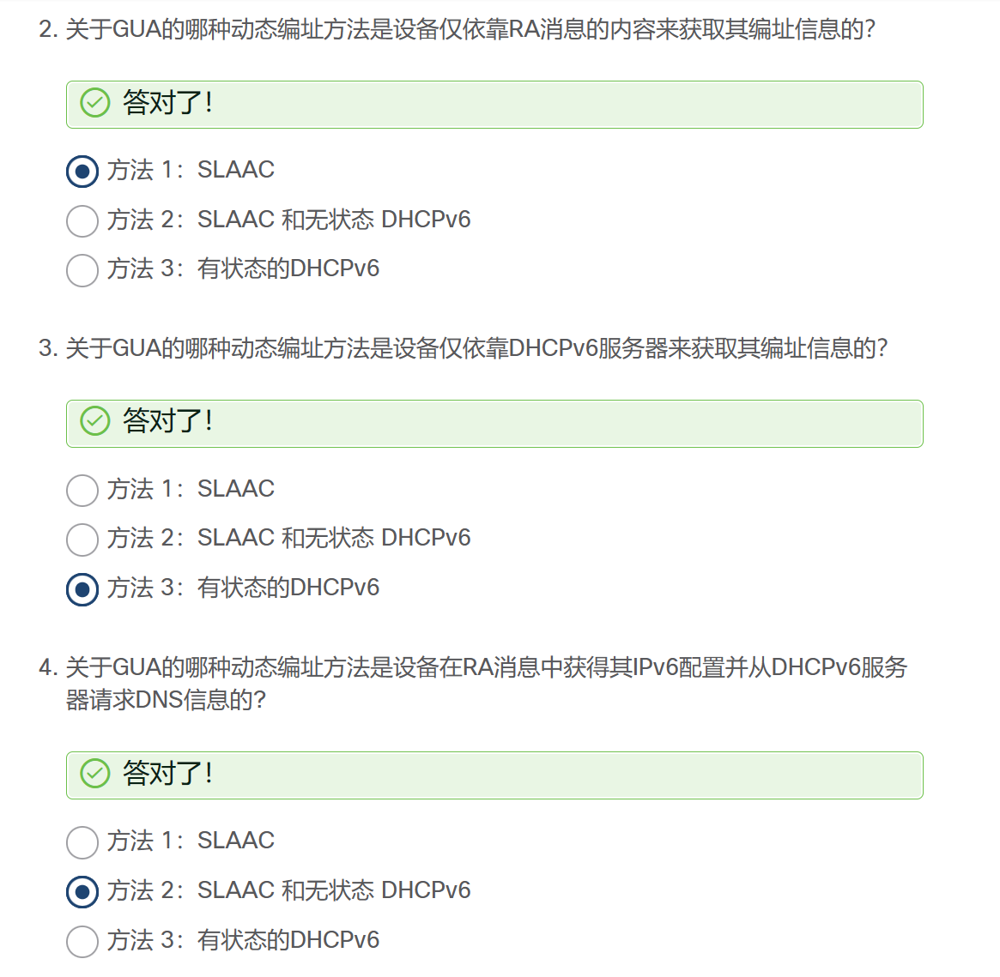

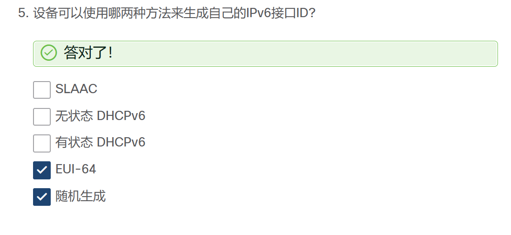

## 12.6 IPv6 LLA 的动态编址

### 小测

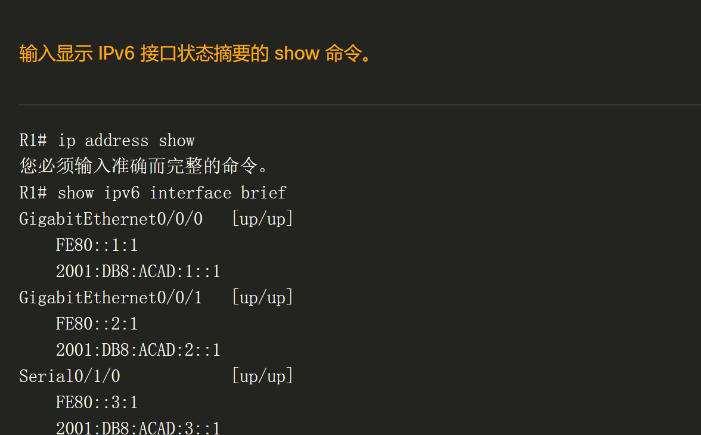

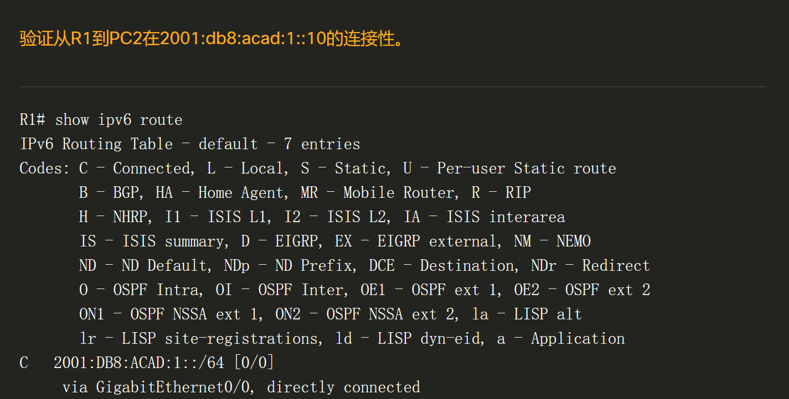

## 12.7 IPv6 组播地址

前缀为 `ff00::/8`

## 12.9 测试

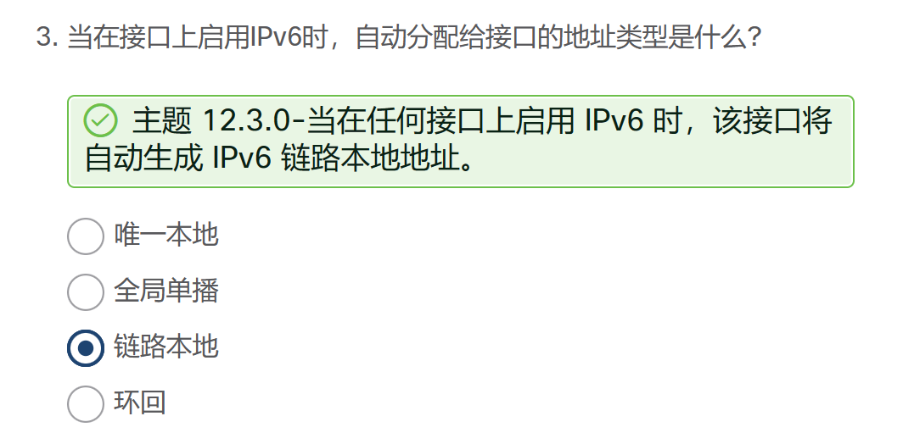

是的，生成的是链路本地地址，**不是环回**！

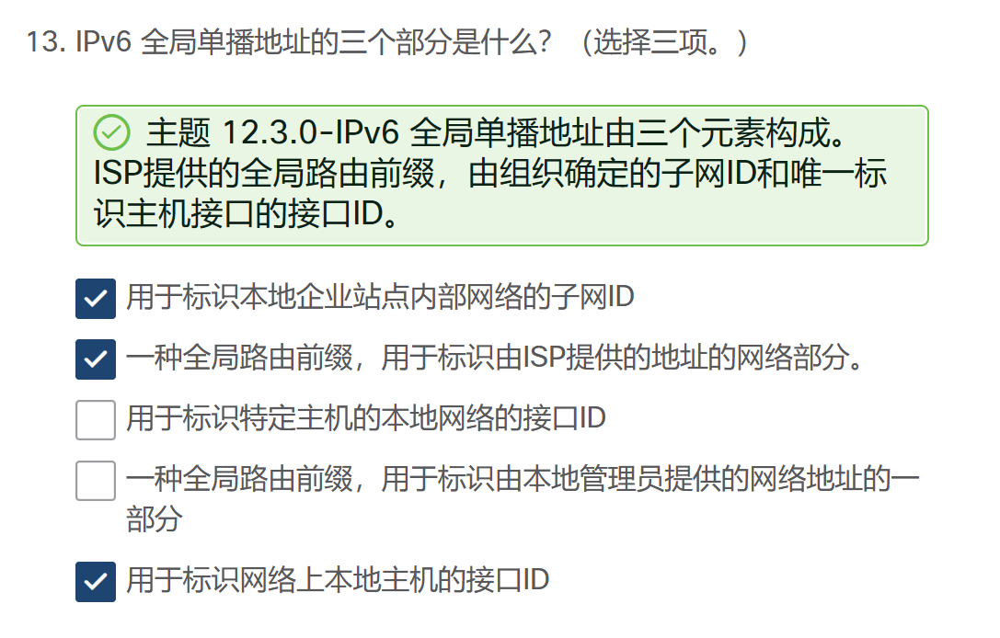

全局路由前缀被认为是**ISP**提供的。。。

