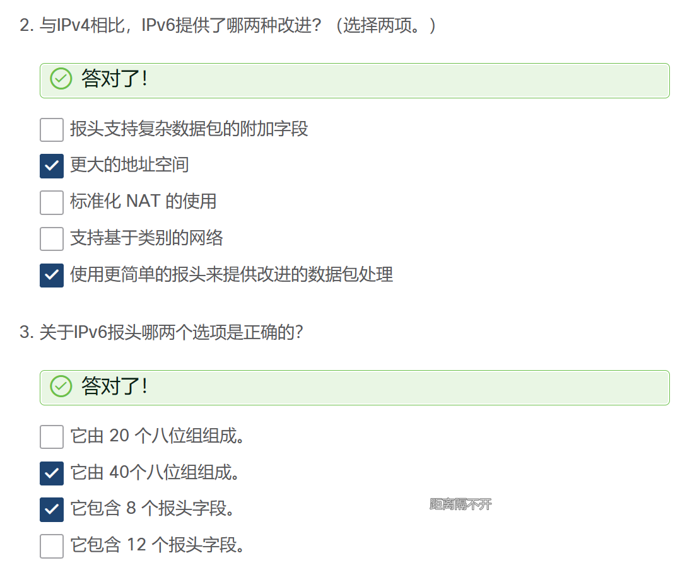
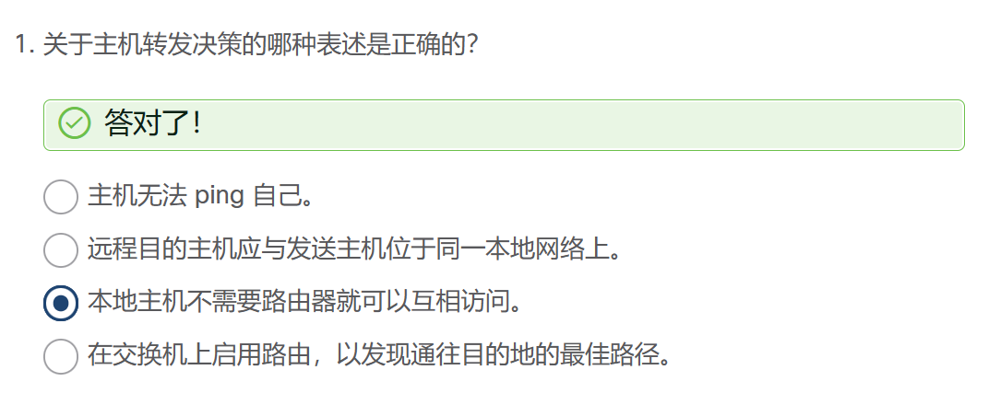
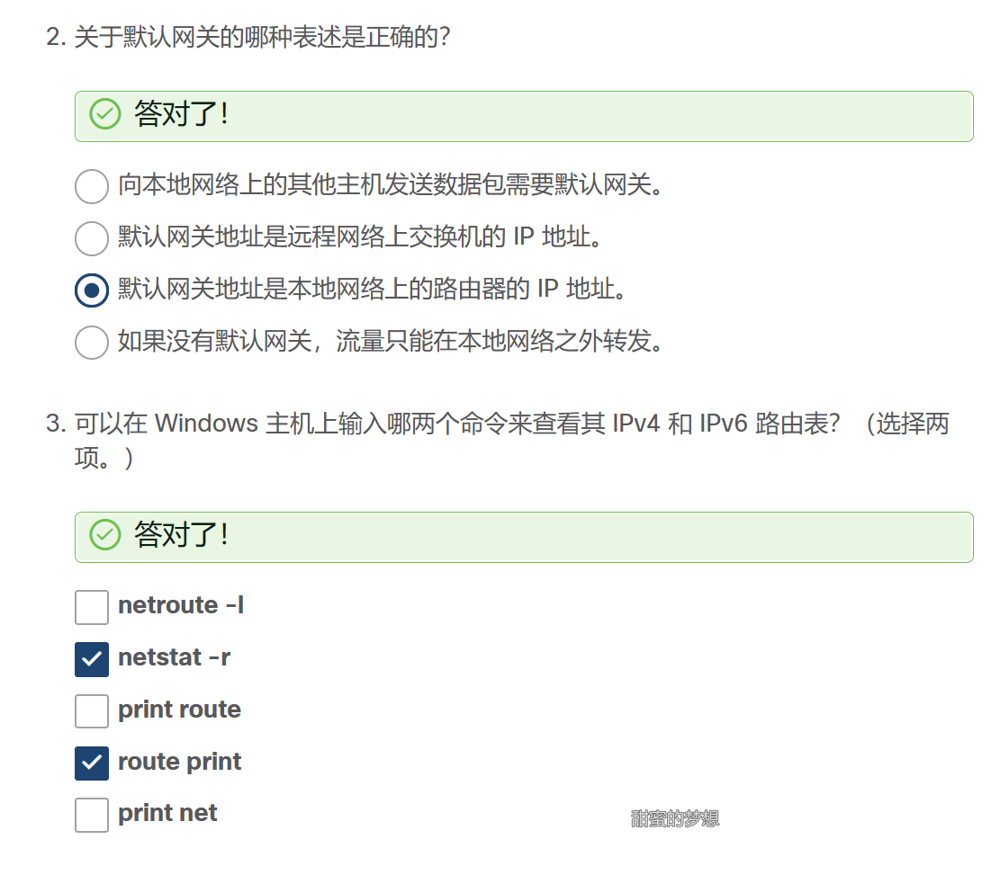
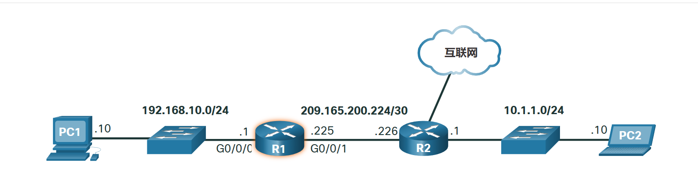
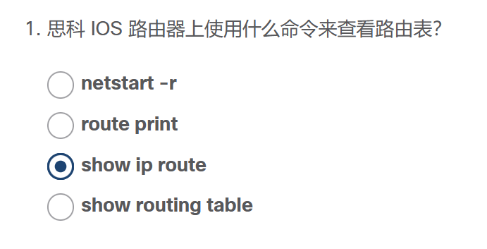
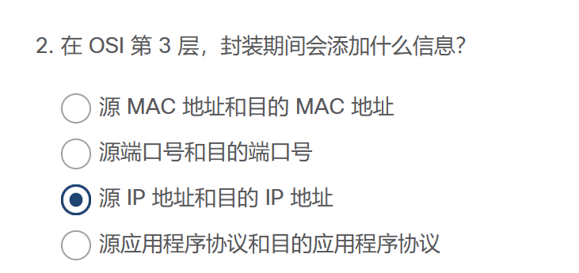
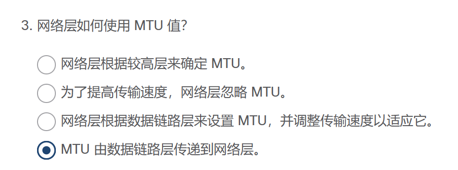
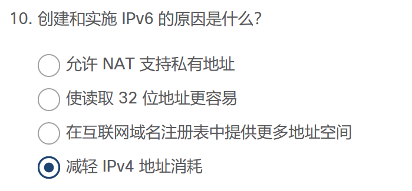

# 8. 网络层

## 8.1 网络层的特征

### 8.1.1 网络层

Protocol Data Unit (PDU)
: 说人话就是这一层的数据包

### 8.1.2 IP 封装

### 8.1.3 IP 特征

有三个特征：

#### 8.1.3.1 无连接

发送数据包前，不与目的地建立连接

#### 8.1.3.2 Best Effort

不保证数据包交付

#### 8.1.3.3 介质无关性

和传输介质无关

但是，说是这么说，其实会考虑每种介质可以传输的最大 PDU 大小，也称呼为最大传输单位（**MTU**）


假如需要分割数据包的时候，则需要**分片**

### 8.1.4 小测


三题最开始都错了

## 8.2 IPv4 数据包

### 8.2.4 小测


不是差分

## 8.3 IPv6 数据包

### 8.3.6 小测


- **更大的地址空间** - IPv6 地址基于 128 位分层编址，而 IPv4 采用的是 32 位。
- **改进数据包处理过程** - IPv6 报头简化为更少的字段。
- **消除了对 NAT 的需求** - 有了数额如此巨大的公有 IPv6 地址，私有 IPv4 地址和公有 IPv4 地址之间不再需要 NAT。这可避免需要端到端连接的应用程序遇到某些由 NAT 引起的故障。



一行 32 bits (4 bytes)。源和目标地址各有4行，前面还有两行，一共 10 行，也就是 40 bytes

## 8.4 主机的路由方式

### 8.4.5 小测



有 switch 或者直接连接也行



## 8.5 路由简介

### 8.5.6 IPv4 路由表简介



```shell
R1# show ip route
Codes: L - local, C - connected, S - static, R - RIP, M - mobile, B - BGP
       D - EIGRP, EX - EIGRP external, O - OSPF, IA - OSPF inter area 
       N1 - OSPF NSSA external type 1, N2 - OSPF NSSA external type 2
       E1 - OSPF external type 1, E2 - OSPF external type 2
       i - IS-IS, su - IS-IS summary, L1 - IS-IS level-1, L2 - IS-IS level-2
       ia - IS-IS inter area, * - candidate default, U - per-user static route
       o - ODR, P - periodic downloaded static route, H - NHRP, l - LISP
       a - application route
       + - replicated route, % - next hop override, p - overrides from PfR
Gateway of last resort is 209.165.200.226 to network 0.0.0.0
S*    0.0.0.0/0 [1/0] via 209.165.200.226, GigabitEthernet0/0/1
      10.0.0.0/24 is subnetted, 1 subnets
O        10.1.1.0 [110/2] via 209.165.200.226, 00:02:45, GigabitEthernet0/0/1
      192.168.10.0/24 is variably subnetted, 2 subnets, 2 masks
C        192.168.10.0/24 is directly connected, GigabitEthernet0/0/0
L        192.168.10.1/32 is directly connected, GigabitEthernet0/0/0
      209.165.200.0/24 is variably subnetted, 2 subnets, 2 masks
C        209.165.200.224/30 is directly connected, GigabitEthernet0/0/1
L        209.165.200.225/32 is directly connected, GigabitEthernet0/0/1
R1#
```

比较重要的几个：

- **L** - 直连的本地接口 IP 地址
- **C** - 直连网络
- **S** - 静态路由由管理员手动配置
- **O** - OSPF
- **D** - EIGRP


### 8.5.7 小测



- Windows: `route print` 或 `netstat -r`
- Linux: `ip route show` 或 `route`
- cisco: `show ip route`

是的，当然和 Windows 上的不一样


## 8.6 测试



层数是从下往上数。。。



C 应该是后半句话错了



看清 C 的意思，别看太快

