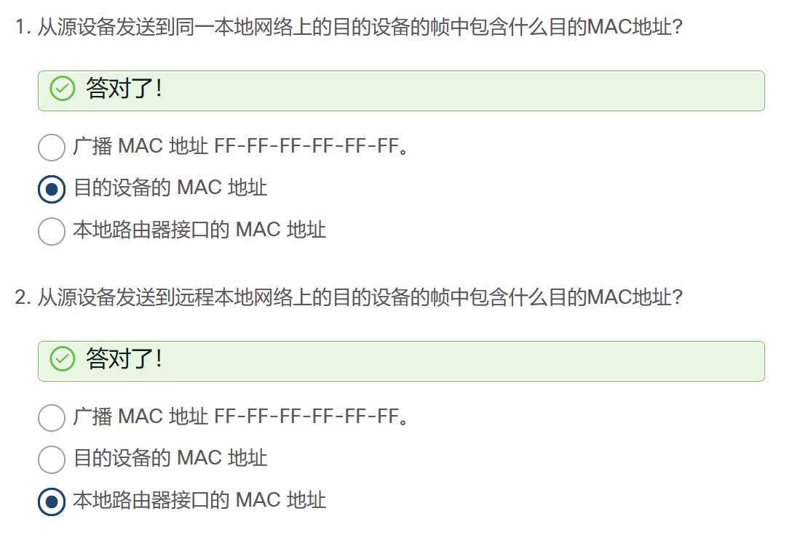
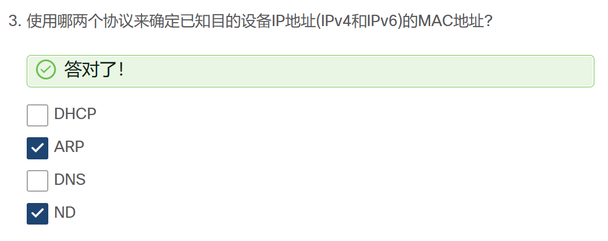
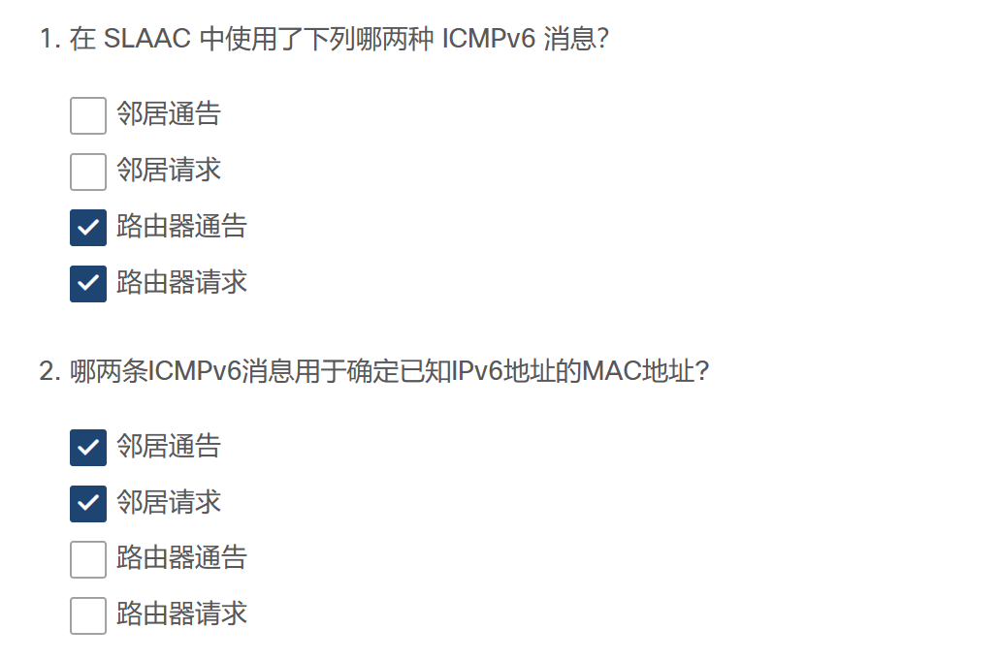
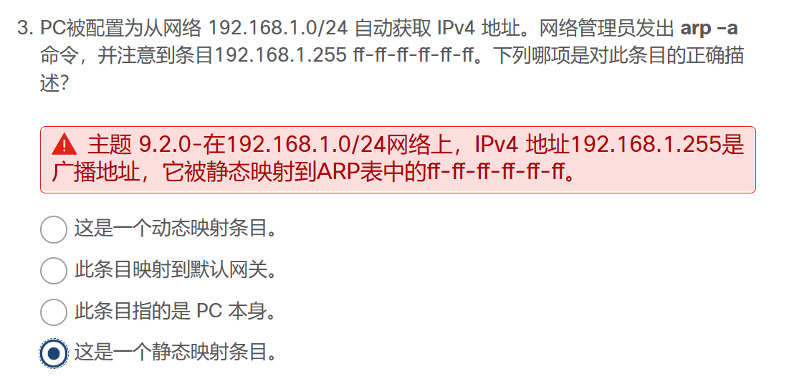
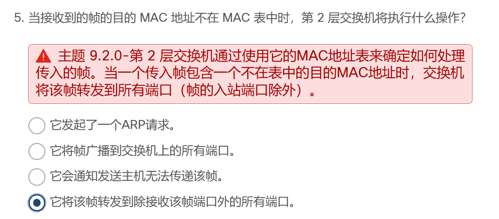
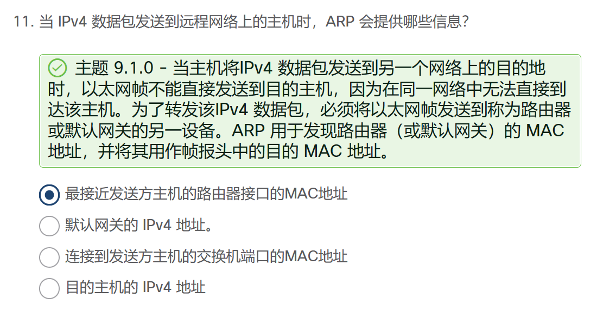
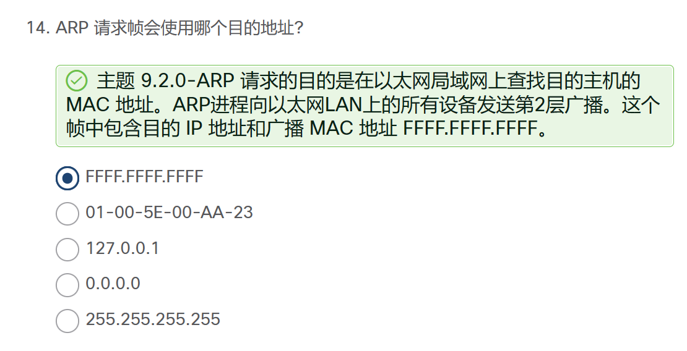

# 9. 地址解析

## 9.1 MAC 和 IP

### 9.1.4 小测

==同一局域网是直接填写目标 MAC，远程的话则是填写默认网关的 MAC==

IPv4 是 ARP，IPv6 是 ND (Neighbor Discovery)

## 9.2 ARP

### 9.2.10 小测

不是 NVRAM

> NVRAM 是断电后依然能保持数据的，真奇葩

`show ip arp`

## 9.3 IPv6 邻居发现

### 9.3.2 IPv6 邻居发现消息

- 邻居请求消息（NS）
- 邻居通告消息（NA）
- 路由器请求消息（RS）
- 路由器通告消息（RA）
- 重定向消息（不用管）

其中：

- 地址解析：邻居请求、邻居通告（类似 ARP）
- 动态地址分配/无状态地址自动配置（SLAAC）：路由请求、路由通告

### 9.3.5 小测

## 9.4 测试

ARP 表中存在静态映射的条目`............255`到`ff-ff-ff-ff-ff-ff`

Windows 上 `arp -a`

还是会排除接受端口的！接收到泛洪时也是一样

不是交换机

IP 地址是已知的！！！别以为是广播地址！

