# 14. 路由

## 14.1 路径确定

### 14.1.3 最佳路径就是最长匹配

路由表中包含了：

- 前缀
- 前缀长度

目的 IP 要和前缀长度进行匹配，并选择长度最长的那个

e.g.,

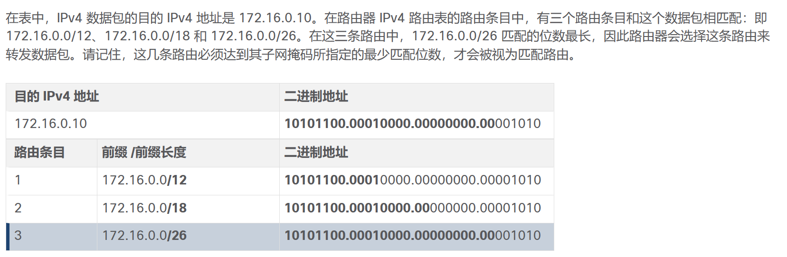

### 14.1.6 构建路由表

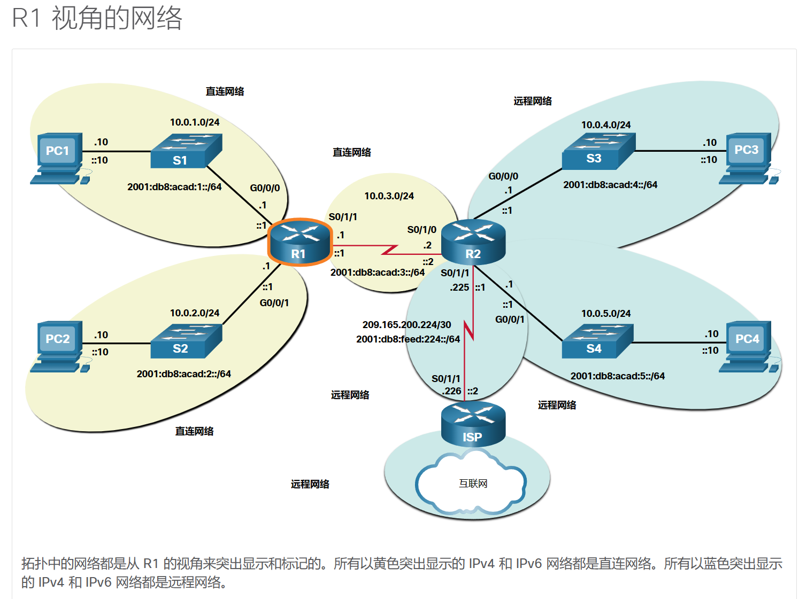

### 14.1.7 小测

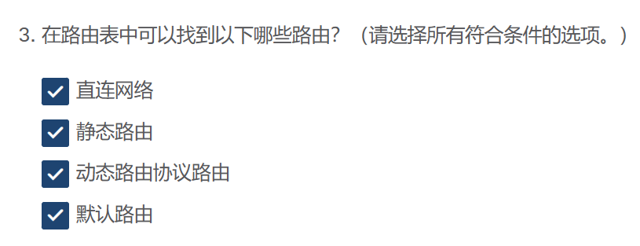

是的，都有。直连网络居然也是。。。

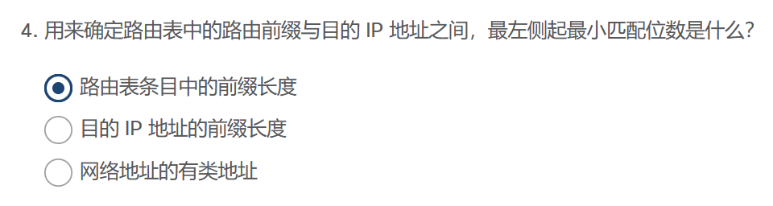

## 14.2 数据包转发

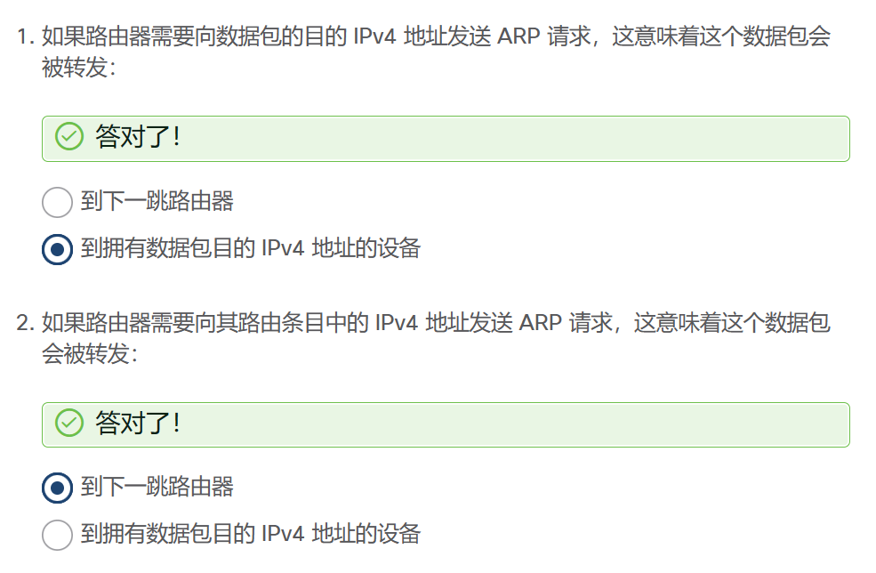

## 14.4 IP 路由表

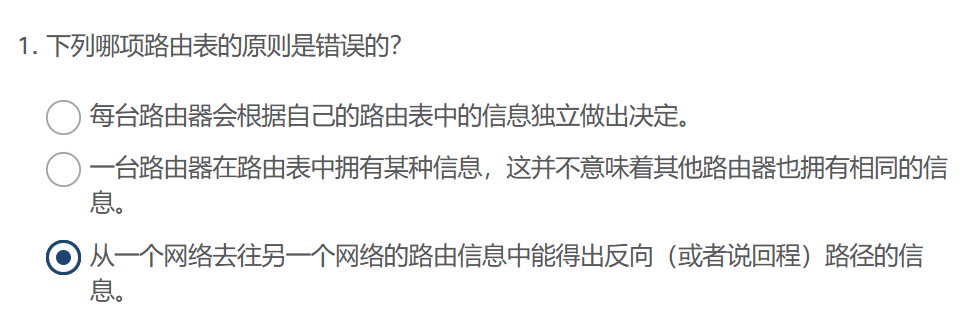

居然不能推导返程的？？？

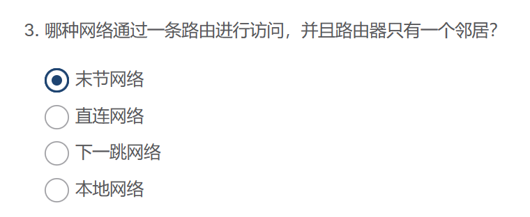

猜对了

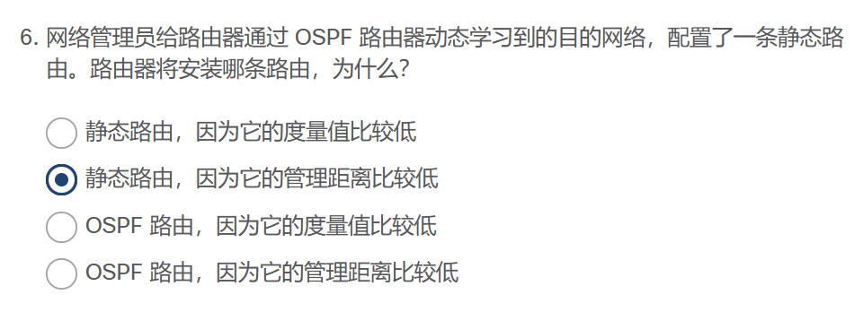

又猜对了

## 14.5 静态路由和动态路由

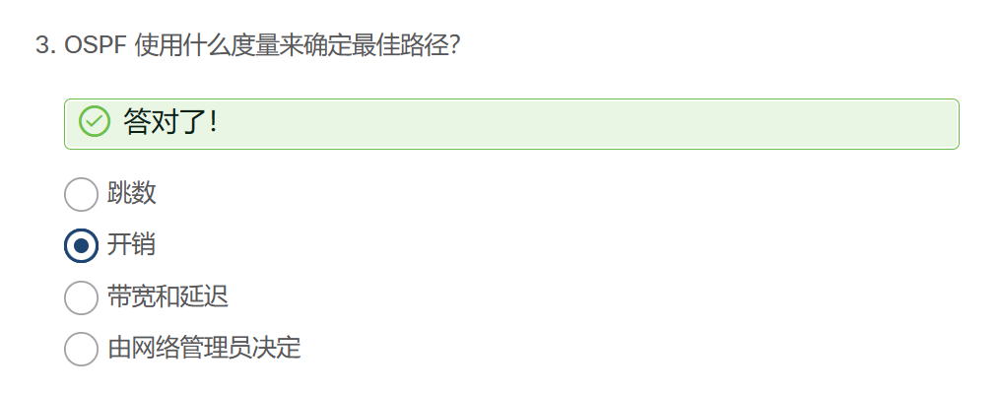

OSPF 基于带宽来计算开销！

不是 A。。。居然真叫负载均衡

## 14.6 测验

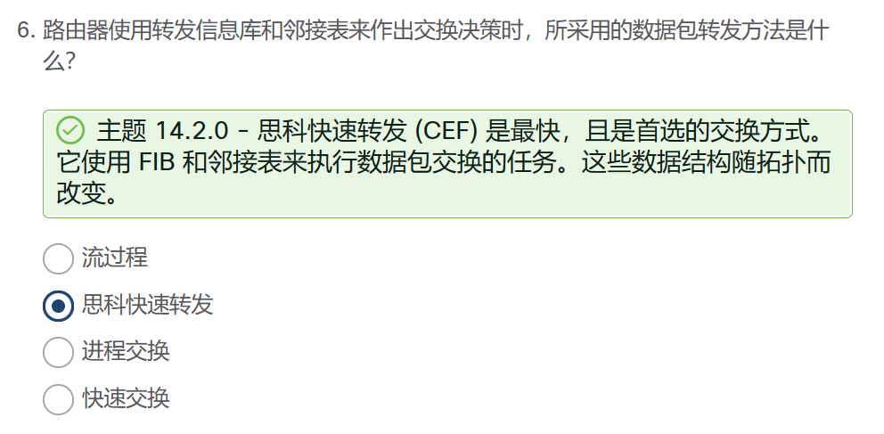

cisco 你没事吧？？？

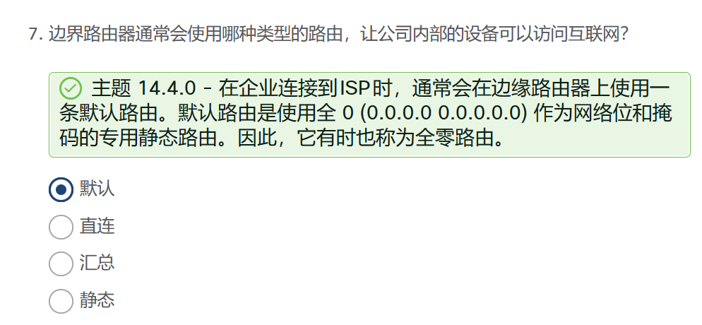

啊？为什么

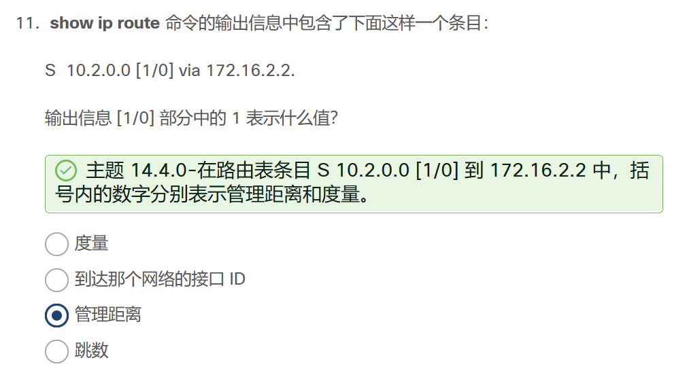

[管理距离/度量]

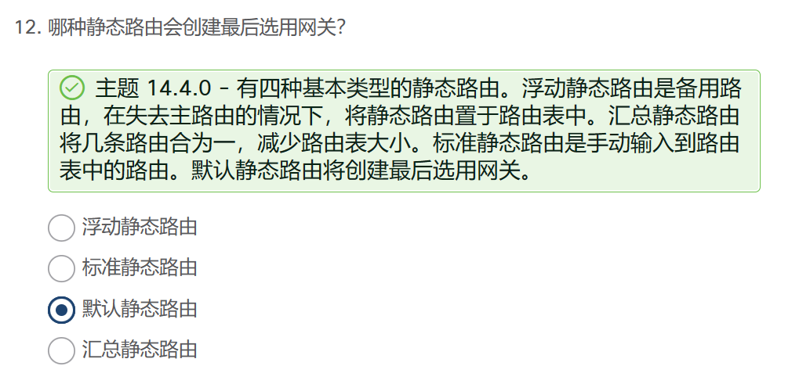

?

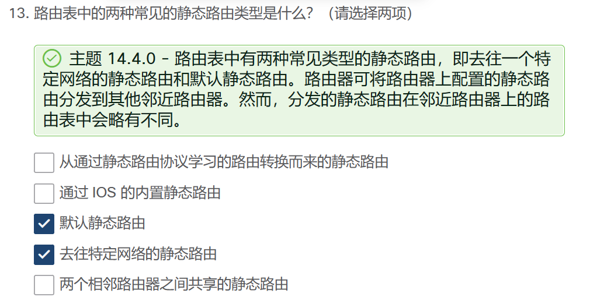

