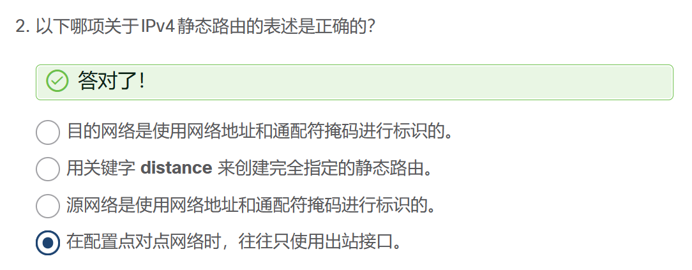
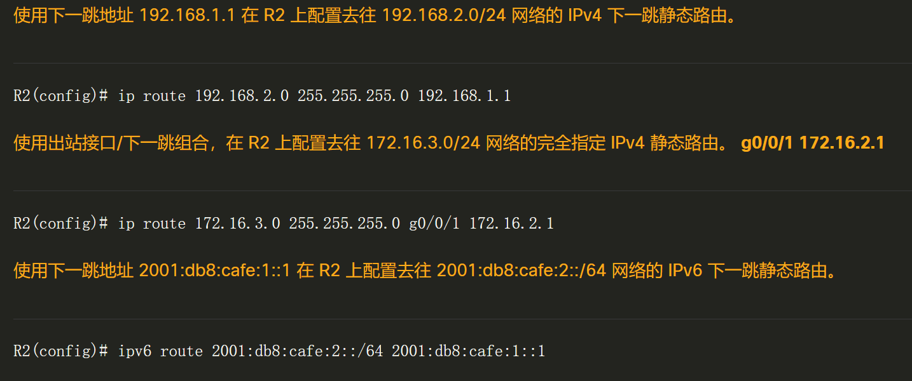
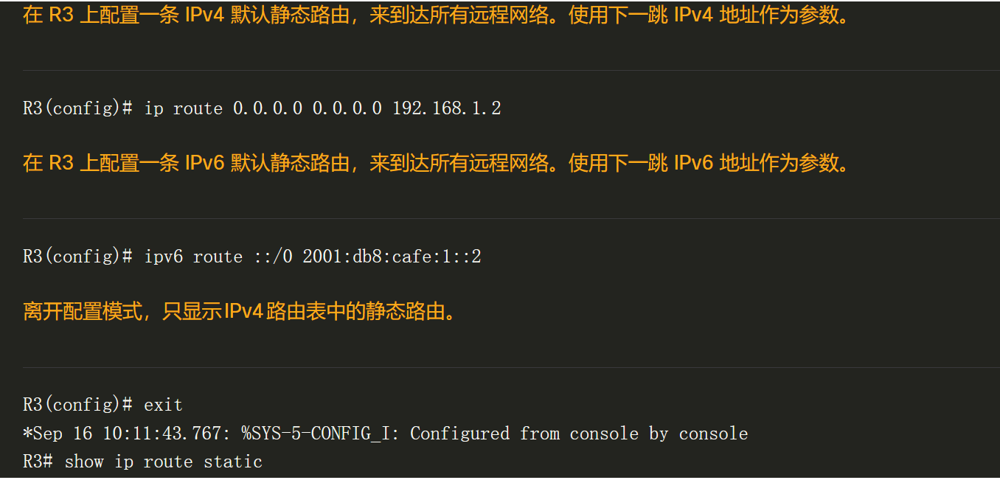
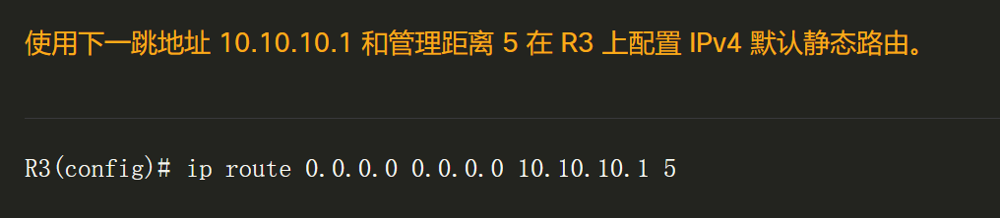
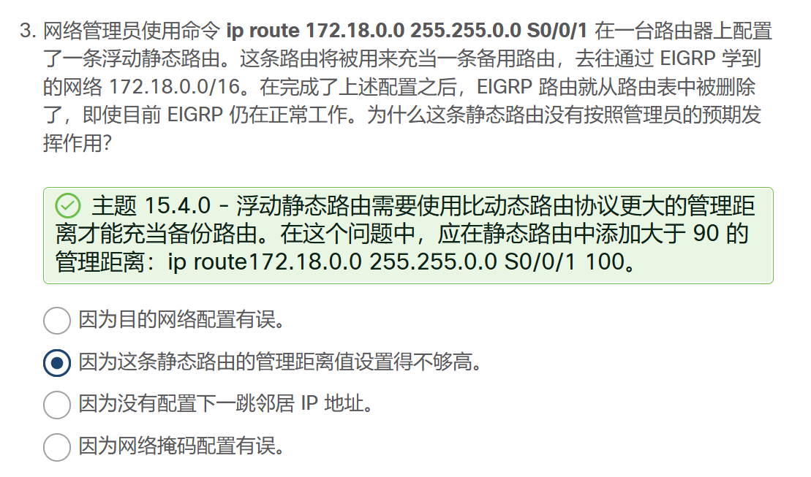
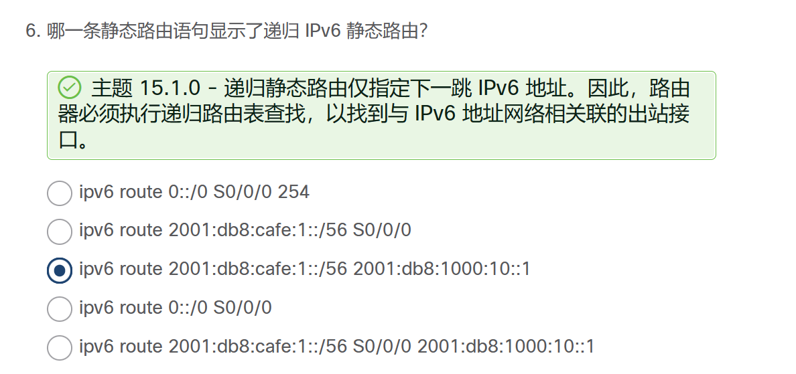
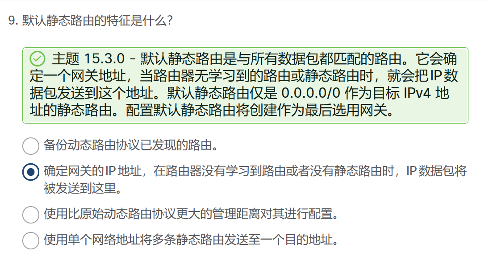
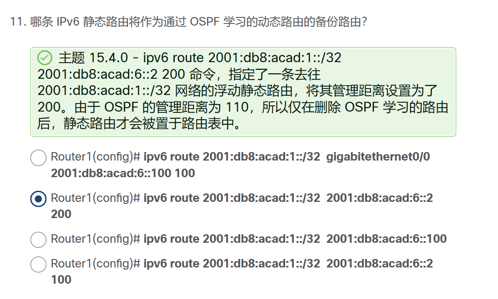
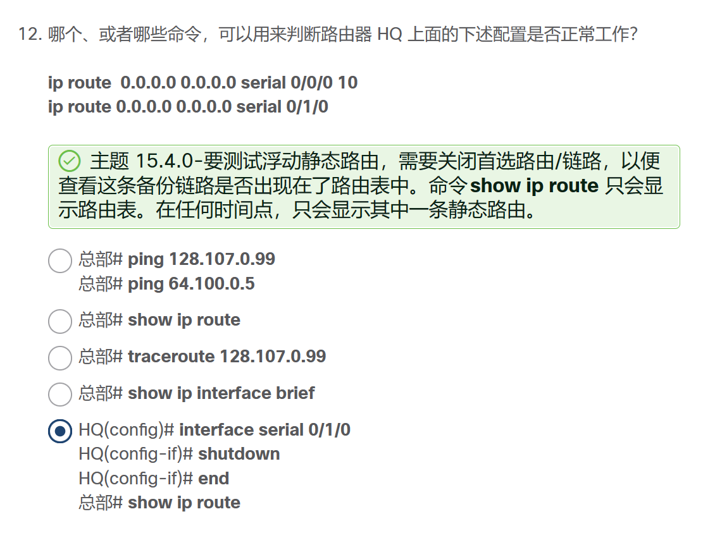

# 15. IP 静态路由

## 15.1 静态路由

- 指定出站接口：**直连**静态路由
- 指定下一跳地址：**递归**静态路由
- 两个都指定：完全指定静态路由

## 15.2 配置 IP 静态路由

## 15.3 配置 IP 默认静态路由

## 15.4 配置浮动静态路由

## 15.6 测试

浮动静态路由就是需要比较大的管理距离

仅仅指定下一跳地址才是递归

C 居然是错的？

OSPF 的距离居然有 110。。。

同时配置了浮动静态路由和默认静态路由的情况下，如何检测浮动路由是否生效

