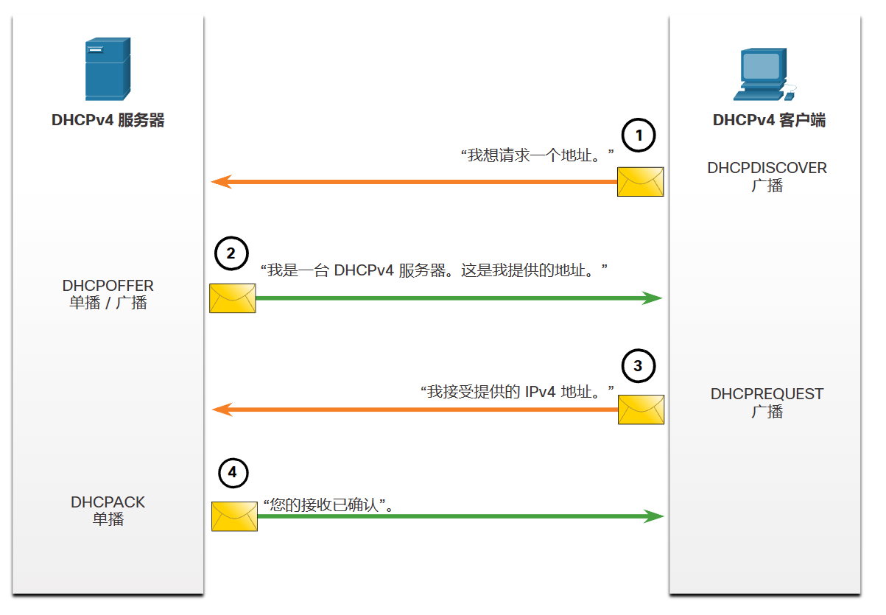
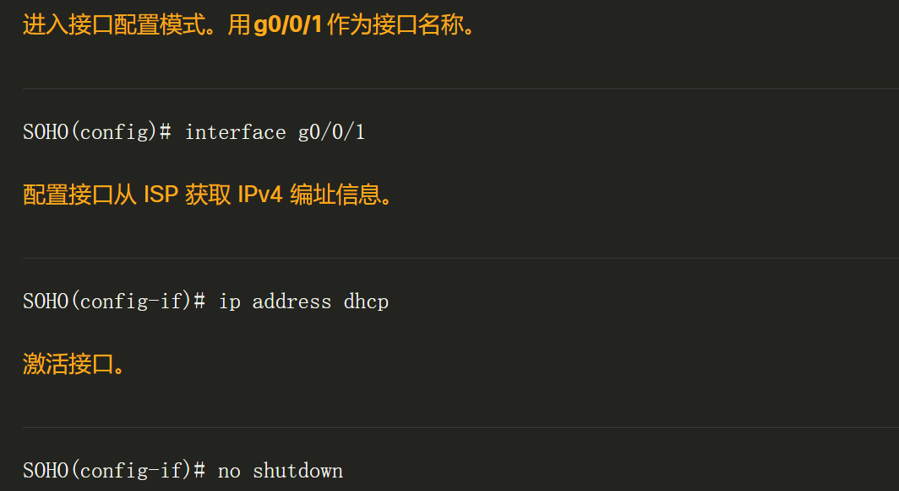
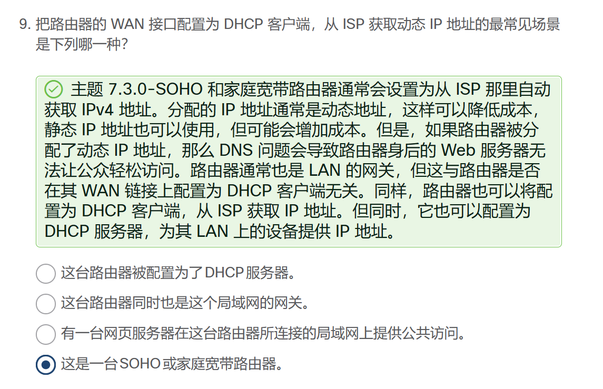
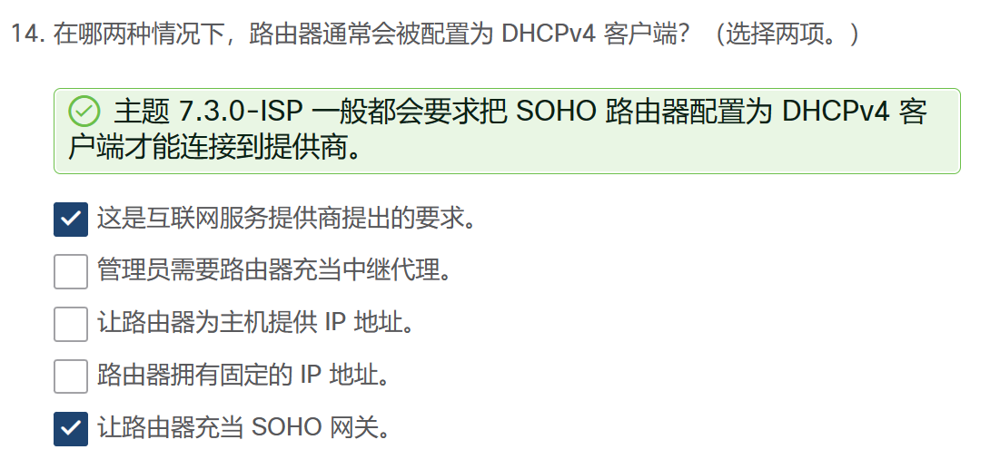

# 7. DHCPv4

## 7.1 DHCPv4 概念

获取租约的步骤：

可以看到是：

- discover: 广播
- offer: 
- request: 广播（以拒绝其它 DHCP 服务器）
- ack

续订租约的步骤：

- request
- ack

## 7.3 DHCPv4 客户端

## 7.4 测试

第一个选项这么奇怪。。。SOHO 代表 small offices and home offices

