# 8. SLAAC 和 DHCPv6

## 8.1 IPv6 GUA 分配

全局单播地址

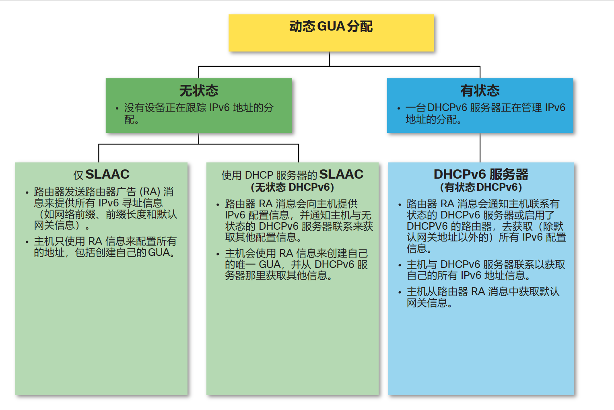

### 8.1.4 三个 RA 消息标记

客户端如何获取 IPv6 全局单播地址取决于 RA 消息中的设置。

- **A标记** - 这是地址自动配置（Address Autoconfiguration）标记。 使用无状态地址自动配置（==SLAAC==）来创建IPv6 GUA。
- **O标记** - 这是其他配置（Other Configuration）标记。其他信息可以从==无状态的 DHCPv6== 服务器那里获取。
- **M标记** - 这是被管理地址配置（Managed Address Configuration）标记。使用==有状态的 DHCPv6== 服务器获取 IPv6 全局单播地址。

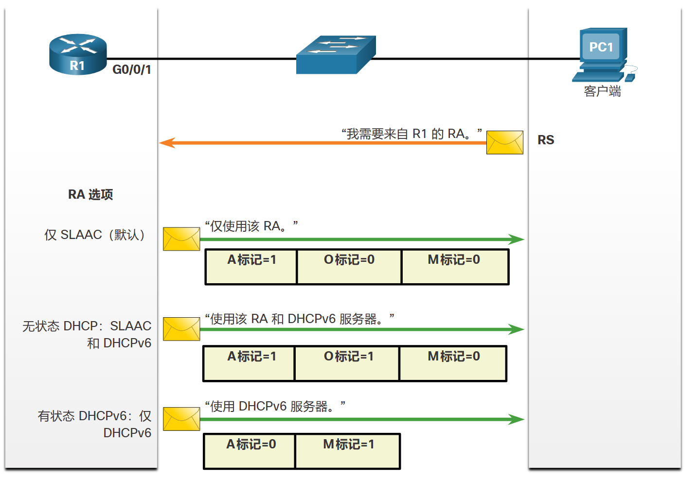

> 三个不同情况下对应的标记值要留意

## 8.2 SLAAC

### 8.2.2 启用 SLAAC

需要用 `ipv6 unicast-routing` 来让路由器启用 IPv6 路由，加入 IPv6 全路由器组播组

### 8.2.7 小测

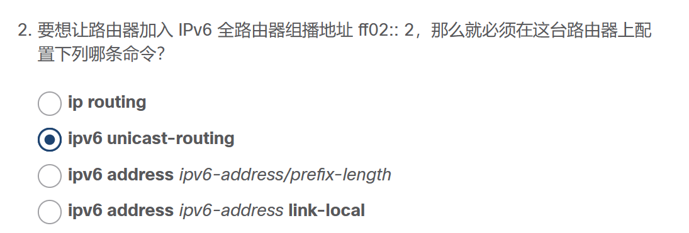

## 8.3 DHCPv6

端口：

- 服务器发送给客户端：目标端口为 546
- 客户端发送给服务器：目标端口为 547

有状态 DHCPv6 流程如下：

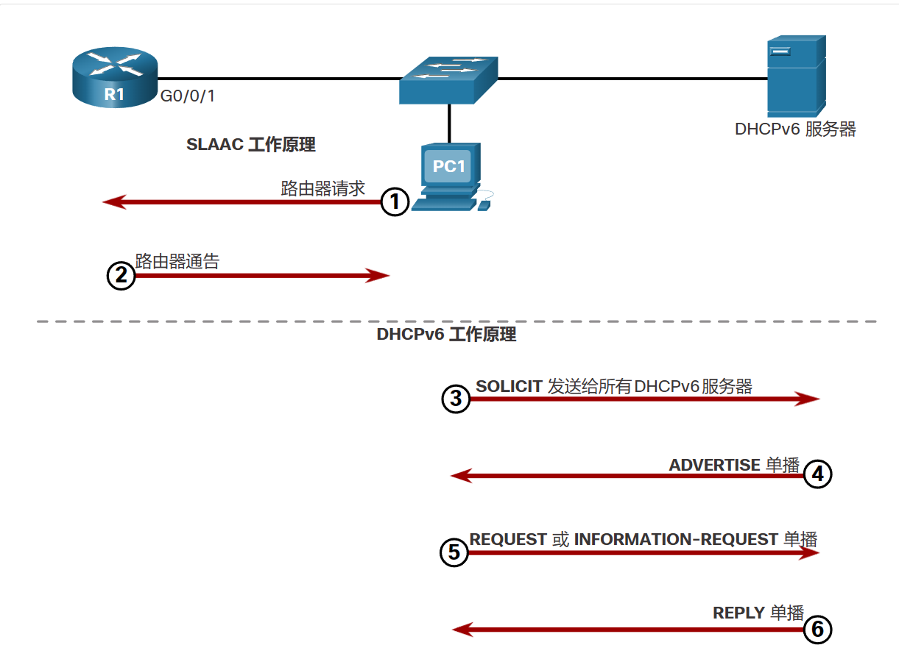

注意是现有 RS/RA 后有 DHCPv6 SOLICIT 和 DHCPv6 ADVERTISE

## 8.4 配置 DHCPv6 服务器

太没营养了，随便看看得了

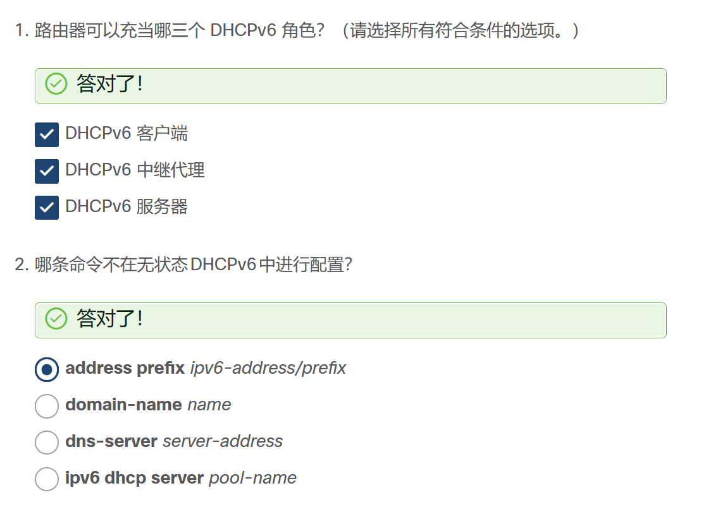

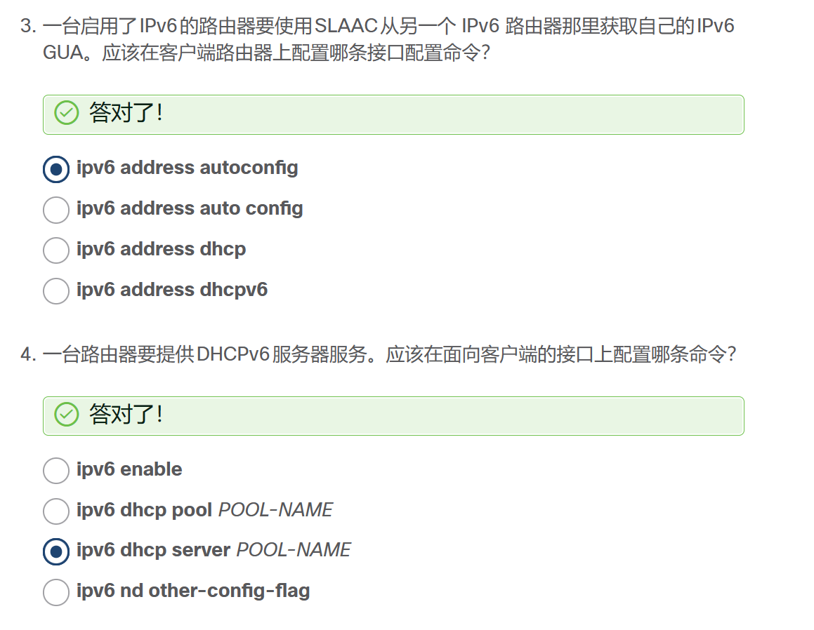

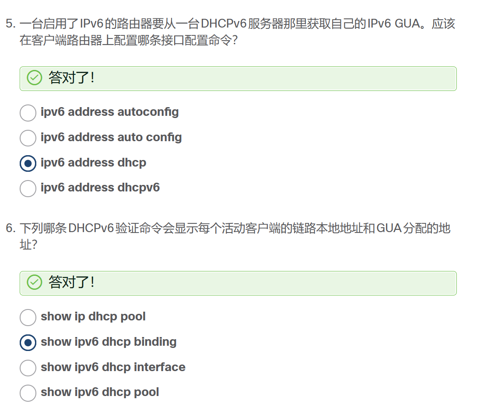

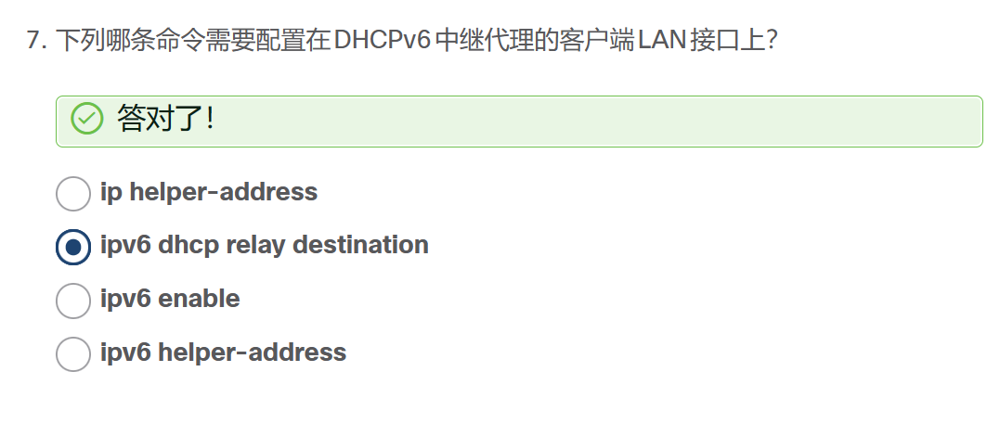

## 8.5 测试

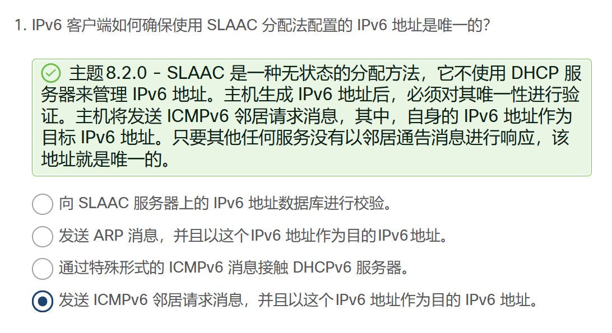

DAD 中会以当前获取的 IPv6 地址作为目的 IPv6 地址

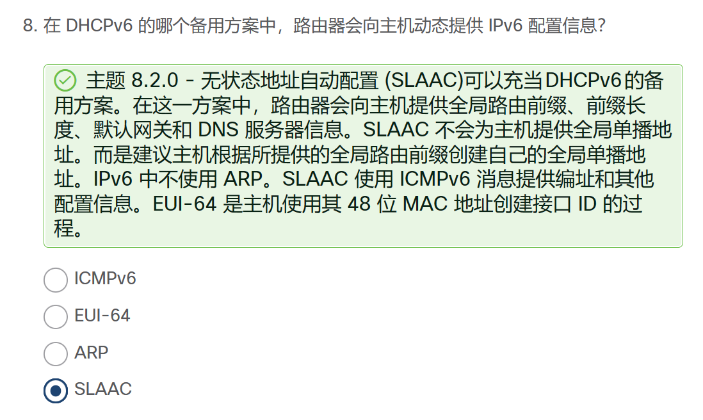

动态提供居然是对的。。。除了接口 ID 以外都是提供的

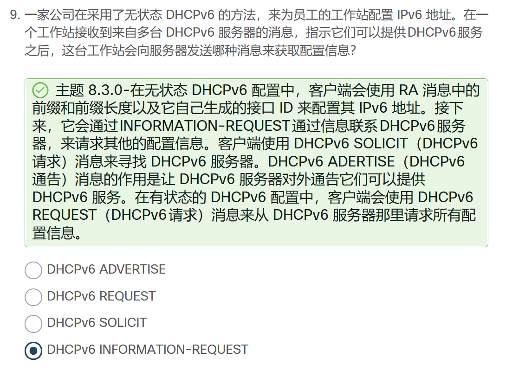

无状态 DHCPv6 发的是 INFORMATION-REQUEST，有状态发的才是 REQUEST。。。逆天

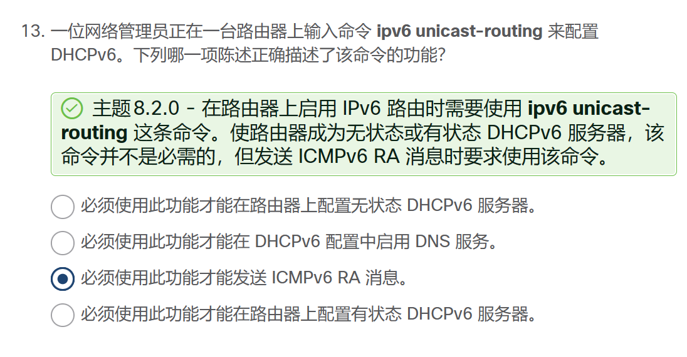

配置的过程确实有这条命令，但不是必需的？？？

