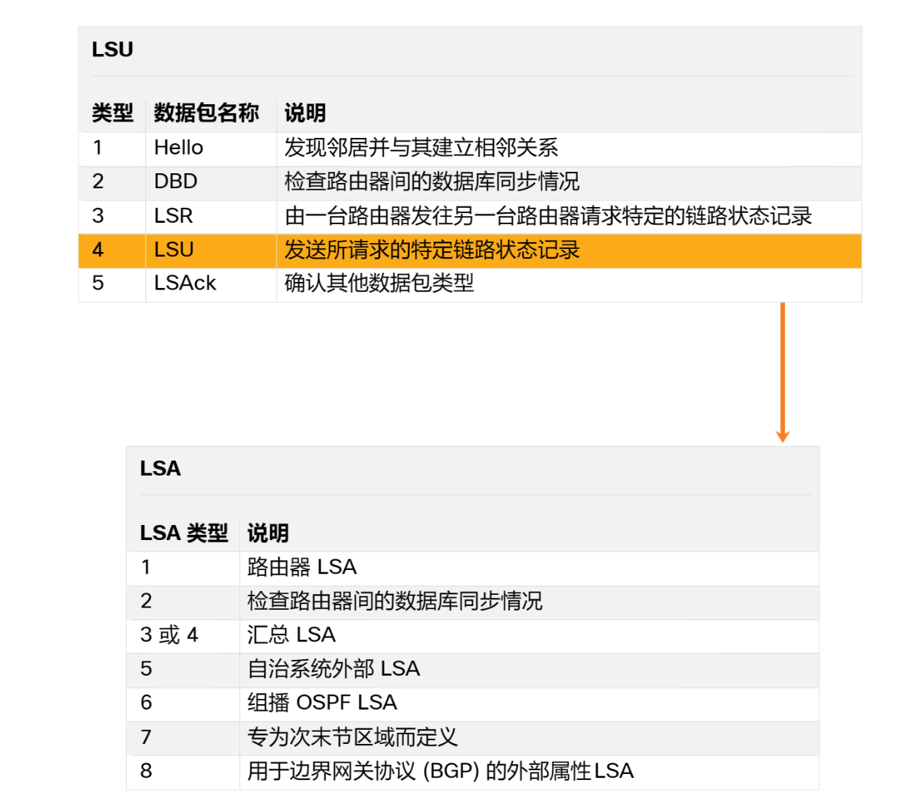
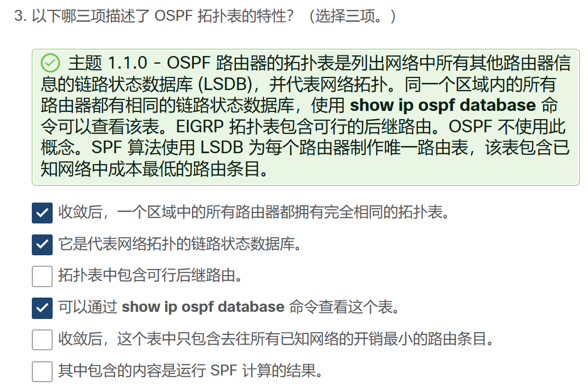
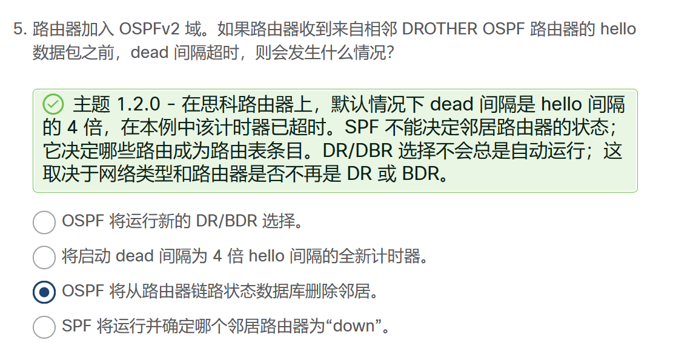
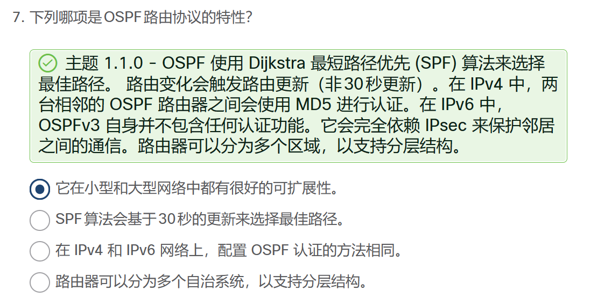
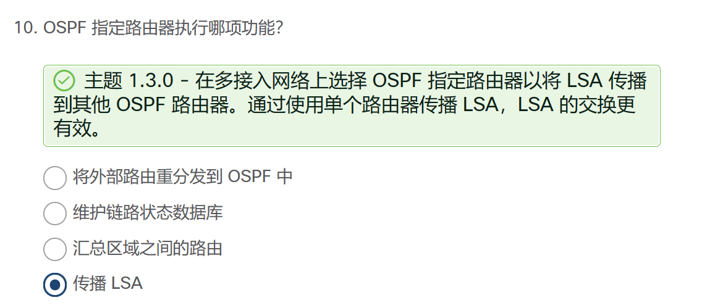
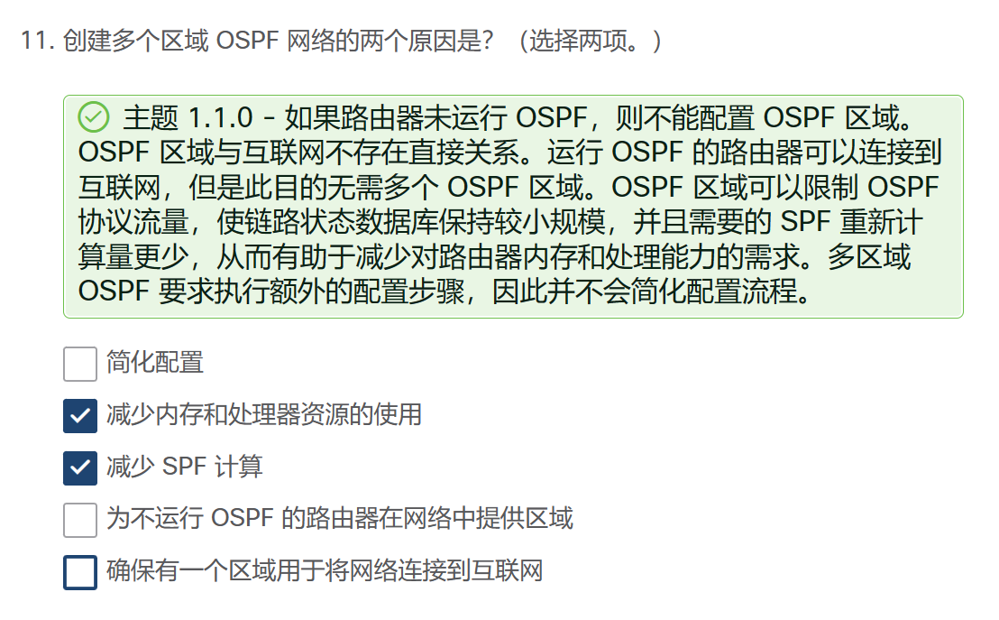
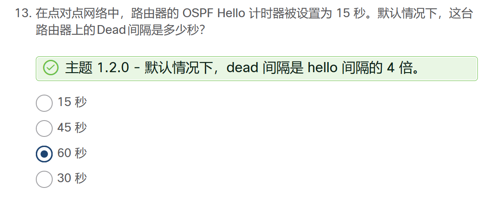
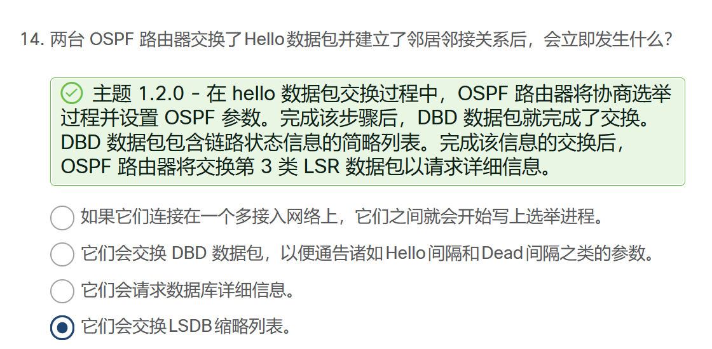

# 1. 单区域 OSPFv2

## 1.1 OSPF 的功能和特征

<table class="table table--bordered table--compressed table--wrap table--nostripes"><thead><tr><th style="width: 175px;">数据库 </th><th style="width: 125px;">表 </th><th>说明</th></tr></thead><tbody><tr><td>邻接数据库</td><td>邻居表</td><td><ul><li> 列出了已经与本地路由器建立了 双向通信的所有邻居路由器。</li><li>该表对于每个路由器都是唯一的。</li><li> 我们可以查看邻居表使用<strong>show ip ospf neighbor</strong>  命令。</li></ul></td></tr><tr><td>链路状态数据库</td><td>拓扑表</td><td><ul><li>列出网络中所有其他路由器的相关信息。</li><li>这个数据库代表了网络拓扑。</li><li>某个区域内的所有路由器都有相同的 LSDB。</li><li> 我们可以查看LSDB使用<strong>show ip ospf database</strong>  命令。</li></ul></td></tr><tr><td>转发数据库</td><td>路由表</td><td><ul><li> 列出了SPF算法根据链路状态计算生成的路由 数据库。</li><li> 每台路由器上的路由表都是唯一的，其中包含了 如何把数据包发送给其他路由器的信息。</li><li> 我们可以使用命令<strong>show ip route</strong>来查看路由表。</li></ul></td></tr></tbody></table>

工作步骤：

- 建立邻居邻接关系
- 交换链路状态通告
- 构建链路状态数据库
- 执行 SPF 算法
- 选择最优路由

## 1.2 OSPF 数据包

### 1.2.2 OSPF 数据包类型

- **Type 1: Hello 数据包** - 用来建立和维护与其他OSPF路由器之间的邻接关系。
- **Type 2: 数据库描述 (DBD) 数据包** - 它包含有发送方路由器的LSDB缩略列表，接收方路由器用它来比对本地LSDB。LSDB 必须在同一区域内的所有链路状态路由器上保持一致，以构建准确的 SPF 树。
- **Type 3: 链路状态请求 (LSR) 数据包** - 接收方路由器可以通过发送LSR，来请求DBD中任意条目的详细信息。
- **Type 4: 链路状态更新 (LSU) 数据包** - 用来回复LSR的请求，以及用来通告新信息。LSU 中可以包含七种不同类型的 LSA。
- **Type 5: 链路状态确认 (LSAck) 数据包** - 当路由器接收到LSU之后，它会发送LSAck来确认自己收到了LSU。LSAck 数据字段为空。

### 1.2.3 链路状态更新

一个 LSU 会包含一个以上的 LSA，LSA 会包含目的网络的路由信息

> LSA 和 LSAck 应该不是一个东西

## 1.3 OSPF 的工作方式

这一节讲整体的工作流程

<table class="table table--bordered table--compressed table--wrap table--nostripes" style="width: 600px;"><thead><tr><th style="width: 150px;">状态</th><th>描述</th></tr></thead><tbody><tr><td><strong>Down 状态</strong>       </td><td><ul><li>没有收到 Hello 数据包 = Down。</li><li>路由器发送 Hello 数据包。</li><li>过渡到 Init 状态。</li></ul></td></tr><tr><td><strong>Init 状态</strong>       </td><td><ul><li>Hello 数据包已从邻居接收。</li><li>Hello数据包中包含有发送方路由器的路由器ID。</li><li>过渡到 Two-Way 状态。</li></ul></td></tr><tr><td><strong>Two-Way 状态</strong>       </td><td><ul><li> 在这种状态下，这两台路由器之间的通信是 双向的。</li><li>在多访问链路上，路由器之间会选举出 DR 和 BDR。</li><li>过渡到 ExStart 状态。</li></ul></td></tr><tr><td><strong>ExStart 状态</strong>       </td><td> 在点对点网络上，两台路由器会确定由哪台路由器来初始化 DBD 数据包交换的过程，并且会确定初始 DBD 数据包的序列号。</td></tr><tr><td><strong>Exchange 状态</strong>       </td><td><ul><li>路由器交换 DBD 数据包。</li><li> 如果路由器还要请求更多的路由器信息，则进入 Loading状态；否则，进入为 Full 状态。</li></ul></td></tr><tr><td><strong>Loading 状态</strong>       </td><td><ul><li>LSR 和 LSU 用于获取更多路由信息。</li><li>路由使用 SPF 算法进行处理。</li><li>过渡到 FULL 状态。</li></ul></td></tr><tr><td><strong>Full 状态</strong>       </td><td>路由器的链路状态数据库已经收敛。</td></tr></tbody></table>

### 1.3.3 建立邻居关系

在整个步骤中，存在变数的是 Two-Way 状态：

- 假如两个邻居只是点对点的连接，那么会立刻进入下一状态
- 但是更多数情况下，两个路由器之间通过以太网相连，这时候则需要选举 **DR (Designated Router)** 和 **BDR (Backup Designated Router)**

### 1.3.5 DR

你可能会想，为什么我要 DR 这种玩意？

主要问题出在 **LSA 泛洪**：当参与的路由器比较多时，网络拓扑一旦发生变化，链路状态路由器就会泛洪 LSA，会卡死

所以我们就先选举一个 DR 出来，作为 **LSA 的收集和分发点**。大家先把 LSA 发给 DR，再由 DR 发给其它路由器

## 1.4 测试

拓扑表会相同，但是路由表（SPF 计算得到）并不一样！

啊？

- B: SPF 是自动触发，没有定时间
- D: 路由器分为多个“区域”

“指定路由器” 是 DR (Designated Router) 的缩写

能简化 SPF 的计算！

"建立了邻居关系"意思是 two-way 已经结束了。。。

