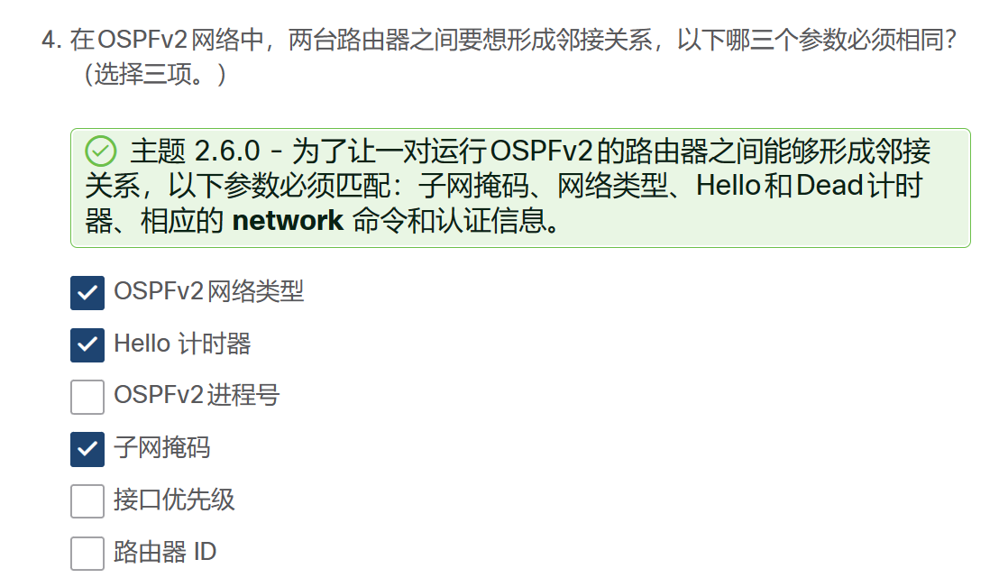
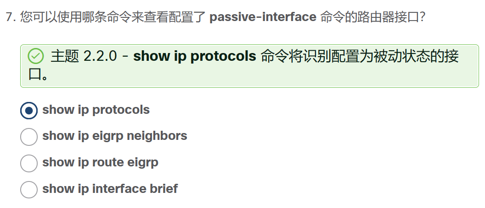
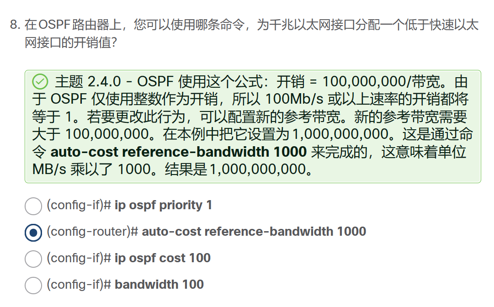
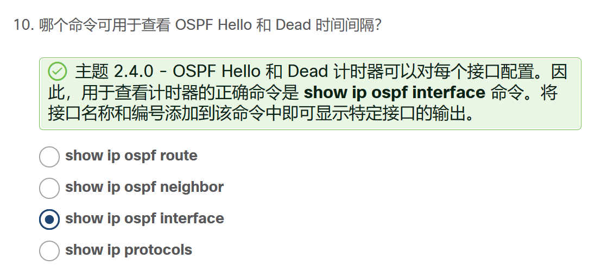
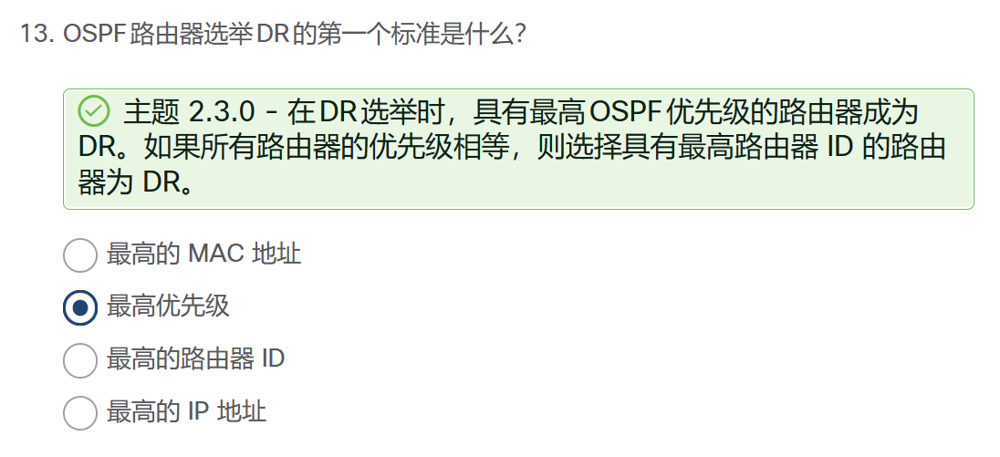
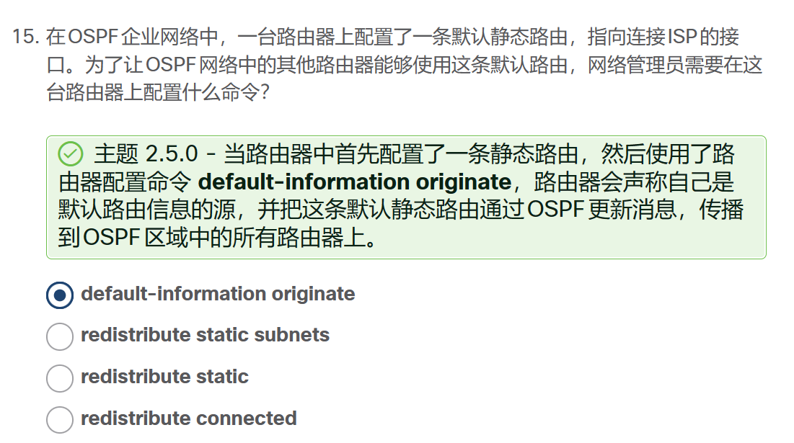

# 2. 单区域 OSPFv2 配置

## 2.1 OSPF 路由器 ID

### 2.1.2 OSPF 的路由器配置模式

启用 OSPF 的语法是 `router ospf process-id`，比如：

```shell
router ospf 10
```

process-id 值只在路由本地生效，其它路由不受影响

### 2.1.3 路由器 ID

**长度 32 位，格式和 IPv4 地址相同**。作用是唯一地标识一台 OSPF 路由器

那怎么确定这个值呢？

- `router-id your_rid` 来手动指定
- 假如没有明确配置路由器 ID，那么会选择任意环回接口的最高 IPv4 地址
- 如果没有配置环回接口，那么会选择所有物理接口的最高活动 IPv4 地址

> 环回地址通常有 `127.0.0.1` 到 `127.255.255.254` 的范围，==并不是只有 `127.0.0.1` 一个！==

### 2.1.5 配置环回接口地址作为 RID

```shell
R1(config-if)# interface Loopback 1
R1(config-if)# ip address 1.1.1.1 255.255.255.255
R1(config-if)# end
R1# show ip protocols | include Router ID
  Router ID 1.1.1.1
R1#
```

### 2.1.6 手动配置 RID

```shell
R1(config)# router ospf 10
R1(config-router)# router-id 1.1.1.1
R1(config-router)# end
*May 23 19:33:42.689: %SYS-5-CONFIG_I: Configured from console by console
R1# show ip protocols | include Router ID
Router ID 1.1.1.1
R1#
```

## 2.7 测试



计时器要一样？？？



不是 D。。。逆天



？






优先级比路由器 ID 更优先考虑！！！




