# 9. QoS

## 9.1 网络传输质量

### 9.1.2 确定流量优先级

使用队列实现通信优先级：

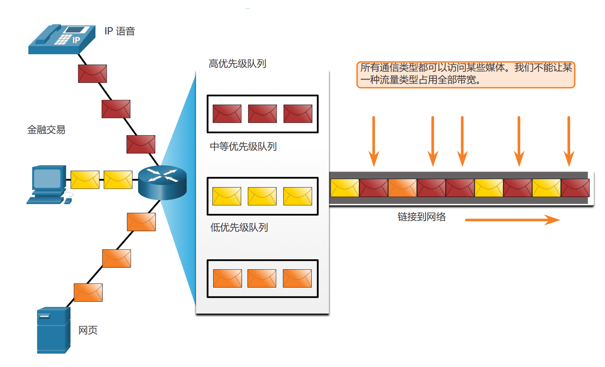

### 9.1.3 带宽、延迟和抖动

带宽
: 一秒内传输的位数表示，bps

拥塞：示例

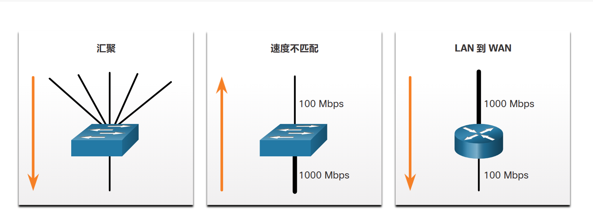

会发生拥塞的地方适合部署 QoS

延迟
: 包括固定延迟和可变延迟。固定延迟例如一个 bit 放到传输介质上所花费的时间；可变延迟由设备要处理的流量多少决定

抖动
: 接收数据包的延迟的变化

### 9.1.4 丢包

在发生拥塞时，可能发生丢包

播放延迟缓冲器补偿抖动：

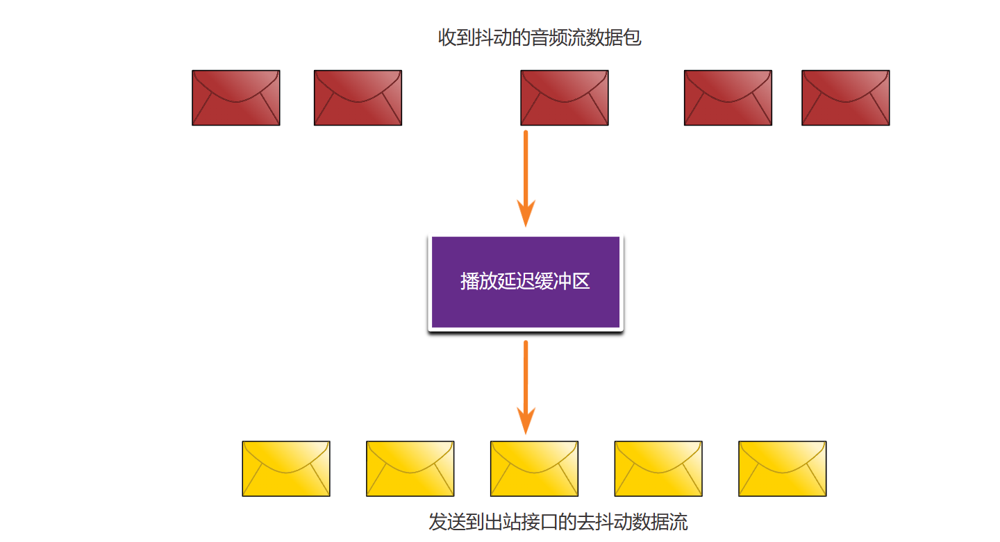

## 9.2 流量特征

### 9.2.3 语音

<table class="table table--bordered table--compressed table--wrap" style="width: 525px;"><thead><tr><th style="width: 225px;">语音流量特征</th><th style="width: 300px;">单向要求</th></tr></thead><tbody><tr><td><ul><li><mark>平稳</mark></li><li>良性</li><li>丢弃敏感</li><li>延迟敏感</li><li>UDP 优先级</li></ul></td><td colspan="2"><ul><li>延迟 ≤ 150毫秒</li><li>抖动 ≤ 30 毫秒</li><li>丢包 ≤ 1% 带宽（30-128 Kbps）</li></ul></td></tr></tbody></table>

### 9.2.4 视频

<table class="table table--bordered table--compressed table--wrap" style="width: 525px;"><thead><tr><th style="width: 225px;">视频流量特征</th><th style="width: 300px;">单向要求</th></tr></thead><tbody><tr><td><ul><li><mark>突发</mark></li><li>恶性</li><li>丢弃敏感</li><li>延迟敏感</li><li>UDP 优先级</li></ul></td><td colspan="2"><ul><li>延迟 ≤ 200-400 毫秒</li><li>延迟 ≤ 30-50 毫秒</li><li>丢包 ≤ 0.1<strong>-</strong>1%</li><li>带宽 (384 Kbps &gt; 20 Mbps)</li></ul></td></tr></tbody></table>

### 9.2.5 数据

<table class="table table--bordered table--compressed table--wrap" style="width: 225px;"><thead><tr><th style="width: 225px;">数据流量特征</th></tr></thead><tbody><tr><td><ul><li>平稳/突发</li><li>良性/恶性</li><li>丢弃不敏感</li><li>延迟不敏感</li><li>TCP 重传</li></ul></td></tr></tbody></table>

可能会消耗大部分网络容量

### 小测

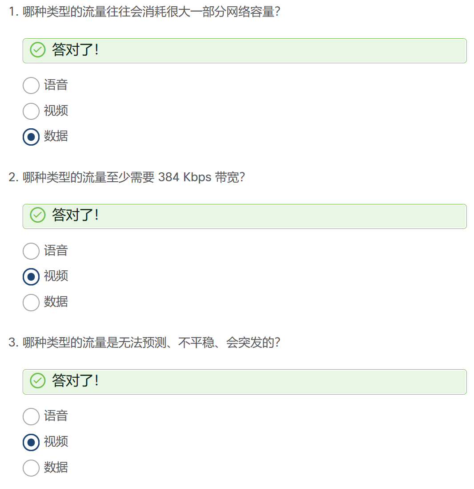

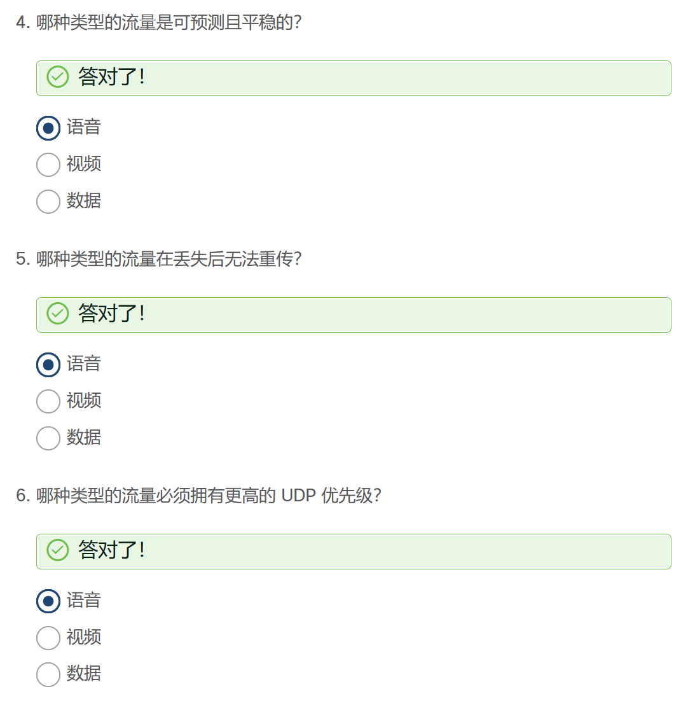

## 9.3 队列算法

队列算法用于实现 QoS

### 9.3.3 先进先出 FIFO

First In First Out

略

### 9.3.4 加权公平队列 WFQ

Weighted Fair Queuing

根据数据包报头编址（源和目的 IP 地址、MAC 地址、端口号、协议和服务类型 [ToS] 值等特征）将流量分为不同的流。IP 报头中的 ToS 值可用于分类流量。

### 9.3.5 基于类的加权公平队列 CBWFQ

Class Based Weighted Fair Queuing

相比 WFQ 新增了用户自定义匹配类别的支持

### 9.3.6 低延迟队列 LLQ

Low Latency Queue

在 CBWFQ 的基础上添加了一个“严格优先级队列”（PQ），属于是最最优先的流量

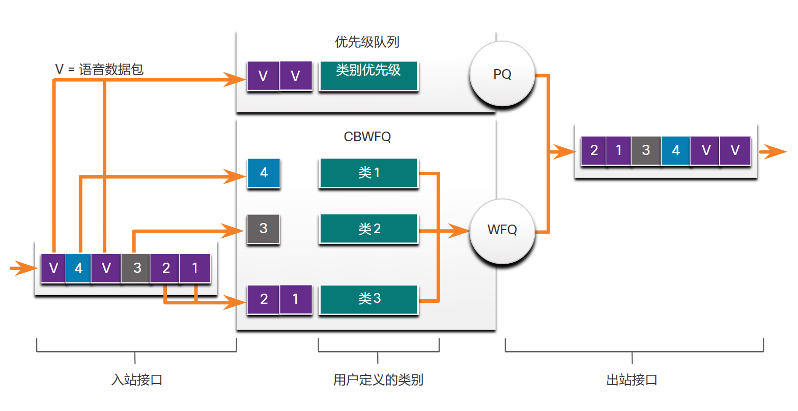

## 9.4 QoS 模型

<table class="table table--bordered table--compressed table--wrap table--nostripes" style="width: 800px;"><thead><tr><th style="width: 250px;"><strong>型号</strong>       </th><th style="width: 550px;"><strong>描述</strong>       </th></tr></thead><tbody><tr><td>尽力而为模型</td><td><ul><li> 它并不是真正的 QoS 部署， 也无需明确配置。</li><li>在不需要实施 QoS 时使用的就是它。</li></ul></td></tr><tr><td>集成服务 (IntServ)</td><td><ul><li> IntServ 为 IP 数据包提供了非常高的 QoS 传输保证。</li><li> 它为应用定义了一个信令过程，以信令的方式告诉 网络它们在一段时间内需要特殊的 QoS， 应该为它们预留带宽。</li><li> 但 IntServ 模型严重限制了网络的可扩展性。</li></ul></td></tr><tr><td>差分服务 (DiffServ)</td><td><ul><li> DiffServ 在 QoS 的实施中提供了高可扩展性和灵活性。</li><li> 网络设备会对流量进行分类识别， 并为不同的流量类别提供不同 级别的 QoS 服务。</li></ul></td></tr></tbody></table>

### 9.4.3 尽力而为 best-effort

没有特殊的 QoS 的传输的时候，就是“尽力而为”

<table class="table table--bordered table--compressed table--wrap table--nostripes" style="width: 800px;"><thead><tr><th style="width: 400px;"><strong>优点 </strong>       </th><th style="width: 400px;"><strong>缺点</strong>       </th></tr></thead><tbody><tr><td>该模型是最具可扩展性的。</td><td><mark>没有传输保证。</mark></td></tr><tr><td> 可扩展性仅受限于可用带宽，在这种情况下， 所有流量都会受到相同的影响。</td><td> 如果数据包最终能够到达的话，它们可以随时以任何顺序 到达。</td></tr><tr><td>无需特殊 QoS 机制。</td><td>没有任何数据包会被优先处理。</td></tr><tr><td>这是部署最简单和最快的模型。</td><td><mark>关键数据包和普通邮件的处理是一样的。</mark></td></tr></tbody></table>

### 9.4.4 集成服务 IntServ

Integrated Services。ppt 上叫综合服务

概括：使用 [RSVP (Resource Reservation Protocol)](https://en.wikipedia.org/wiki/Resource_Reservation_Protocol) 来请求和预留资源

<table class="table table--bordered table--compressed table--wrap table--nostripes" style="width: 800px;"><thead><tr><th style="width: 400px;"><strong>优势</strong>       </th><th style="width: 400px;"><strong>缺点</strong>       </th></tr></thead><tbody><tr><td><ul><li>主动执行端到端资源准入控制</li><li>针对每个请求执行策略准入控制</li><li>以信令的方式识别动态端口号</li></ul></td><td><ul><li> 为了执行连续信令需要状态化架构， 这<mark>需要消耗大量资源</mark></li><li> 基于流的分类方法不能扩展到大型实施中，比如 互联网。</li></ul></td></tr></tbody></table>

### 9.4.5 差分服务 DiffServ

Differentiated Services

概括：给 packet 打上标签，表明希望获得什么服务。由路由器和交换机来根据标签进行调度

<table class="table table--bordered table--compressed table--wrap" style="width: 800px;"><thead><tr><th style="width: 300px;"><strong>优势</strong></th><th style="width: 500px;"><strong>缺点</strong></th></tr></thead><tbody><tr><td><ul><li>高度可扩展</li><li>提供了多种不同的质量级别</li></ul></td><td><ul><li>无法绝对保证服务质量</li><li>需要一套复杂的机制才能在网络中协同工作</li></ul></td></tr></tbody></table>

总之没那么精准，但是胜在可拓展性强

## 9.5 QoS 实施技术

### 9.5.3 QoS 工具

<table class="table table--bordered table--compressed table--wrap table--nostripes" style="width: 800px;"><thead><tr><th style="width: 225px;"><strong>QoS 工具</strong>       </th><th style="width: 575px;"><strong>描述</strong>       </th></tr></thead><tbody><tr><td>分类和标记工具</td><td><ul><li> 对会话或流进行分析，从而确定它们所属的流量类别。</li><li>在确定了流量类别后，对数据包进行标记。</li></ul></td></tr><tr><td>拥塞避免工具</td><td><ul><li> 按照 QoS 策略的定义，把网络资源分组到不同的流量类中。</li><li> QoS 策略中可能还会标识出哪些流量可能会被有选择地 丢弃、延迟，或重新标记，来避免拥塞。</li><li> 最主要的拥塞避免工具是 WRED，它会以种高效利用带宽的方式来调节 TCP 数据流量，避免队列溢出导致的尾部丢弃。</li></ul></td></tr><tr><td>拥塞管理工具</td><td><ul><li> 当流量的规模超出了可用的网络资源时，流量会开始排队来等待可用资源。</li><li> 常见的思科 IOS 拥塞管理工具包括 CBWFQ 和 LLQ 算法。</li></ul></td></tr></tbody></table>

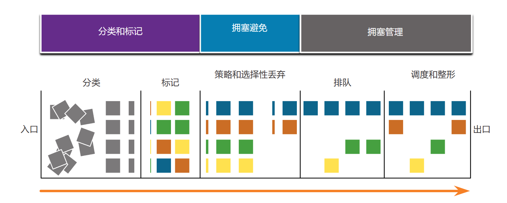

### 9.5.4 分类和标记

<table class="table table--bordered table--compressed table--wrap table--nostripes" style="width: 650px;"><thead><tr><th style="width: 200px;"><strong>QoS 工具</strong>       </th><th style="width: 50px;"><strong>层 </strong>       </th><th style="width: 300px;"><strong>标记字段 </strong>       </th><th style="width: 100px;"><strong>位宽 </strong>       </th></tr></thead><tbody><tr><td>以太网（802.1Q、802.1p）</td><td>2</td><td>服务等级 (CoS)</td><td>3</td></tr><tr><td>802.11 (Wi-Fi)</td><td>2</td><td>Wi-Fi 流量标识符 (TID)</td><td>3</td></tr><tr><td>MPLS</td><td>2</td><td>实验 (EXP)</td><td>3</td></tr><tr><td>IPv4 和 IPv6</td><td>3</td><td>IP 优先权 (IPP)</td><td>3</td></tr><tr><td>IPv4 和 IPv6</td><td>3</td><td>差分服务代码点 (DSCP)</td><td>6</td></tr></tbody></table>

可以看到既有第2层的实现，也有第3层的实现

#### 9.5.4.1 DSCP

DSCP 的值分为三类：

- **尽力而为** (BE) - 所有 IP 数据包的默认值。DSCP 值为 0。每跳行为是正常路由。当路由器遇到拥塞时，将丢弃这些数据包。尚未实施 QoS 计划。
- **加速转发** (EF) - RFC 3246 将 EF 定义为 DSCP 的十进制值 46(binary 101 110). 前 3 位 (101) 直接映射至用于语音流量的第 2 层 CoS 值 5。在第 3 层，思科建议只使用 EF 标记语音数据包。
- **保证转发** (AF) - RFC 2597 中定义 AF 使用 DSCP 中的 5 个最高有效位，以此来表示队列和丢弃优先级

而 AF 的定义如下：

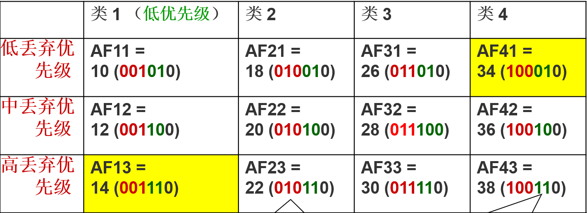

### 9.5.11 拥塞避免

加权随机早期探测 WRED

降低负载，防患于未然（也防止TCP全局同步）

## 测试

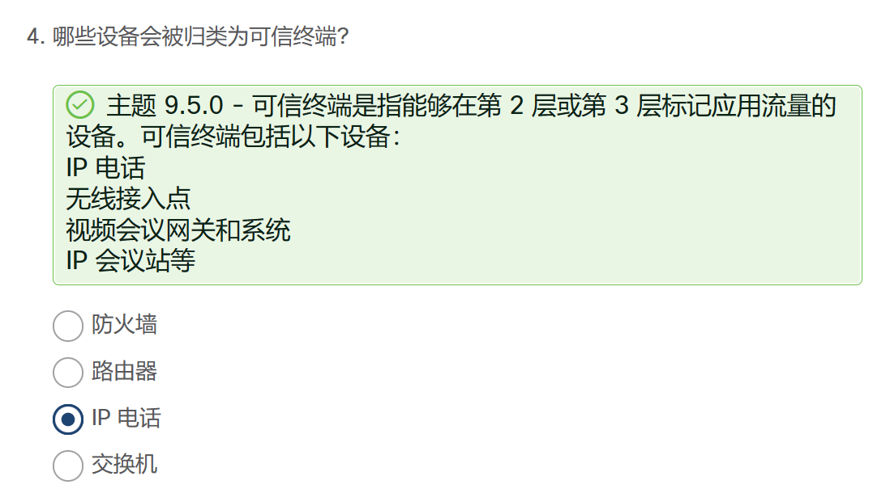

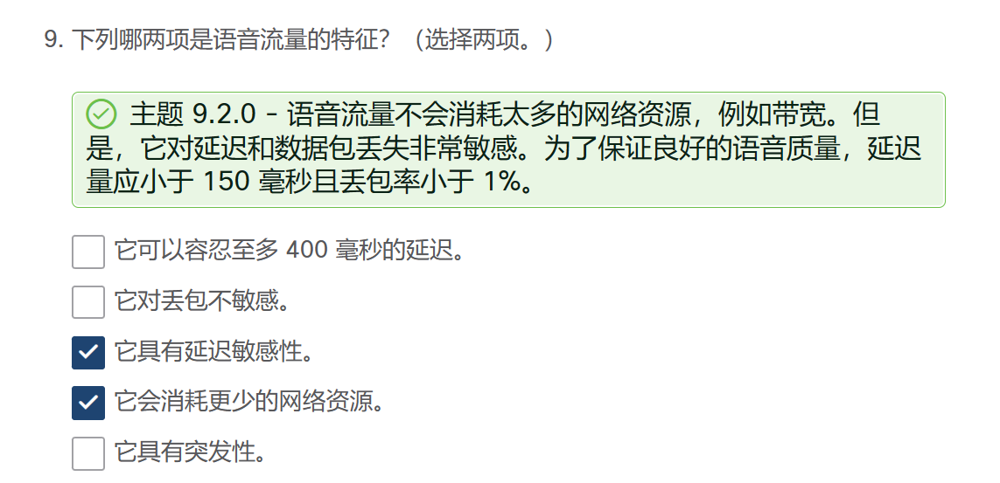

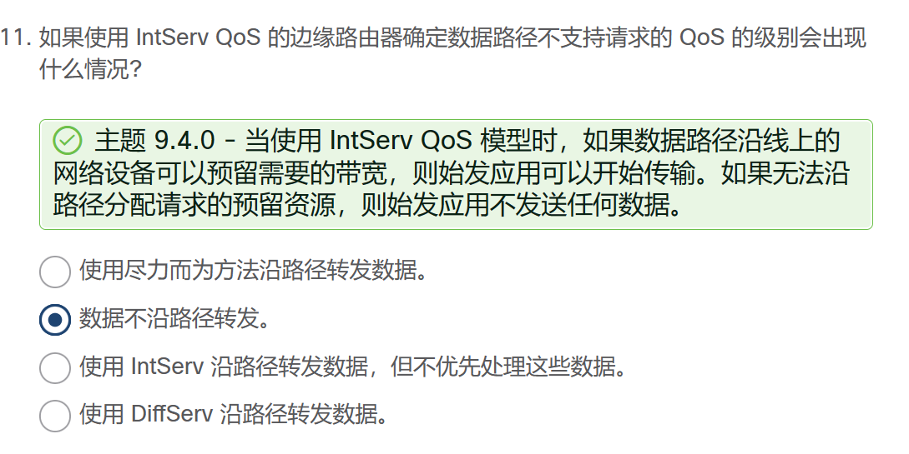

