# 1. Information Retrieval 

## 1.1 IR Task

Information Retrieval
: Depends on similarity between the records and the queries

还包含下列特点：

- **unstructured data**: 相较之下，数据库研究的是结构化的数据
- **statistical regularities**: 不关心数据的实际含义。相较之下，NLP 挖掘无结构数据的含义

---

|Information Retrieval|Data Retrieval|
|---|---|
|relevant things|all things satisfy clearly defined conditions|

说白了就是 IR 没有明确的标准，而 DR 有明确的标准，类似 SQL

---

简易的 IR 流程：

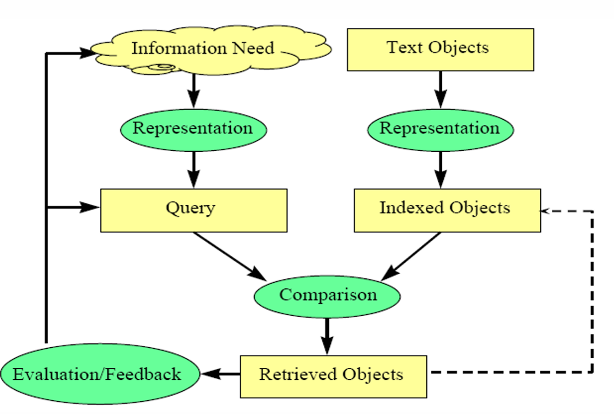

## 1.2 Retrieval Model

Vector Space Model
: Everything is a vector in a high-dimensional space

一个文档/请求可以表示成向量：

$$
d_j=(w_{1j},w_{2j},...,w_{tj})
$$

其中每一项表示的是文档中的一项 (term)，每一项都一个权重（其实我觉得更像是坐标）

通过这种表达方式，每个文档/请求都可以表示成一个向量：

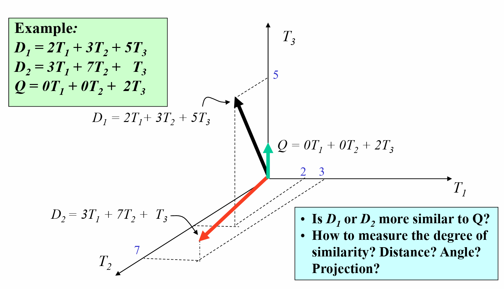

---

既然一个文档的表示方式我们已经知道了，那么要是有一堆文档呢？

$$
\begin{bmatrix}
& T_1 & T_2 & \dots & T_l \\
D_1 & w_{11} & w_{21} & \dots & w_{l1} \\
D_2 & w_{12} & w_{22} & \dots & w_{l2} \\
\vdots & \vdots & \vdots & \ddots & \vdots \\
D_n & w_{1n} & w_{2n} & \dots & w_{ln}
\end{bmatrix}
$$

就会变成如上的 **term-document** matrix

---

那么怎么确定每一项的权重呢？比较常用的是：

tf-idf weighting
: tf: term frequency (词频)；idf: inverse document frequency (逆向文件频率)

$$
w_ij = tf_{ij} × idf_i = tf_{ij} × log(N/df_i)
$$

说人话：在单个文件里高频出现的词会有很高的权重

query vector 一般也会被当作很短的 document 来处理

---

得到了向量后，我们就可以进行 document 和 query 之间相似度的计算了

最典的当然是 cosine 相似度

$$
sim(d_i, d_j) = (W_i · W_j^T) / (||W_i|| * ||W_j||)
$$

---

Vector Space Model 的优劣：

- 优点：
    - simple
    - partial matching and ranked results
    - efficient implementation for large document

- 缺点

    - missing semantic information
    - ...

## 1.3 Indexing 

为了能够更加高效地查询，我们可以把文档先提前建立数据结构，然后定期更新就行

比方说原本的文档构成长这样：

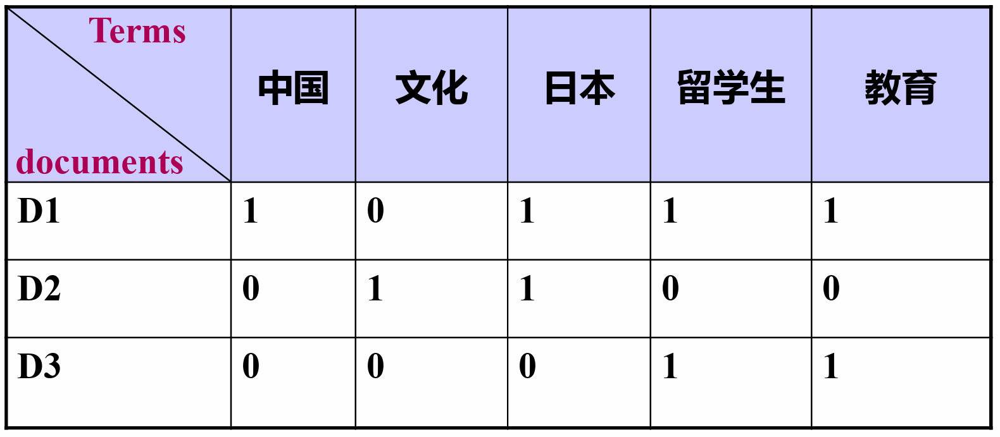

一种常见的做法是构建 **Inverted Index**。因为一个词一般只会在个别文档里出现，我们就只需要查询个别文档：

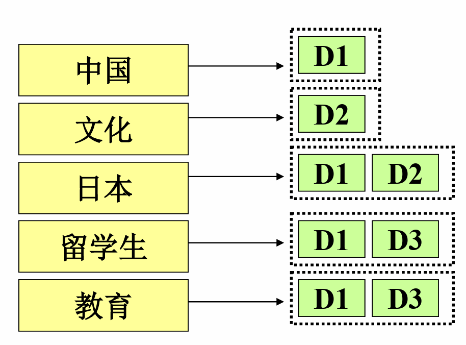

我们可以构建出 **Inverted Files**：

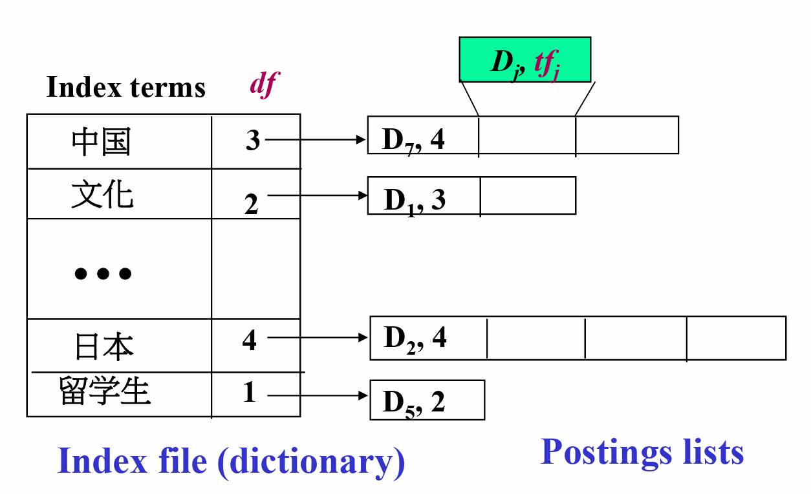

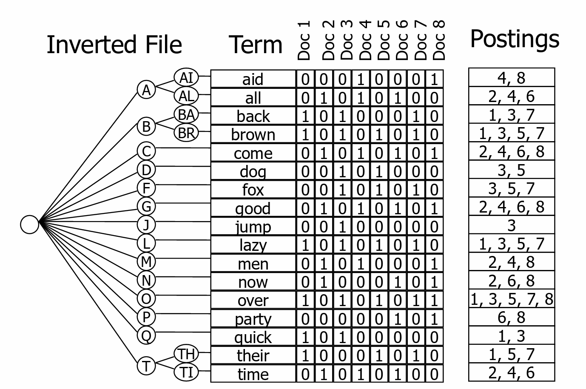

比如这样子构建：

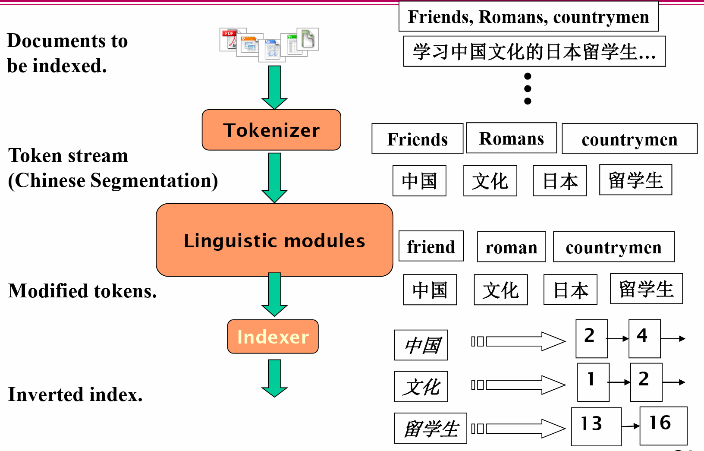

---

你可能已经发现了，最后的 posting files 里面究竟都可能记录着什么东西呢？

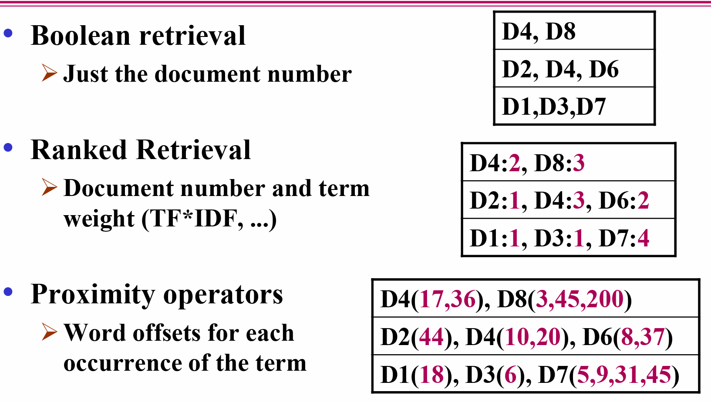

三种常见的构建方式

---

最后说一下对于 inverted files 来说常见的 query 方式：

- **Boolean Query**

    先由 primitive keyword 根据 inverted index 提取出相关的文档，然后用逻辑运算符：

    - **OR**: $e_1$ 和 $e_2$ 的并集
    - **AND**: $e_1$ 和 $e_2$ 的交集
    - **BUT**: $e_1$ 和 $e_2$ 的差别

        e.g., ($e_1$ $\text{BUT}$ $e_2$) -> satisfy $e_1$ but not $e_2$

- **Phrasal Query**

    就是用个别短词来进行查询，需要 posting files 中包含词的位置信息

    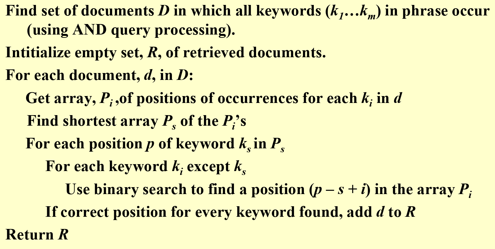

    说人话就是所有词都出现，而且顺序正确

## 1.4 Evaluation

为了衡量各种指标的性能，我们可以用一种维恩图的思想：

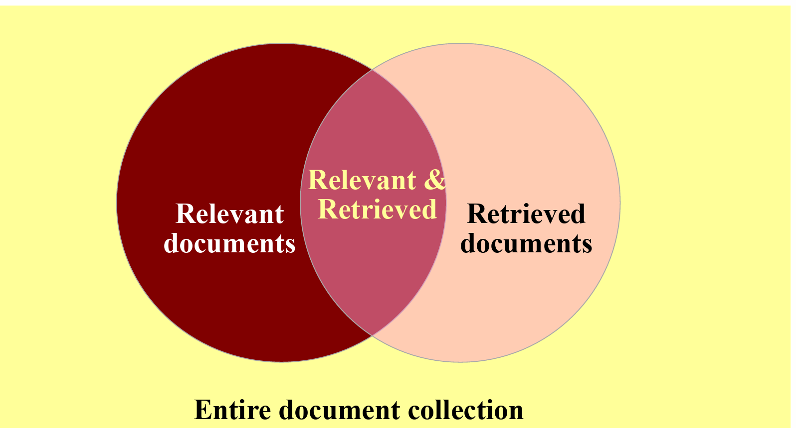

衡量 relevant 和 retrieved

这就不得不提两个衡量的指标了：

Precision
: 查准率。找到的文献里有多少是相关的。在搜索场景中合适

$$
\text{Precision}=\frac{\text{Relevant Retrieved} }{\text{Retrieved} }
$$

Recall
: 查全率。相关的文献有多少比例被找到了。在法律、医疗等场景中合适

$$
\text{Recall}=\frac{\text{Relevant Retrieved} }{\text{Relevant} }
$$

一般来说两个指标之间是负相关的关系：

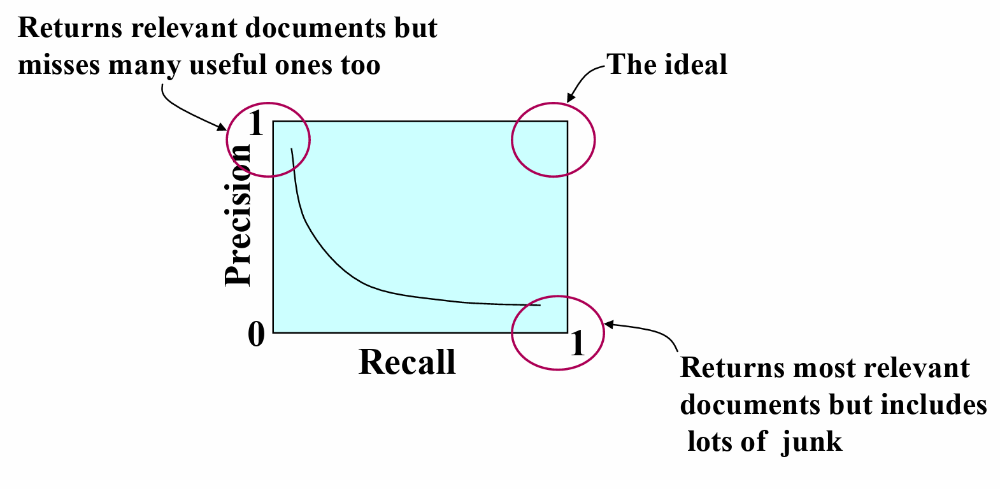

我们一般会试图把这个 **recall-precision 的关系曲线**画出来，来对模型进行全面的衡量。绘制的方法就是调整每次 retrieve 的文档数量，一般来说随着文档数量的增大，recall 会增大，然后 precision 会降低

e.g.

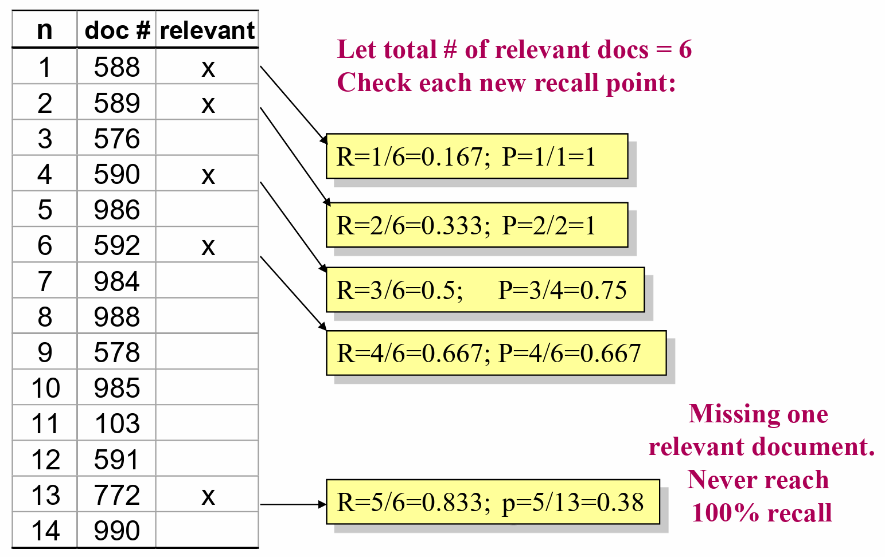

中间空缺的部分就直接线性填补

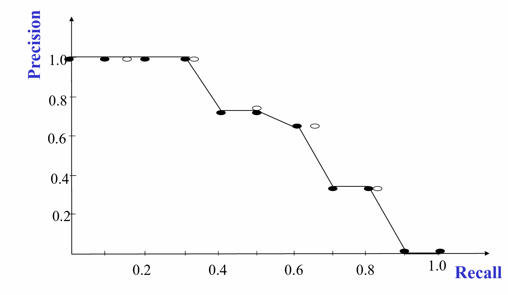

要比较不同的模型的时候，整体上曲线靠近右上角的模型更优

---

有时候也不一定一个曲线就一定比另一个曲线看起来更好，这种时候如何更精确的计算？这就需要：

Mean Average Precision (MAP)
: mean of average precision for many queries

e.g.,

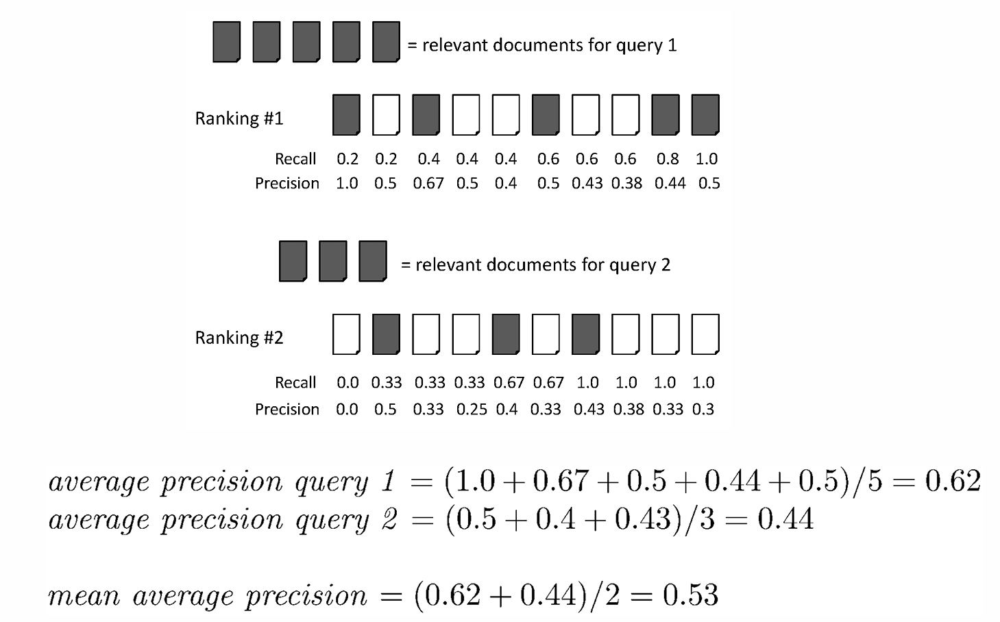

---

除了 MAP 之外，还有很多别的指标：

R-Precision
: precision at the R-th position in the ranking of results for a query that has R relevant documents

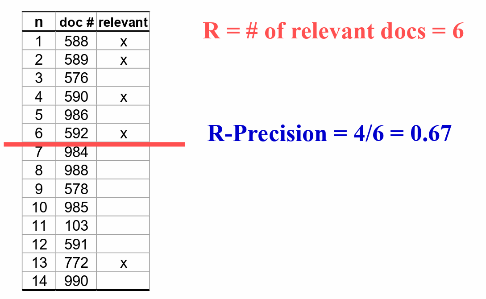

Precision@N
: Mean precision at a fixed number of documents

互联网搜索经常用 10 或者 20

Mean Reciprocal Rank (MRR)
: mean of the reciprocal ranks over all the topics

正确答案序号的倒数。对于排位非常敏感

Discounted Cumulative Gain (DCG)
: graded relevance as gain

强调提取高相关度的结果，如搜索引擎

除此之外还有 Normalized DCG，懒得写了

