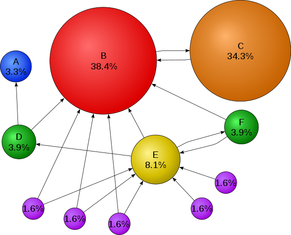

# 2. Link Analysis

## 2.1 Web Graph

略

## 2.2 Link Analysis Algorithms

### 2.2.1 PageRank

参考 [wiki](https://en.wikipedia.org/wiki/PageRank)

说白了就是基于以下假设：

> more important websites are likely to receive more links from other websites

输入越多，就越重要：

具体要计算的话：

$$
PR(u)=(1-d) + d\sum_{v\in B_u}\frac{PR(v)}{L(v)}
$$

其中 $PR$ 就是 PageRank 缩写，$d$ 是 Damping factor（一般取 0.85），$u$ 是 page，$v$ 是指向了 $u$ 的 page，而 $L(v)$ 则是 page $v$ 向外的链接个数

### 2.2.2 HITS Model

Hypertext Induced Topic Selection

大体上的假设是
