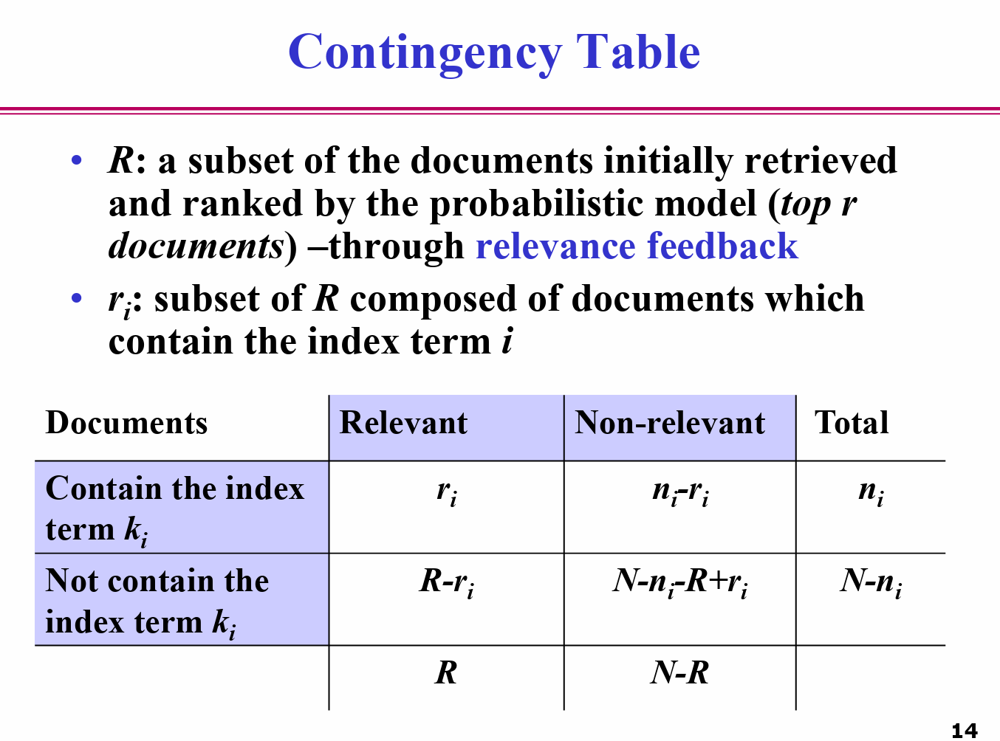
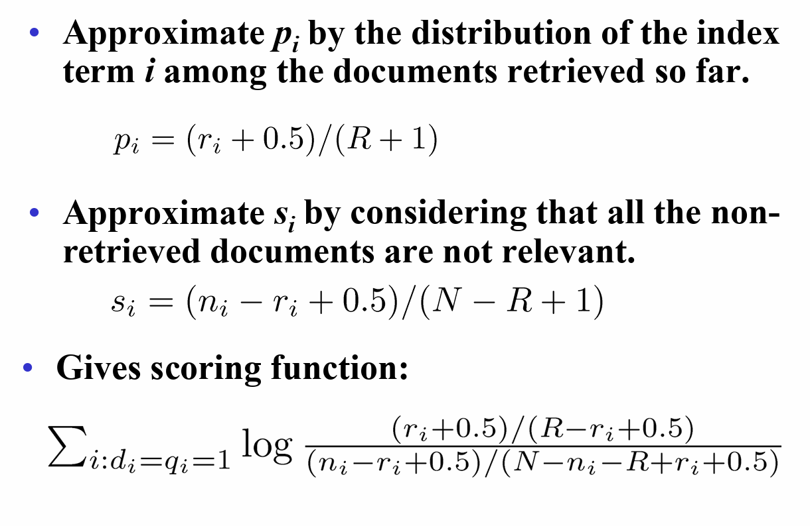
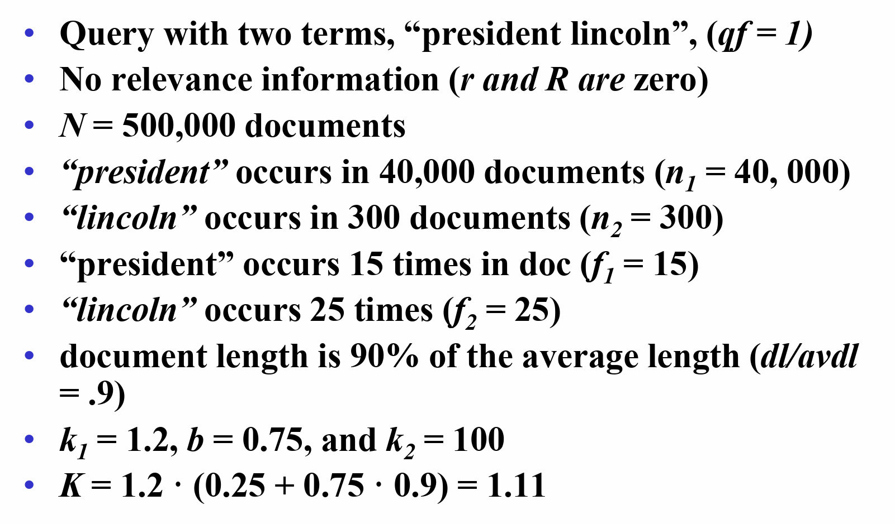
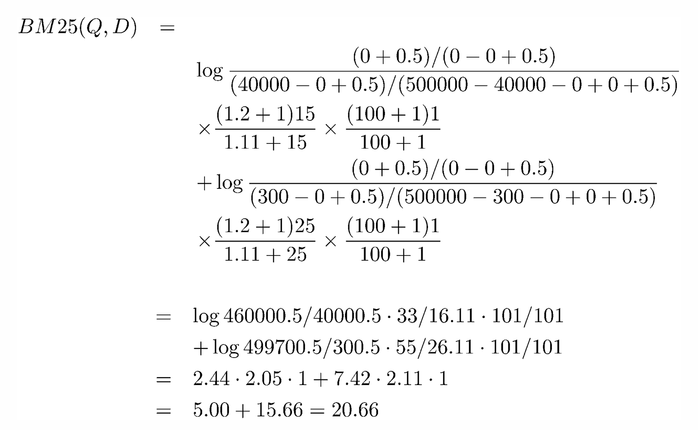
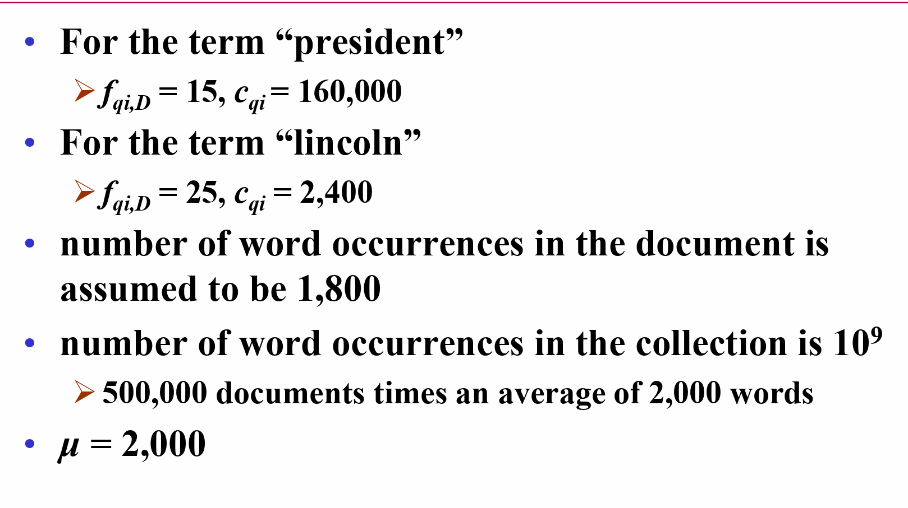
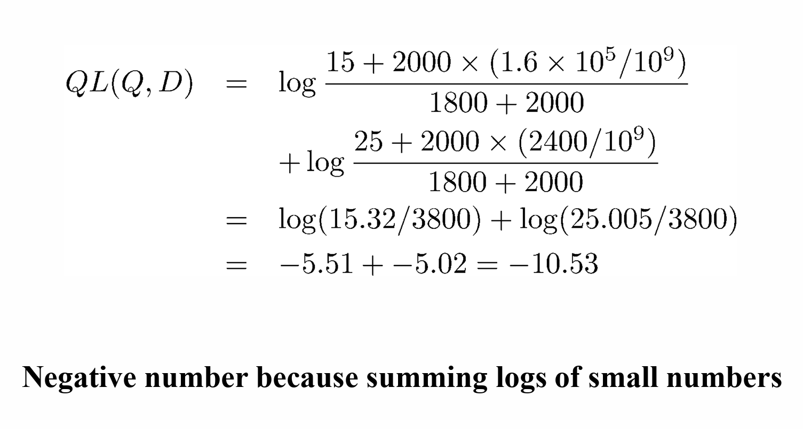

# 3. Language Models

## 3.1 Probabilistic Model

把文档的提取看成是概率问题

$$
\text{sim}(D,q)=\frac{P(R|D)}{P(NR|D)}
$$

其中 $R$ 是 relevant documents，$NR$ 是 non-relevant

根据贝叶斯定理，上面的式子可以近似改成：

$$
\text{sim}(D,q)\approx \frac{P(D|R)}{P(D|NR)}
$$

---

我们来考虑下简单的情况，即特征只有 occurrence 或者 non-occurrence 两种情况，且每个特征之间相互独立：

$$
\frac{P(D\vert R)}{P(D\vert N R)}\ =\ \prod_{i:d_{i}=1}\ \frac{p_{i} }{s_{i} }\cdot\ \prod_{i:d_{i}=0}\ \frac{1-p_{i} }{1-s_{i} }
$$

其中 $p_i$ 是 $i$ 在相关文档中出现的概率，$s_i$ 是在不相关文档中出现的概率

出于我看不懂的原因，反正最后 scoring function 变成：

$$
\sum_{i:d_i=1}=\log \frac{p_i(1-s_i)}{s_i(1-p_i)}
$$

---

给了个我觉得和上面完全没关系的例子：

虽然不知道为什么 $p_i$ 不是 $r_i/R$，但是假如解释成抽下一个的概率的话又很合理

### 3.1.1 BM25

BM25 算法在上面那个例子的基础上加入了文档和请求的权重

$$
\sum_{i\in Q} \log \frac{(r_i+0.5)/(R-r_i+0.5)}{(n_i-r_i+0.5)/(N-n_i-R+r_i+0.5)} \cdot \frac{(k_1+1)f_i}{K+f_i}\cdot \frac{(k_2+1)qf_i}{k_2+qf_i}
$$

其中 $k_1,k_2$ 都是超参，$qf_i$ 是物品 $i$ 在 query 中的概率。$K=k_1((1-b)+b\cdot\frac{dl}{\text{avg}(dl)})$，$dl$ 为 doc length，$\text{avg}(dl)$ 是平均 doc length，$b$ 一般取 0.75jo

e.g.,

## 3.2 Language Model

预测下一个词

N-gram
: 就是 lookback windows 有 $N$ 个词

对于词出现概率的预测为：

$$
(1-\alpha_D)P(q_i|D)+\alpha_D P(q_i|C)
$$

其中 $\alpha_D$ 怎么设计有很多种方法。

比如 **Dirichlet Smoothing**:

$$
\alpha_D=\frac{\mu}{|D|+\mu}
$$

所以最终的 document score 就是：

$$
\sum_{i=1}^n \log \frac{f_{q_i,D}+\mu\frac{c_{q_i} }{|C|} }{|D|+\mu}
$$

Query Likelihood e.g., 

## 3.3 Topic Model

略。见作业 1 第 6 题

## 3.4 Neural Network Language Model

