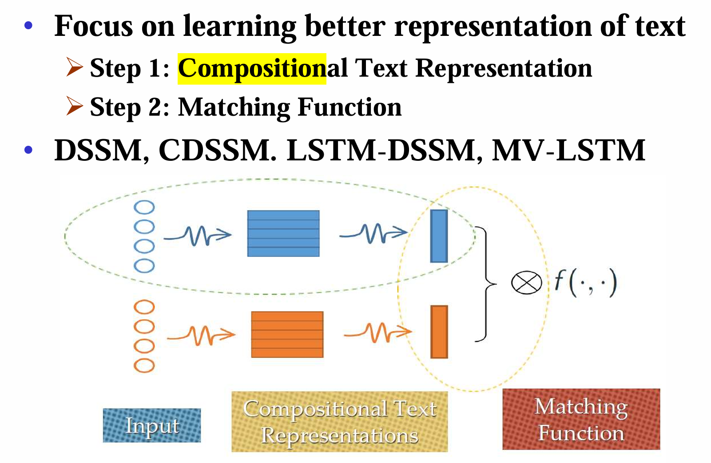
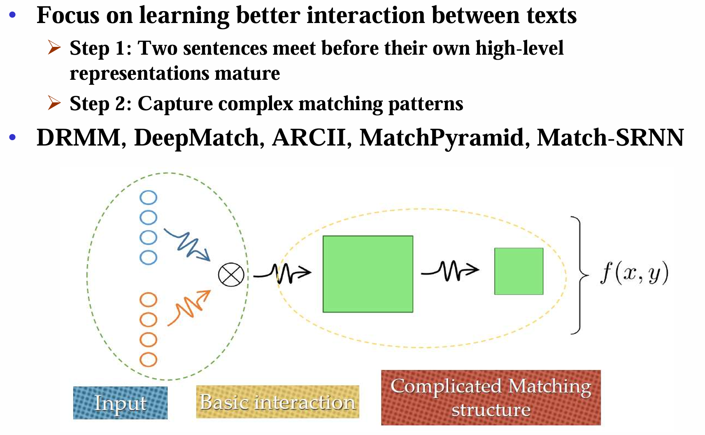

# 4. Neural IR

## 4.1 Learning to Rank

见作业 2 第 1 题，其实大体上可以分为三种不同的类：

- **Pointwise**
- **Pairwise**
- **Listwise**

### 4.1.1 Ranking SVM

### 4.1.2 RankNet

### 4.1.3 LambdaMART

### 4.1.4 SetRank

## 4.2 Neural IR

### 4.2.1 Composition focused VS Interaction focused

见作业 2 第 3 题

第一个译为“双塔模型”，第二个译为“单塔模型”

composition 注重于学习文本表达：

interaction 注重于学习交互：

### 4.2.2 Word2Vec & Golve

见作业 2 第 2 题

思想上都是把 word 表示成 embedding

Word2Vec 有两种变体：

- **CBOW** (Continuous bag-of-words)

    从上下文中推导词汇

    一般配合 softmax 使用
- **Skip-gram**

    从词汇推导上下文

    一般配合 negative sampling 使用（我感觉这东西有点像对比学习的思路，把样本同时出现视为正样本，其它为负样本）

---

GloVe (Global Vectors for Word) 主要是构建全局的 ratio of co-occurrence probability matrix（是两个概率的 ratio，不是直接用概率）

### 4.2.3 GLM, DSSM, Convolutional DSSM, DRMM

