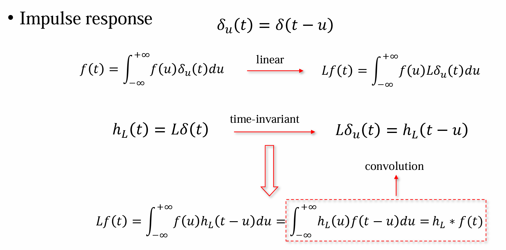

# 3. Image Fundamental

## Convolution

见这个[解释](https://betterexplained.com/articles/intuitive-convolution/)

假如是二维的卷积的话，卷积核也要横竖翻转两次，选取一个作为锚点

标志性的卷积核：

- **Laplacian filter**: detects sudden intensity transitions in the image and highlights the edges
- **Mean filter**: a simple, intuitive and easy to implement method of smoothing images

### Linear time-invariant

见 [wiki](https://en.wikipedia.org/wiki/Linear_time-invariant_system#Continuous-time_systems) 的解释。大概意思是说，一个 linear 且 time-invariant 的系统是可以用卷积来进行描述的

考试似乎会考如何推导，所以这里把两个概念都记录下：

Linearity
: means that the relationship between the input $x(t)$ and the output $y(t)$, both being regarded as functions, is a linear mapping: if $a$ is a constant then the system output to $ax(t)$ is $ay(t)$; if $x'(t)$ is a further input with system output $y'(t)$ then the output of the system to $x(t)+x'(t)$ is $y(t)+y'(t)$

Time invariance
: means that whether we apply an input to the system now or $T$ seconds from now, the output will be identical. e.g., if the output due to input $x(t)$ is $y(t)$, then the output due to input $x(t-T)$ is $y(t-T)$. Hence, the system is time invariant because the output does not depend on the particular time the input is applied.

总之推导过程如下：（背就完事了）

