# 4. Basic Image Operations

## Point Operators

### Basic point operations

基本点运算

搞了半天就是加一个增益 $k$ 和一个偏移量 $l$：

$$
\mathbf{N}_{x,y}=k\times \mathbf{O}_{x,y}+l
$$

### Histogram

直方图的操作有几种：

- **normalization**

    说人话就是让直方图分布均匀一些（拉对比度

    $$
    \mathbf{N}_{x,y}=\frac{\mathbf{N}_\text{max}-\mathbf{N}_{\text{min} }}{\mathbf{O}_\text{max}-\mathbf{O}_\text{min} }\times (\mathbf{O}_{x,y}-\mathbf{O}_\text{min})+\mathbf{N}_\text{min}
    $$

    其实还挺好懂的，就是把值给等比放大了

    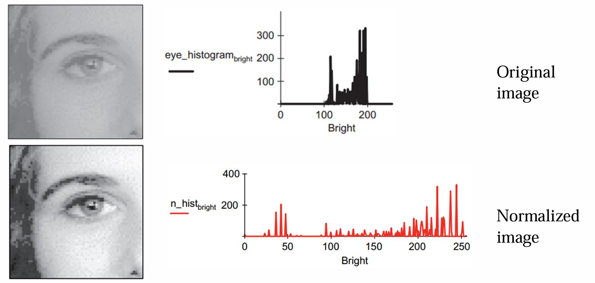
- **equalization**

    虽然和 normalization 一样都是提高对比度，但是这个是非线性的，也不可逆

    离散的情况下的例子：

    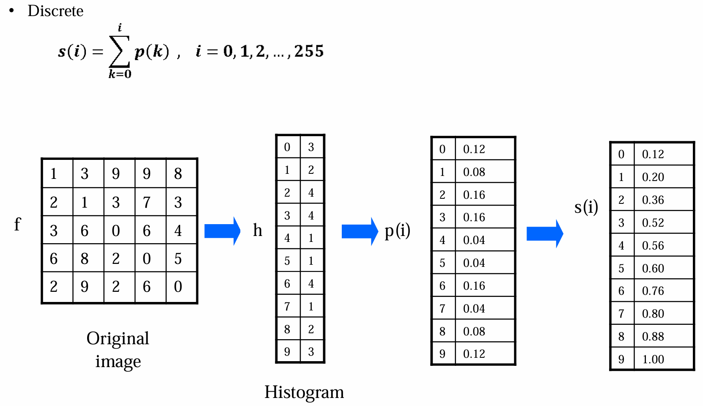

    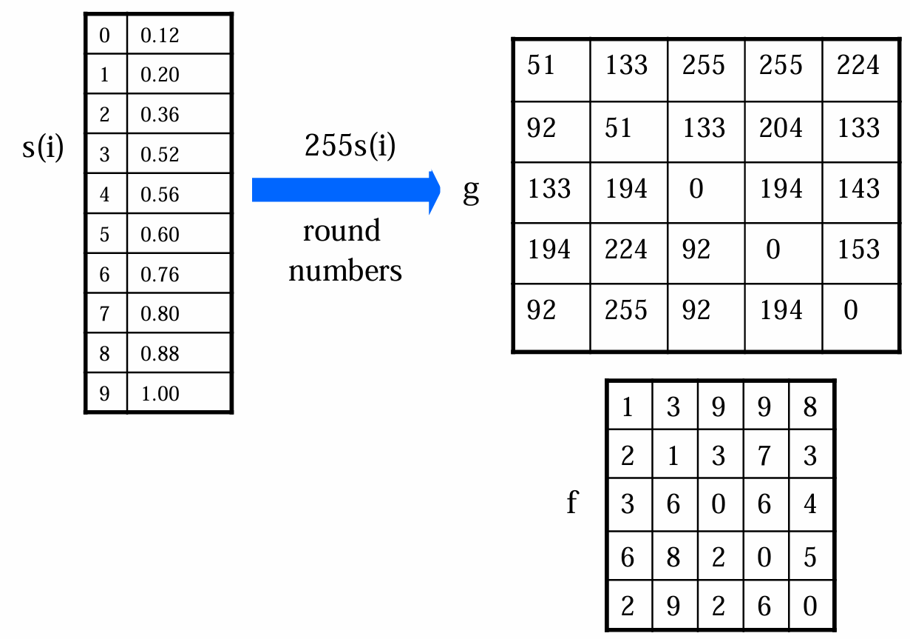

    所以 $p(i)$ 是某个亮度出现的概率，$s(i)$ 是累积的概率，最终结果 $g$ 是由累积的概率乘上 255 得到

    > 所以这个和 normalization 的区别是，那个是根据亮度值的比例来调整，这个是根据亮度出现的概率调整

- **specification**

    这个比较奇特。大概是指定一个希望得到的 histogram，然后把一张现有的图片转换过去

    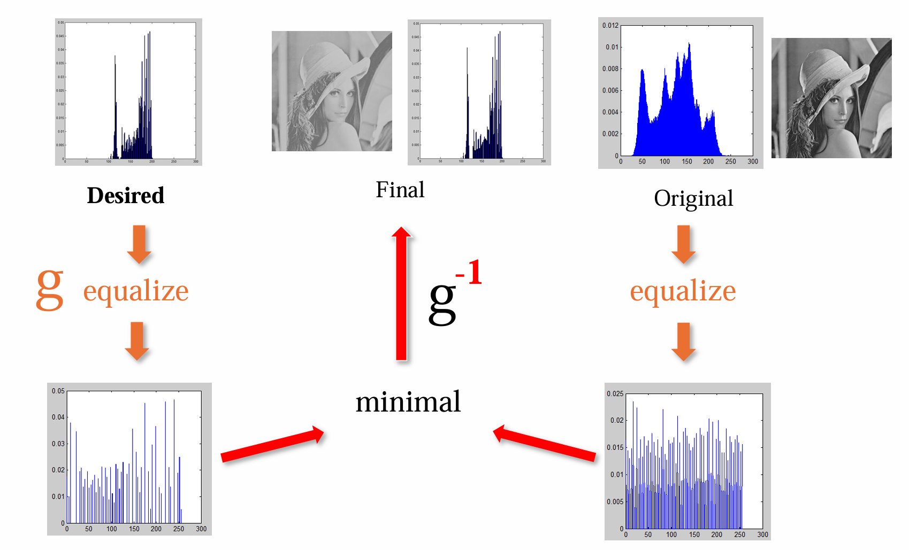

    这里的 minimal 指的应该是匹配最近的那个累积亮度

    e.g.,

    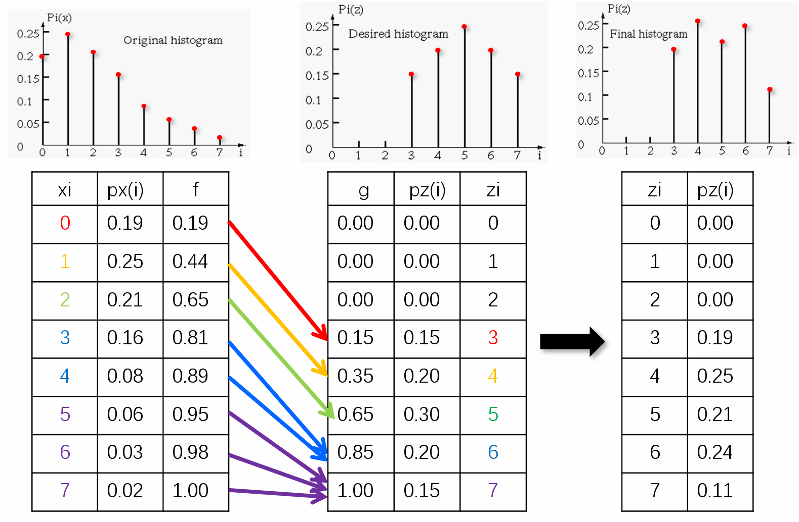

    可以看到原本的 histogram 的亮度区间是被匹配到的目标 histogram 最接近的那个区间，然后替换掉了那个区间的值

### Thresholding

比如二值化

有个 adaptive thresholding，懒得看了

## Image Noise

高斯和椒盐噪声。略

## Group Operations

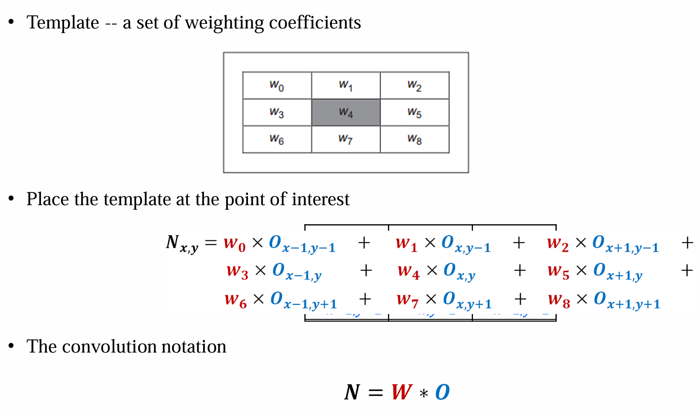

就是卷积

特殊卷积就很多了：

- **Averaging Operator**

    $$
    \begin{bmatrix}
    1/9 & 1/9 & 1/9 \\
    1/9 & 1/9 & 1/9 \\
    1/9 & 1/9 & 1/9 
    \end{bmatrix}
    $$

    - 优点：减少噪声
    - 缺点：糊了

    卷积核越大越糊

- **Gaussian Averaging Operator**

    $$
    g(x,y,\sigma)=\frac{1}{2\pi\sigma^2}e^{-(\frac{x^2+y^2}{2\sigma^2})}
    $$

    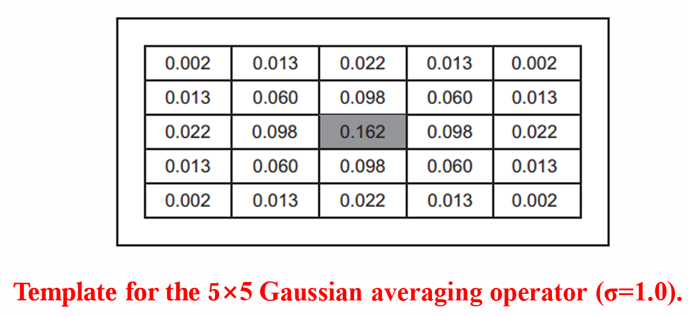

    相较之下没那么糊

- **Mean Filter**

    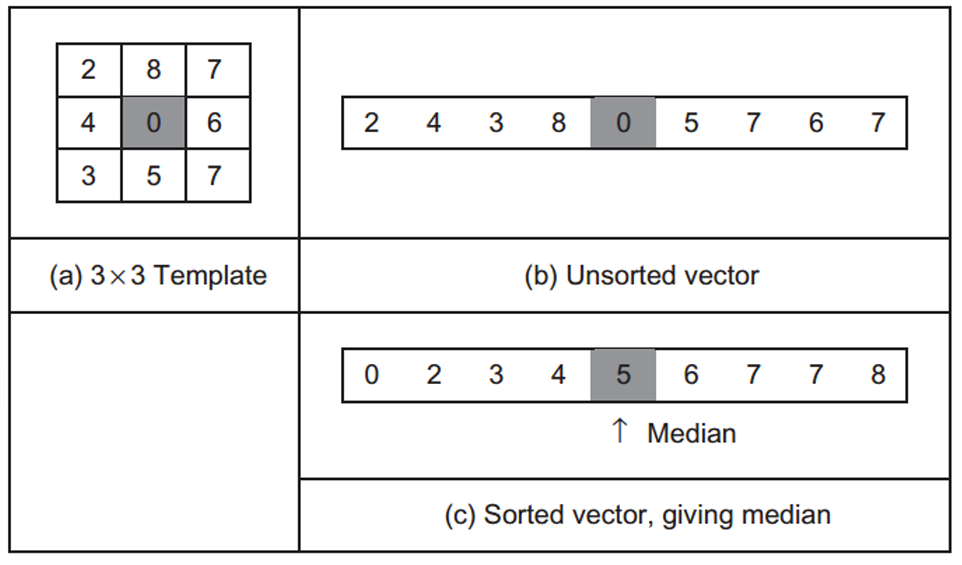

    就是取所有值里面的中值

    能够去除 salt pepper noise。而且保留边缘

    应用方面，甚至可以去除前景：

    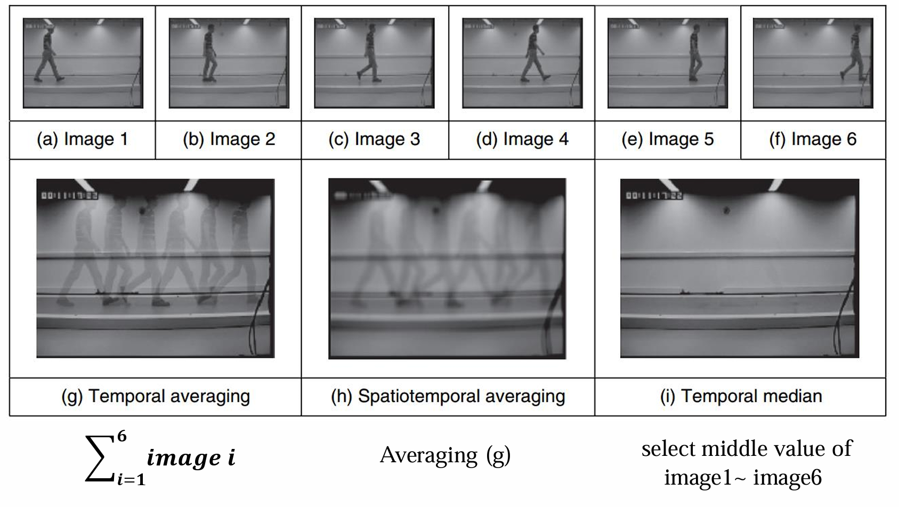

- **Mode Filter**

    用出现频率最高的值做填充

- **Truncated Median Filter**

    先裁掉一部分，再算中值

    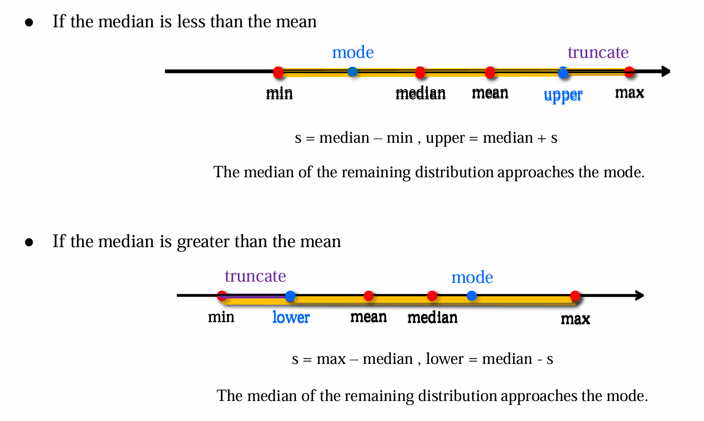

    也能够去掉 salt 和 pepper noise，还可以保留 feature boundaries

总结：

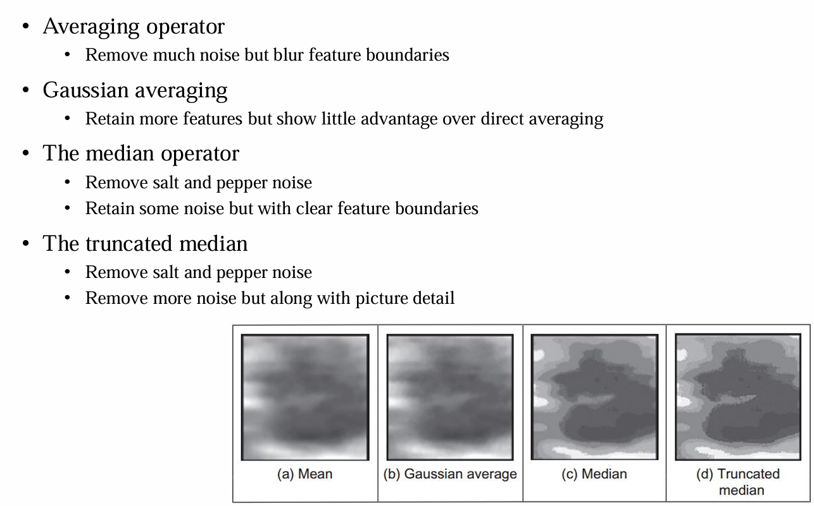

