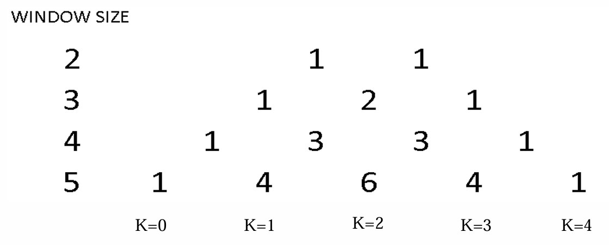
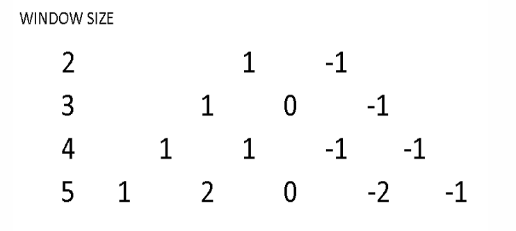
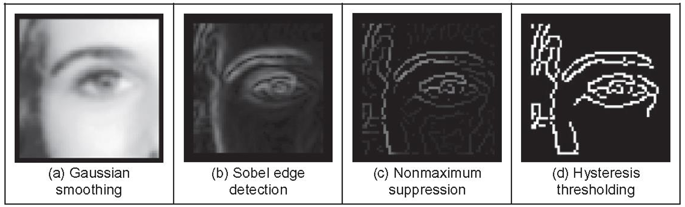
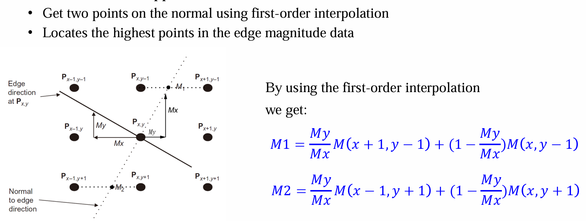

# 5. Low-Level Feature Extraction

其实通篇都在介绍 edge detector

## 5.1. First-order edge-detection operators

仔细想想的话，其实边缘检测就是计算一下相邻的像素值之间的差异

### 5.1.1. Prewitt edge-detection operators

对于 x 轴横向的检测：

$$
M_x=
\begin{bmatrix}
1 & 0 & -1 \\
1 & 0 & -1 \\
1 & 0 & -1
\end{bmatrix}
$$

对于 y 轴纵向的检测：

$$
M_y=
\begin{bmatrix}
1 & 1 & 1 \\
0 & 0 & 0 \\
-1 & -1 & -1
\end{bmatrix}
$$

所以两个的结果的均方和再开方就是最终结果

### 5.1.2. Sobel edge-detection operator

相比于上一种，实际上就是中间的值变大了一点：

$$
M_x=
\begin{bmatrix}
1 & 0 & -1 \\
2 & 0 & -2 \\
1 & 0 & -1
\end{bmatrix}
$$

$$
M_y=
\begin{bmatrix}
1 & 2 & 1 \\
0 & 0 & 0 \\
-1 & -2 & -1
\end{bmatrix}
$$

实际上这只是 window size(WS)=3 的情况。假如扩展到所有情况下的话，第 $k$ 位的表达式如下：

$$
\text{Smooth}_k=\frac{(\text{WS}-1)!}{(\text{WS}-1-k)!k!}
$$

算出来的结果就会有这样的规律：

由此矩阵运算得到了一些更奇怪的矩阵，叫 differencing coefficients：

我感觉意思是对于一个倒三角形状的三个值，原本矩阵的右上角减去左上角的值等于最终矩阵下面位置的值

总而言之，最终计算的时候就还是正常的二维卷积

### 5.1.3 Canny edge detector

实际上这个算法包含了一系列的操作，见[wiki](https://en.wikipedia.org/wiki/Canny_edge_detector)：

我们重点来关注下 **Nonmaximum suppression** 是咋回事。通过各种一阶的边缘检测算法，我们实际上得到了两个矩阵，沿着 x 方向的 $M_x$ 和 沿着 y 方向的 $M_y$。这俩玩意实际上决定了某一点的边缘的方向，即 $\theta=\arctan (M_y, M_x)$

大概的做法就是沿着边缘的法线方向得到两个交点，然后把当前值和这俩交点的值进行比较。==假如当前点的值小于任意其中之一，则把当前点设成 0。否则认为当前点就是最大值==

---

最后的一步是 hysteresis thresholding。我们在前面的步骤中其实得到了一些 strong edge pixels 和一些 weak edge pixels。我们现在想要确定这些 weak 的是不是真的边缘。

想法其实非常简单，就是假定真正的边缘是连续的。所以，只要一个 weak 的周围 8 格有 strong 的存在，那么就认定这个是真的边缘，否则不是

## 5.2 Second-order edge-detection operators

最简单的是拉普拉斯算子：

$$
\begin{bmatrix}
0 & -1 & 0 \\
-1 & 4 & -1 \\
0 & -1 & 0
\end{bmatrix}
$$

> 推导过程见 review ppt 的 P86

### 5.2.1 Marr-Hildreth operator

实际上 Canny 的效果一般比这个好

根据 [wiki](https://en.wikipedia.org/wiki/Marr%E2%80%93Hildreth_algorithm)，这玩意的计算主要过程是：

> convolving the image with the Laplacian (就是**二阶导**) of the **Gaussian function**, or, as a fast approximation by difference of Gaussians. Then, **zero crossings** (与 x 轴的交点) are detected in the filtered result to obtain the edges

具体表达式略

