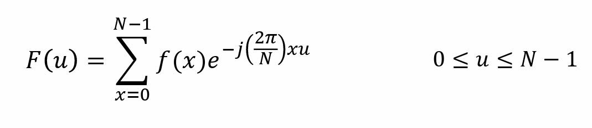
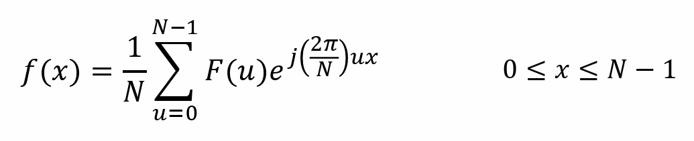
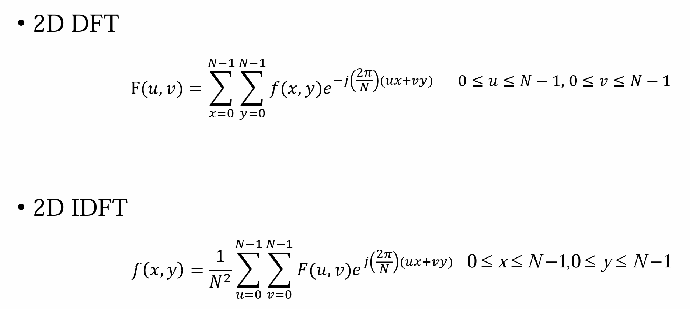

# 6. Fourier Analysis

## 6.1 Common forms of the Fourier series

见[wiki](https://en.wikipedia.org/wiki/Fourier_series)

傅里叶级数有许多种不同但是等价的表达形式。这里记原始的函数为 $s(x)$，经由傅里叶级数表达的函数为 $s_N(x)$

定义 period $P$，则波长为 $\frac{P}{n}$，频率为 $\frac{n}{P}$

### 6.1.1 amplitude-phase form

$$
\displaystyle s_{_{N} }(x)=D_{0}+\sum _{n=1}^{N}D_{n}\cos \left(2\pi {\tfrac {n}{P} }x-\varphi _{n}\right)
$$

### 6.1.2 sine-cosine form

$$
\displaystyle s_{_{N} }(x)=A_{0}+\sum _{n=1}^{N}\left(A_{n}\cos \left(2\pi {\tfrac {n}{P} }x\right)+B_{n}\sin \left(2\pi {\tfrac {n}{P} }x\right)\right)
$$

其中：

$$
\begin{aligned}
A_{0}&={\frac {1}{P} }\int _{P}s(x)\,dx\\
A_{n}&={\frac {2}{P} }\int _{P}s(x)\cos \left(2\pi {\tfrac {n}{P} }x\right)\,dx\qquad {\text{for } }n\geq 1\qquad \\
B_{n}&={\frac {2}{P} }\int _{P}s(x)\sin \left(2\pi {\tfrac {n}{P} }x\right)dx,\qquad {\text{for } }n\geq 1
\end{aligned}
$$

这里面 $\int_p$ 指代的是在一个指定如 $[-P/2,P/2]$ 之类的区间上进行积分。在 ppt 上，$P=2\pi$ 简化了上面的表达式

### 6.1.3 exponential form

$$
\displaystyle s_{_{N} }(x)=\sum _{n=-N}^{N}C_{n}\ e^{i2\pi {\tfrac {n}{P} }x}
$$

其中，傅里叶系数 $C_n$ 为：

$$
\displaystyle C_{n}={\frac {1}{P} }\int _{P}s(x)e^{-i2\pi {\tfrac {n}{P} }x}\,dx;\quad \forall \ n\in \mathbb {Z} \,
$$

总之 $P=2\pi$ 的时候也会化简一些

## 6.2 Fourier transform

见 [wiki](https://en.wikipedia.org/wiki/Fourier_transform)

$$
{\widehat {f} }(\xi )=\int _{-\infty }^{\infty }f(x)\ e^{-i2\pi \xi x}\,dx.
$$

其中 $\frac{n}{P}\rightarrow \xi$，总之表示的是频率。ppt 里的标记是角速度 $\omega=2\pi \xi$

至于逆傅里叶变换则是：

$$
f(x)=\int _{-\infty }^{\infty }{\widehat {f} }(\xi )\ e^{i2\pi \xi x}\,d\xi ,\quad \forall \ x\in \mathbb {R} .
$$

可以看到正向有负号，逆向无负号

### 6.3 Discrete Fourier transform

感觉主要是积分变成了求和，以及指数上多了个 $1/N$

反向：

还有二维的版本：

